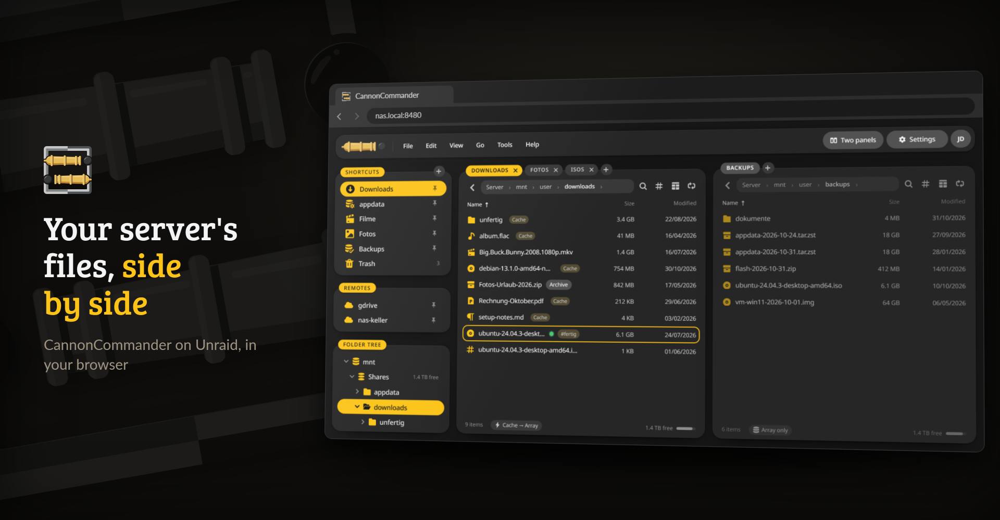
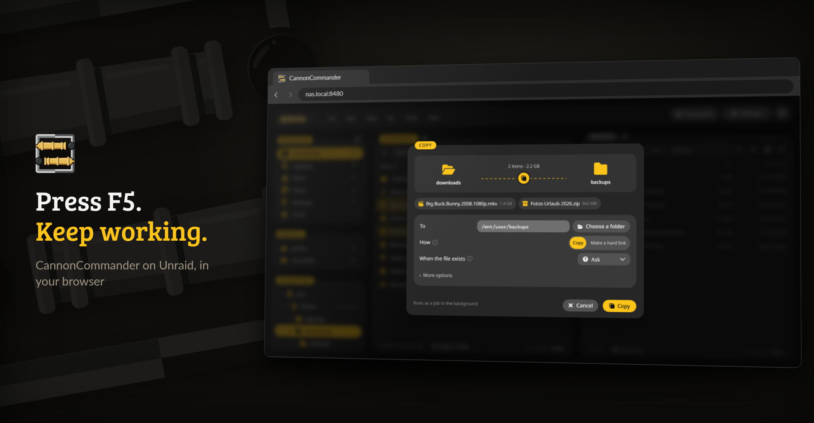
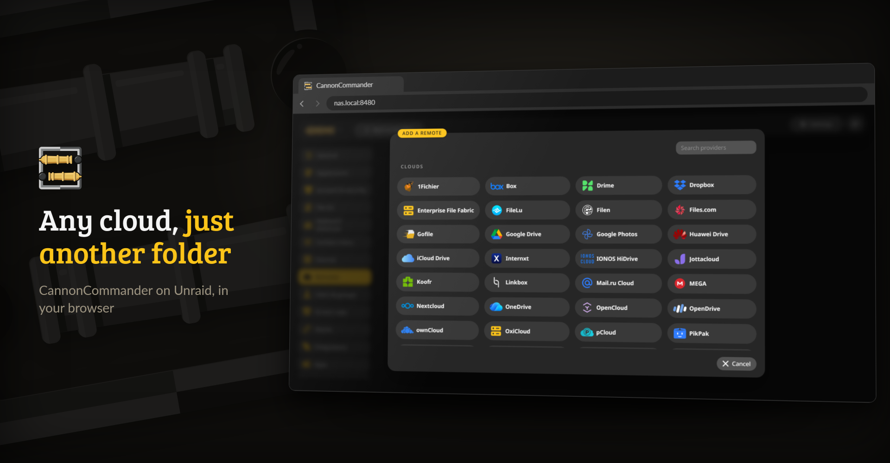
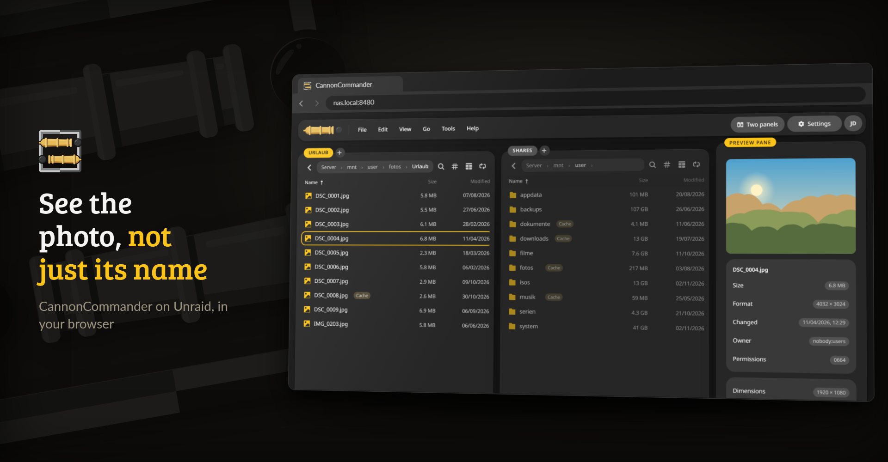
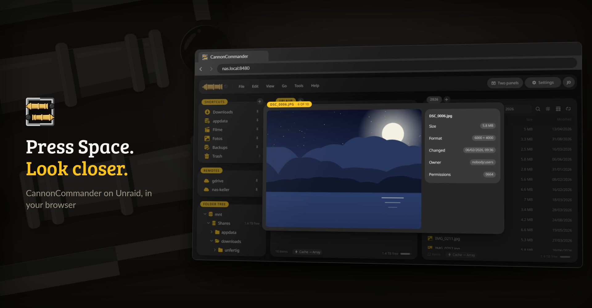
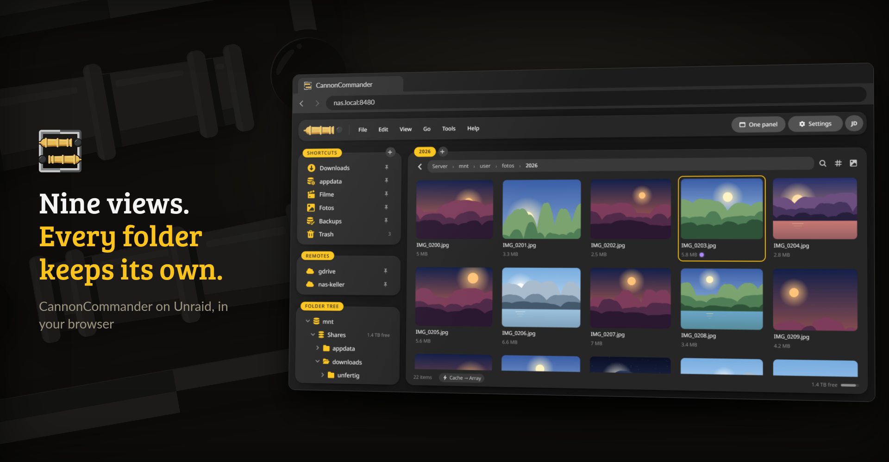
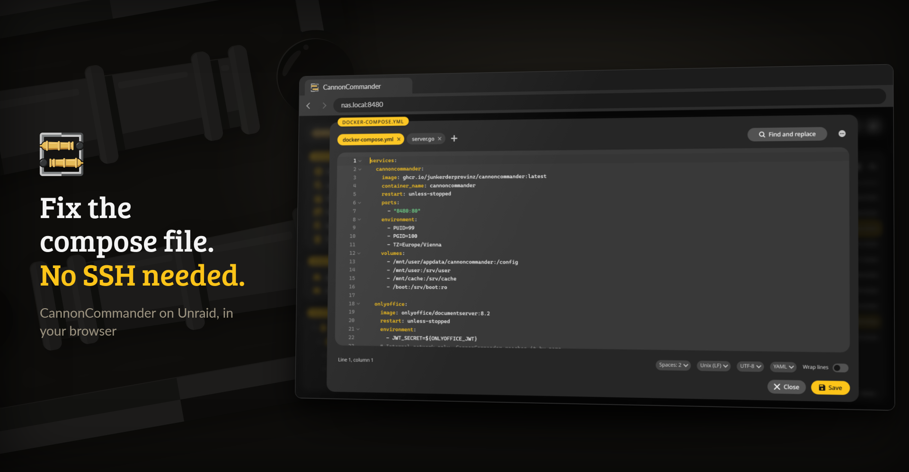
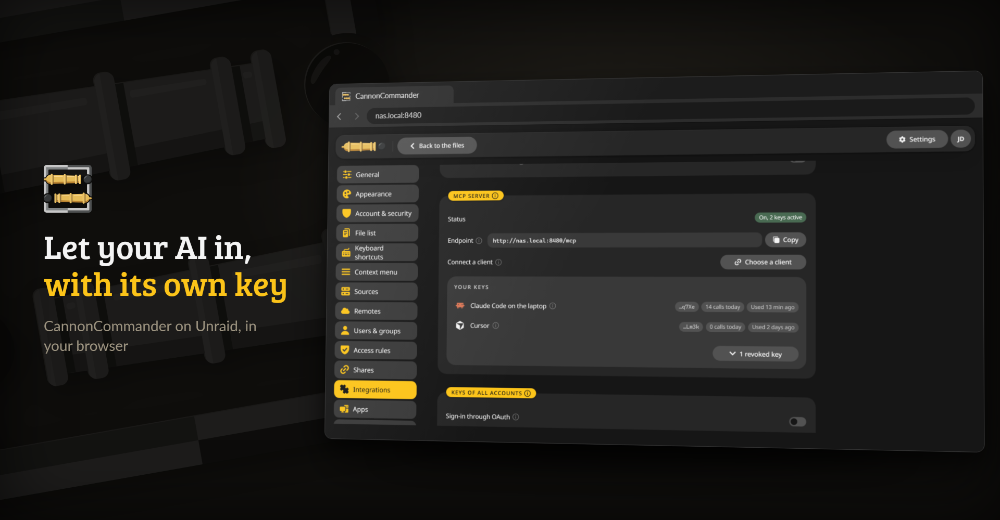
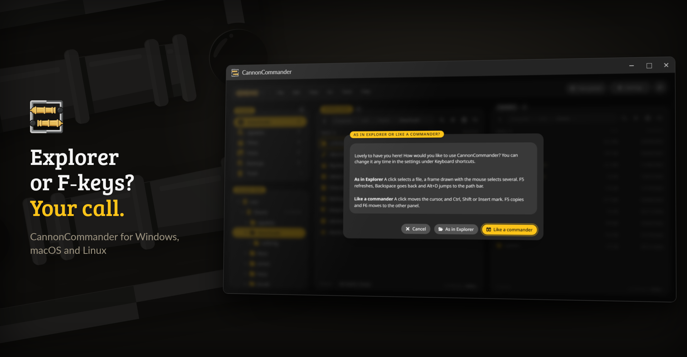

<p align="center">
  <picture>
    <source media="(prefers-color-scheme: dark)" srcset="https://raw.githubusercontent.com/junkerderprovinz/cannoncommander/main/.github/assets/cannoncommander-banner-dark.png">
    
  </picture>
</p>

<p align="center">
  <a href="https://github.com/junkerderprovinz/cannoncommander/actions/workflows/test.yml"></a>&nbsp;
  <a href="https://github.com/junkerderprovinz/cannoncommander/actions/workflows/container.yml"></a>&nbsp;
  <a href="https://hub.docker.com/r/junkerderprovinz/cannoncommander"></a>&nbsp;
  <a href="https://hub.docker.com/r/junkerderprovinz/cannoncommander"></a>&nbsp;
  <a href="https://github.com/junkerderprovinz/cannoncommander/pkgs/container/cannoncommander"></a>&nbsp;
  <a href="https://vuejs.org"></a>&nbsp;
  <a href="https://rclone.org"></a>&nbsp;
  <a href="https://unraid.net"></a>&nbsp;
  <a href="LICENSE"></a>
</p>

<br>

<p align="center">
<b>The most beautiful file manager you will ever run. Also the only one you need.</b><br>
<br>
Two panels, F5 to copy, and an interface so polished you will catch yourself tidying folders just to look at it. CannonCommander runs on your server in the browser and on your desk as an app for Windows, macOS and Linux. Copies fly off as jobs in the background, deletes land in a trash first, and on a NAS it even knows which disks are asleep before it wakes them.
</p>

<!-- docs-button: written by scripts/gen_download_buttons.py -->
<p align="center">
  <a href="https://junkerderprovinz.github.io/cannoncommander/"></a>
</p>
<!-- /docs-button -->

<br>

<p><a id="table-of-contents" href="#table-of-contents"><picture><source media="(prefers-color-scheme: dark)" srcset=".github/assets/sections/table-of-contents-dark.svg"></picture></a></p>

1. [Download](#1-download)
2. [Support](#2-support)
3. [What it looks like](#3-what-it-looks-like)
4. [What it does](#4-what-it-does)
5. [How it compares](#5-how-it-compares)
6. [Getting started](#6-getting-started)
7. [Configuration](#7-configuration)
8. [Security](#8-security)
9. [Building from source](#9-building-from-source)
10. [How AI is used here](#10-how-ai-is-used-here)

<br>

<p><a id="1-download" href="#1-download"><picture><source media="(prefers-color-scheme: dark)" srcset=".github/assets/sections/1-download-dark.svg"></picture></a></p>

<!-- download-buttons: written by scripts/gen_download_buttons.py -->
<p align="center">
  <picture><source media="(prefers-color-scheme: dark)" srcset=".github/assets/sections/group-server-dark.svg"></picture>
</p>
<p align="center">
  <a href="https://ca.unraid.net/apps?q=cannoncommander"></a>
  &nbsp;
  <a href="https://mos-official.net/apps.html?search=CannonCommander"></a>
  &nbsp;
  <a href="https://github.com/junkerderprovinz/zimaos-apps#cannoncommander"></a>
  &nbsp;
  <a href="https://github.com/junkerderprovinz/umbrel-apps#install"></a>
</p>
<p align="center">
  <a href="https://raw.githubusercontent.com/junkerderprovinz/cannoncommander/main/compose.yaml"></a>
  &nbsp;
  <a href="https://github.com/junkerderprovinz/cannoncommander/releases/latest"></a>
</p>
<br>
<p align="center">
  <picture><source media="(prefers-color-scheme: dark)" srcset=".github/assets/sections/group-desktop-dark.svg"></picture>
</p>
<p align="center">
  <a href="https://github.com/junkerderprovinz/cannoncommander/releases/latest/download/cannoncommander-windows-amd64-installer.exe"></a><a href="https://github.com/junkerderprovinz/cannoncommander/releases/latest/download/cannoncommander-windows-arm64-installer.exe"></a>
  &nbsp;
  <a href="https://github.com/junkerderprovinz/cannoncommander/releases/latest/download/cannoncommander-macos-universal.zip"></a>
  &nbsp;
  <a href="https://github.com/junkerderprovinz/cannoncommander/releases/latest/download/cannoncommander-linux-amd64-installer"></a><a href="https://github.com/junkerderprovinz/cannoncommander/releases/latest/download/cannoncommander-linux-arm64-installer"></a>
</p>
<p align="center">
  <a href="https://github.com/junkerderprovinz/cannoncommander/releases/latest/download/cannoncommander-linux-amd64.flatpak"></a><a href="https://github.com/junkerderprovinz/cannoncommander/releases/latest/download/cannoncommander-linux-arm64.flatpak"></a>
</p>
<!-- /download-buttons -->

<br>

<p><a id="2-support" href="#2-support"><picture><source media="(prefers-color-scheme: dark)" srcset=".github/assets/sections/2-support-dark.svg"></picture></a></p>

<p align="center">
A one-knight job: I build it, keep it running, work through the issues and add what people ask for, until nothing is missing. It is free, with no accounts, no telemetry, no ads and no paid tier. No asterisk anywhere. Nothing readable ever leaves your own walls. Forged on evenings and weekends, with heart and stubbornness.
</p>

<p align="center">
If it has earned a place on your server, toss a coin to your knight: it helps cover the costs and keeps the project alive. It also makes this knight's heart beat a little faster. Three ways below, whichever suits you.
</p>

<!-- give-buttons: written by scripts/gen_download_buttons.py -->
<p align="center">
  <a href="https://buymeacoffee.com/junkerderprovinz"></a>
  &nbsp;
  <a href="https://www.paypal.com/donate/?hosted_button_id=76FVV52TKXTUS"></a>
  &nbsp;
  <a href="https://junkerderprovinz.github.io/junkerderprovinz/"></a>
</p>
<!-- /give-buttons -->

<br>

<p><a id="3-what-it-looks-like" href="#3-what-it-looks-like"><picture><source media="(prefers-color-scheme: dark)" srcset=".github/assets/sections/3-what-it-looks-like-dark.svg"></picture></a></p>

The folders, files and keys in these pictures are made up. The [documentation](https://junkerderprovinz.github.io/cannoncommander/) has a picture for every step.

<p align="center">
  
  <br><em>Tabs in both panels, and badges for the files that still sit on the cache.</em>
</p>

<br>

<p align="center">
  
  <br><em>Copies run as jobs in the background, and a hard link saves the space where Unraid allows one.</em>
</p>

<br>

<p align="center">
  
  <br><em>Every provider rclone speaks, browsed like a share on the server.</em>
</p>

<br>

<p align="center">
  
  <br><em>The preview pane shows the file under the cursor, with the camera data of a photo.</em>
</p>

<br>

<p align="center">
  
  <br><em>Space opens a quick look at the file under the cursor, and the arrow keys walk through the folder.</em>
</p>

<br>

<p align="center">
  
  <br><em>Details, columns, tiles, a gallery and more, remembered per folder.</em>
</p>

<br>

<p align="center">
  
  <br><em>F4 opens the editor, with tabs, syntax colours and find and replace.</em>
</p>

<br>

<p align="center">
  
  <br><em>The built-in MCP server lets the AI assistants you already use work with your files, each through its own key.</em>
</p>

<br>

<p align="center">
  
  <br><em>The desktop app works on your own computer and asks once how you like to work.</em>
</p>

<br>

<p><a id="4-what-it-does" href="#4-what-it-does"><picture><source media="(prefers-color-scheme: dark)" srcset=".github/assets/sections/4-what-it-does-dark.svg"></picture></a></p>

- **Two panels and the keyboard.** Tabs, a menu bar, a command search on Ctrl+K and the keys the classic commanders taught your fingers: F3 views, F4 edits, F5 copies, F6 moves, F7 makes a folder, F8 deletes.
- **Jobs in the background.** Copies, moves and deletes run on the server with speed, time left, pause and a speed limit, and pick up again after a restart.
- **A trash and an undo**, so a wrong F8 costs nothing.
- **Unraid in view.** Cache and array, sleeping disks, the parity check, hard links and Unraid's own permissions.
- **Nine views**, 89 columns, quick look on the space bar and a preview pane.
- **Tools for the whole collection.** Search by name, field or content, folder compare and sync, duplicates, disk usage, batch rename, archives, checksums.
- **Remote storage** through rclone, **share links** with password and expiry, a **WebDAV** server.
- **People and rules.** Users, groups, access rules, two-factor sign-in, passkeys, API tokens and OIDC.
- **AI assistants, with your rights**, through the built-in MCP server.

Every feature with pictures and step-by-step guides: **[the documentation](https://junkerderprovinz.github.io/cannoncommander/)**.

<br>

<p><a id="5-how-it-compares" href="#5-how-it-compares"><picture><source media="(prefers-color-scheme: dark)" srcset=".github/assets/sections/5-how-it-compares-dark.svg"></picture></a></p>

CannonCommander started from the code of [FileBrowser Quantum](https://github.com/gtsteffaniak/filebrowser), which itself grew out of [File Browser](https://github.com/filebrowser/filebrowser). The rows come from the [comparison chart in Quantum's README](https://github.com/gtsteffaniak/filebrowser#comparison-chart), the ones under **Commander features** are our own. Every cell was checked against each tool's code and documentation on 12 November 2026: Quantum 2.0.2 and the 2.1 beta, File Browser 2.63.23 (its last release, the project was archived in September 2026), Filestash as of that day, Krusader 2.9.0 and Windows 11 24H2.

| | **CannonCommander** | [Quantum](https://github.com/gtsteffaniak/filebrowser) | [File Browser](https://github.com/filebrowser/filebrowser) | [Filestash](https://www.filestash.app) | [Krusader](https://krusader.org) | [Windows Explorer](https://support.microsoft.com/en-us/windows/file-explorer-in-windows-ef370130-1cca-9dc5-e0df-2f7416fe1cb1) |
|---|:---:|:---:|:---:|:---:|:---:|:---:|
| Filesystem support | ✅ | ✅ | ✅ | ✅ | ✅ | ✅ |
| Linux | ✅ | ✅ | ✅ | ✅ | ✅ | ❌ |
| Windows | ✅ desktop app | ✅ | ✅ | ❌ | ❌ | ✅ |
| Mac | ✅ desktop app | ✅ | ✅ | ❌ | ❌ | ❌ |
| Self hostable | ✅ | ✅ | ✅ | ✅ | ❌ | ❌ |
| Has stable release | ✅ | ✅ | ✅ final release, archived | ❌ rolling builds only | ✅ | ✅ |
| S3 support | ✅ | ❌ | ❌ | ✅ | ❌ | ❌ |
| WebDAV support | ✅ | ✅ | ❌ | ✅ | ✅ | ⚠️ as a network drive |
| FTP support | ✅ | ❌ | ❌ | ✅ | ✅ | ⚠️ as a network location |
| Dedicated docs site | ✅ [docs](https://junkerderprovinz.github.io/cannoncommander/) | ✅ | ❌ docs in the repository | ✅ | ✅ | ⚠️ support articles |
| Multiple sources at once | ✅ | ✅ | ❌ | ⚠️ combined view is paid | ✅ | ✅ |
| Docker image download | 107 MB (with ffmpeg, MuPDF, rclone and 7-Zip) | 63 MB (with ffmpeg) | 17 MB | 284 MB | desktop app | desktop app |
| Min. memory requirements | 128 MB (small share) | 256 MB | 128 MB | 128 MB | desktop app | desktop app |
| Has standalone binary | ⚠️ desktop app only | ✅ | ✅ | ⚠️ Linux only | ❌ | part of Windows |
| Price | free | free | free | free tier | free | included with Windows |
| Rich media preview | ✅ | ✅ | ✅ | ✅ | ⚠️ with KDE viewers | ✅ |
| Upload files from the web | ✅ | ✅ | ✅ | ✅ | ❌ | ❌ |
| Advanced search | ✅ | ✅ | ⚠️ type and case filters only | ⚠️ file names only | ✅ | ✅ |
| Indexed search | ✅ | ✅ | ❌ | ⚠️ extra plugin | ⚠️ Locate index | ✅ |
| Content-aware search | ✅ | ❌ | ❌ | ⚠️ extra plugin | ✅ | ✅ |
| Custom job support | ❌ | ❌ | ⚠️ hook runner, off by default | ✅ | ✅ | ❌ |
| Multiple users | ✅ | ✅ | ✅ | ✅ | ❌ | ❌ |
| Single sign-on support | ✅ | ✅ | ⚠️ through an auth proxy | ⚠️ paid | ❌ | ❌ |
| LDAP sign-on support | ❌ | ✅ | ❌ | ⚠️ paid | ❌ | ❌ |
| Long-lived API key support | ✅ | ✅ | ❌ | ⚠️ session token only | ❌ | ❌ |
| API documentation page | ⚠️ OpenAPI file, no page | ✅ | ❌ | ✅ | ❌ | ⚠️ Shell COM API |
| Mobile app | ❌ | ❌ | ❌ | ❌ | ❌ | ❌ |
| Open source | ✅ | ✅ | ✅ | ✅ | ✅ | ❌ |
| Tags support | ✅ | ❌ | ❌ | ✅ | ⚠️ KDE tags in Properties | ⚠️ some file formats |
| Shareable web links | ✅ | ✅ | ✅ | ✅ | ❌ | ⚠️ OneDrive files only |
| Event-based notifications | ⚠️ when a job ends | ⚠️ when a transfer ends | ❌ | ✅ | ❌ | ❌ |
| Metrics | ❌ | ❌ | ❌ | ⚠️ request graph only | ❌ | ❌ |
| File space quotas | ❌ | ✅ 2.1 beta | ❌ | ⚠️ paid | ❌ | ⚠️ NTFS volume quotas |
| Text-based files editor | ✅ | ✅ | ✅ | ✅ | ✅ | ❌ |
| Office file support | ✅ | ✅ | ❌ | ✅ | ❌ | ❌ |
| Office file previews | ✅ | ✅ | ❌ | ⚠️ through OnlyOffice or Collabora | ⚠️ ODF thumbnails | ⚠️ preview pane |
| Themes | ✅ | ✅ | ✅ | ✅ | ✅ | ⚠️ follows Windows light and dark |
| Branding support | ❌ | ✅ | ✅ | ⚠️ name and CSS, logo is paid | ❌ | ❌ |
| Activity log | ✅ | ✅ | ❌ | ⚠️ paid | ❌ | ❌ |
| Comments support | ❌ | ❌ | ❌ | ⚠️ extra plugin | ⚠️ comment field in Properties | ⚠️ file details, some formats |
| Trash support | ✅ | ❌ | ❌ | ⚠️ plugin on request | ✅ | ✅ |
| Starred/pinned files | ⚠️ folders only | ✅ | ❌ | ⚠️ extra plugin | ⚠️ folder bookmarks | ✅ |
| Chromecast support | ❌ | ❌ | ❌ | ✅ | ❌ | ❌ |
| Share collections of files | ✅ | ❌ | ❌ | ✅ | ❌ | ❌ |
| Can archive selected files | ✅ | ✅ | ⚠️ as a download only | ⚠️ as a download only | ✅ | ✅ |
| Can browse archive files | ✅ | ❌ | ❌ | ⚠️ extra plugin | ✅ | ✅ |
| Can convert documents | ❌ | ❌ | ❌ | ⚠️ extra plugin | ❌ | ❌ |
| Can convert videos | ❌ | ❌ | ❌ | ⚠️ for playback only | ❌ | ❌ |
| Can convert photos | ❌ | ❌ | ❌ | ❌ | ❌ | ❌ |
| **Commander features** | | | | | | |
| Two-pane view | ✅ | ❌ | ❌ | ❌ | ✅ | ❌ |
| Tabs | ✅ | ❌ | ❌ | ❌ | ✅ | ✅ |
| Function-key bar, keyboard first | ✅ | ⚠️ shortcuts, no key bar | ⚠️ a few shortcuts | ⚠️ a few shortcuts | ✅ | ⚠️ shortcuts, no key bar |
| Folder compare | ✅ | ❌ | ❌ | ❌ | ✅ | ❌ |
| Synchronized browsing | ✅ | ❌ | ❌ | ❌ | ✅ | ❌ |
| Batch rename with patterns | ✅ | ❌ | ❌ | ❌ | ⚠️ through KRename | ⚠️ numbered names, no patterns |
| Create and verify checksums | ✅ | ⚠️ create only | ⚠️ create only | ❌ | ✅ | ❌ |
| Quick look on the space bar | ✅ | ❌ | ❌ | ❌ | ⚠️ sidebar preview | ❌ |
| Choosable list columns | ✅ | ⚠️ two extra columns in the 2.1 beta | ❌ | ❌ | ✅ | ✅ |
| Thumbnail or gallery view | ✅ | ✅ | ✅ | ✅ | ✅ | ✅ |
| Command search | ✅ | ❌ | ❌ | ❌ | ✅ | ❌ |
| Duplicate finder | ✅ | ✅ | ❌ | ❌ | ❌ | ❌ |
| Disk usage view | ✅ | ✅ | ⚠️ used space bar | ❌ | ✅ | ⚠️ drive bars only |
| Unraid cache, array and share awareness | ✅ | ❌ | ❌ | ❌ | ❌ | ❌ |

✅ yes · ⚠️ partly · ❌ no. Image sizes are the amd64 download from Docker Hub. "Extra plugin" means a Filestash plugin that is not in the main image, "paid" one of its paid plans. S3, FTP and the other remote protocols come through rclone in CannonCommander, and the app serves its API description at `/api/v1/openapi.yaml`.

<br>

<p><a id="6-getting-started" href="#6-getting-started"><picture><source media="(prefers-color-scheme: dark)" srcset=".github/assets/sections/6-getting-started-dark.svg"></picture></a></p>

- **Unraid:** search for CannonCommander in the **Apps** tab and click **Apply**. [Guide](https://junkerderprovinz.github.io/cannoncommander/getting-started/unraid/)
- **MOS, ZimaOS, CasaOS and umbrelOS:** install it from their app stores. [Guide](https://junkerderprovinz.github.io/cannoncommander/getting-started/app-stores/)
- **Any Docker host:** use [compose.yaml](compose.yaml) or `docker run`. [Guide](https://junkerderprovinz.github.io/cannoncommander/getting-started/docker/)
- **Windows, macOS and Linux:** take the desktop app from the buttons above. [Guide](https://junkerderprovinz.github.io/cannoncommander/desktop-app/)

Then open port 8480. CannonCommander opens without a sign-in until you set a password under **Settings > Account & security**. [First start](https://junkerderprovinz.github.io/cannoncommander/getting-started/first-start/)

<br>

<p><a id="7-configuration" href="#7-configuration"><picture><source media="(prefers-color-scheme: dark)" srcset=".github/assets/sections/7-configuration-dark.svg"></picture></a></p>

Most settings live in the interface under **Settings**. Folders, permissions, the reverse proxy, single sign-on and Unraid's extras are explained in the [configuration guide](https://junkerderprovinz.github.io/cannoncommander/configuration/config-file/).

<br>

<p><a id="8-security" href="#8-security"><picture><source media="(prefers-color-scheme: dark)" srcset=".github/assets/sections/8-security-dark.svg"></picture></a></p>

CannonCommander can read, change and delete everything you map into it, so set a password, keep it on your network or behind https, and read the [security checklist](https://junkerderprovinz.github.io/cannoncommander/security/).

If you find a security problem, please report it privately through [GitHub's security advisories](https://github.com/junkerderprovinz/cannoncommander/security/advisories/new) rather than in a public issue. I will get back to you as soon as I can.

<br>

<p><a id="9-building-from-source" href="#9-building-from-source"><picture><source media="(prefers-color-scheme: dark)" srcset=".github/assets/sections/9-building-from-source-dark.svg"></picture></a></p>

```sh
git clone https://github.com/junkerderprovinz/cannoncommander.git
cd cannoncommander
docker build -t cannoncommander -f _docker/Dockerfile .
```

The desktop app, the development server and the docs are covered in [Building from source](https://junkerderprovinz.github.io/cannoncommander/building/) and [CONTRIBUTING.md](CONTRIBUTING.md).

<br>

<p><a id="10-how-ai-is-used-here" href="#10-how-ai-is-used-here"><picture><source media="(prefers-color-scheme: dark)" srcset=".github/assets/sections/10-how-ai-is-used-here-dark.svg"></picture></a></p>

One knight builds this, and AI is one of the tools I work with, the same way I work with an editor or a compiler. It helps me write code and documentation and it checks my work, and that saves me a good many evenings. It does not make the decisions, though. I read and understand everything before it ships, and if something here breaks, that is on me and not on the tool.

You do not have to take my word for it. The code is open and every release note is written by hand. The issue tracker shows how problems actually get handled, including the ones I got wrong the first time. If you find something that is not right, open an issue and I will look at it.

<br>

Questions? Check the [support thread](https://forums.unraid.net/topic/201231-support-junkerderprovinz-cannoncommand/). Bugs, ideas or feature requests? Please [open a GitHub issue](https://github.com/junkerderprovinz/cannoncommander/issues).

CannonCommander is released under the [GNU Affero General Public License v3.0](LICENSE). It builds on FileBrowser Quantum and File Browser, both under the Apache License 2.0, whose notices are kept in [NOTICE](NOTICE). The name CannonCommander and its logo are not part of the licence, so a fork needs a name of its own. Thank you to Graham Steffaniak and everyone who worked on File Browser before us.
