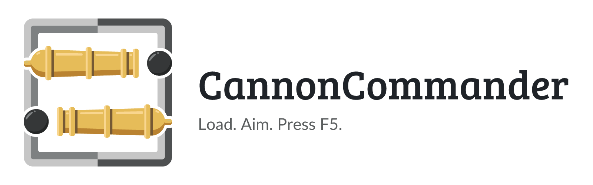
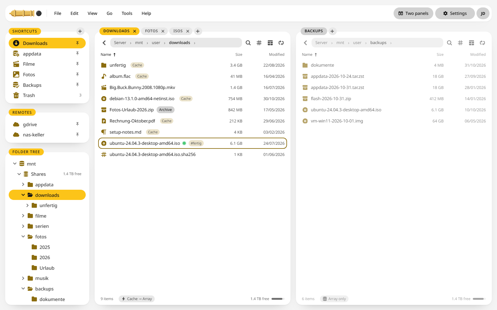
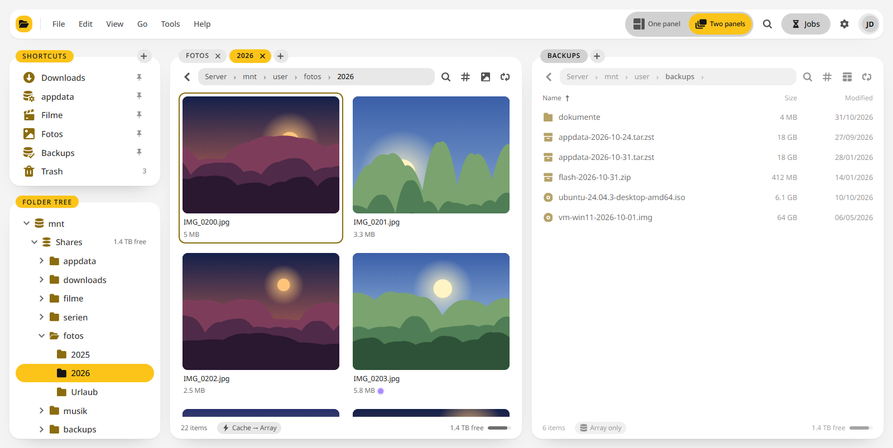
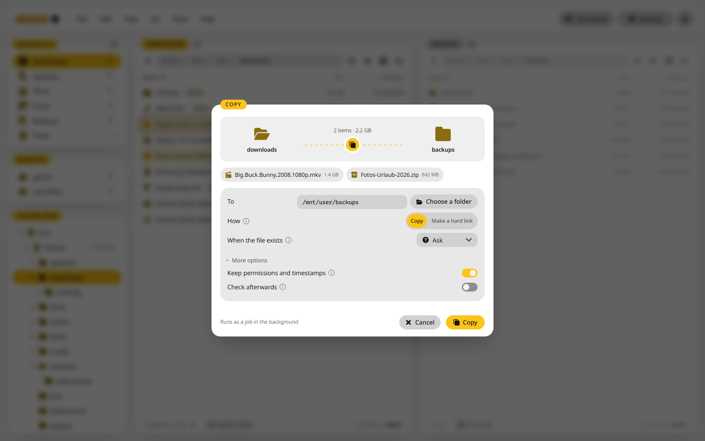

<p align="center">
  <picture>
    <source media="(prefers-color-scheme: dark)" srcset="https://raw.githubusercontent.com/junkerderprovinz/cannoncommander/main/.github/assets/cannoncommander-banner-dark.png">
    
  </picture>
</p>

<p align="center">
  <a href="https://github.com/junkerderprovinz/cannoncommander/actions/workflows/test.yml"></a>&nbsp;
  <a href="https://github.com/junkerderprovinz/cannoncommander/actions/workflows/container.yml"></a>&nbsp;
  <a href="https://hub.docker.com/r/junkerderprovinz/cannoncommander"></a>&nbsp;
  <a href="https://hub.docker.com/r/junkerderprovinz/cannoncommander"></a>&nbsp;
  <a href="https://github.com/junkerderprovinz/cannoncommander/pkgs/container/cannoncommander"></a>&nbsp;
  <a href="https://vuejs.org"></a>&nbsp;
  <a href="https://rclone.org"></a>&nbsp;
  <a href="https://unraid.net"></a>&nbsp;
  <a href="LICENSE"></a>
</p>

<br>

<p align="center">
<b>A two-pane file manager for Unraid that runs in your browser.</b><br>
<br>
Krusader and Total Commander are quick because you work in two panels side by side and press F5 to copy from one to the other. CannonCommander brings that way of working to your server without a desktop in a container, and it knows about Unraid: the cache and the array, sleeping disks, the parity check and the permissions Unraid sets.
</p>

<!-- download-buttons: written by scripts/gen_download_buttons.py -->
<p align="center">
  
</p>
<p align="center">
  
  &nbsp;
  <a href="https://raw.githubusercontent.com/junkerderprovinz/cannoncommander/main/compose.yaml"></a>
  &nbsp;
  <a href="https://github.com/junkerderprovinz/cannoncommander/releases/latest"></a>
</p>
<!-- /download-buttons -->

<br>

<p align="center">
A one-knight job: I build it, keep it running, work through the issues and add what people ask for, until nothing is missing. It is free, with no accounts, no telemetry, no ads and no paid tier. No asterisk anywhere. Nothing readable ever leaves your own walls. Forged on evenings and weekends, with heart and stubbornness.
</p>

<p align="center">
If it has earned a place on your server, toss a coin to your knight: it helps cover the costs and keeps the project alive. It also makes this knight's heart beat a little faster. Three ways below, whichever suits you.
</p>

<!-- give-buttons: written by scripts/gen_download_buttons.py -->
<p align="center">
  <a href="https://buymeacoffee.com/junkerderprovinz"></a>
  &nbsp;
  <a href="https://www.paypal.com/donate/?hosted_button_id=76FVV52TKXTUS"></a>
  &nbsp;
  <a href="https://junkerderprovinz.github.io/junkerderprovinz/"></a>
</p>
<!-- /give-buttons -->

<br>

## Table of Contents

1. [What it looks like](#1-what-it-looks-like)
2. [What it does](#2-what-it-does)
3. [How it compares](#3-how-it-compares)
4. [Getting started](#4-getting-started)
5. [Configuration](#5-configuration)
6. [Security](#6-security)
7. [Building from source](#7-building-from-source)
8. [How AI is used here](#8-how-ai-is-used-here)
9. [Support this project](#9-support-this-project)

<br>

## 1. What it looks like

<p align="center">
  <picture>
    <source media="(prefers-color-scheme: dark)" srcset=".github/assets/screenshots/panels-dark.png">
    
  </picture>
  <br><em>Two panels with tabs, shortcuts and the folder tree. The badges show which files still sit on the cache.</em>
</p>

<p align="center">
  <picture>
    <source media="(prefers-color-scheme: dark)" srcset=".github/assets/screenshots/gallery-dark.png">
    
  </picture>
  <br><em>Each tab has its own view, here large tiles for a folder of photos</em>
</p>

<p align="center">
  <picture>
    <source media="(prefers-color-scheme: dark)" srcset=".github/assets/screenshots/copy-dark.png">
    
  </picture>
  <br><em>F5 copies to the other panel, as a job in the background</em>
</p>

<br>

## 2. What it does

- **Two panels and the keyboard.** Tabs in both panels, a menu bar, a command search on Ctrl+K and the keys you know from Krusader: F3 views, F4 edits, F5 copies, F6 moves, F7 makes a folder and F8 deletes. The function key bar is one switch away under View.
- **Jobs in the background.** Copies, moves and deletes run as jobs with speed, time left, pause and a speed limit. Each job has a rule for files that already exist, and the jobs pick up again after a restart.
- **A trash and an undo.** Deleted files go to a trash on the same share first, and the last actions can be undone.
- **Unraid in view.** Which files sit on the cache and which on the array, disk shares next to user shares, sleeping disks that a copy would wake, the parity check, hard links, and permissions set the way Unraid sets them.
- **Nine ways to look at a folder.** Details with 89 columns to choose from, compact, list, content, columns, tiles, large tiles, a gallery and a drives view. Quick look on the space bar and a preview in the other panel.
- **Tools for the whole collection.** Search by name, field or content, folder compare and sync, file compare, duplicates, disk usage as a tree or a treemap, batch rename with patterns, archives to pack, unpack and test, checksums, split and join, links and properties.
- **A viewer and an editor.** Pictures, video, audio, PDF, Markdown, text and code, Office files, e-books, 3D models and archives open in the browser. An Office server such as OnlyOffice or Collabora can edit Office files.
- **Remote storage.** SFTP, SMB, WebDAV, S3, Google Drive and everything else rclone speaks, mounted below `/mnt/remotes`, where other containers can see it too.
- **Sharing.** Links with a password, an expiry date and download or upload limits, for one file or a whole collection, with a QR code. A WebDAV server lets you mount your files as a drive.
- **People and rules.** Users, groups and rules that hide a folder or make it read only, two-factor sign-in, passkeys, API tokens and single sign-on through OIDC.
- **Colours and tags** for files, saved searches, window profiles, your own key bindings and a Total Commander layout.
- **[ArrowLoop](https://github.com/junkerderprovinz/arrowloop) on call.** A folder pair from the comparison becomes a recurring sync job in ArrowLoop with one click.
- **Looks like the rest of the house.** The interface uses [GlimStone](https://github.com/junkerderprovinz/glimstone), in light and dark, with your own accent colour, and speaks English and German.

<br>

## 3. How it compares

CannonCommander started from the code of [FileBrowser Quantum](https://github.com/gtsteffaniak/filebrowser), which itself grew out of [File Browser](https://github.com/filebrowser/filebrowser). The rows and the values for the web file managers come from the [comparison chart in Quantum's README](https://github.com/gtsteffaniak/filebrowser#comparison-chart). The rows after the divider, and the Krusader and Windows Explorer columns (Windows 11 24H2), come from our own look at their documentation in November 2026.

✅ yes · ❌ no · 🟡 partly · 🚧 planned · ? not verified · n/a does not apply

| | CannonCommander | Quantum | Filebrowser | Filestash | Nextcloud | Google Drive | FileRun | Krusader | Windows Explorer |
|---|---|---|---|---|---|---|---|---|---|
| Filesystem support | ✅ | ✅ | ✅ | ✅ | ✅ | ❌ | ✅ | ✅ | ✅ |
| Linux | ✅ | ✅ | ✅ | ✅ | ✅ | ❌ | ✅ | ✅ | ❌ |
| Windows | ❌ | ✅ | ✅ | ✅ | ❌ | ❌ | ✅ | ❌ | ✅ |
| Mac | ❌ | ✅ | ✅ | ✅ | ❌ | ❌ | ✅ | 🟡 | ❌ |
| Self hostable | ✅ | ✅ | ✅ | ✅ | ✅ | ❌ | ✅ | 🟡 | ❌ |
| Has stable release | ✅ | ✅ | ✅ | ✅ | ✅ | ✅ | ✅ | ✅ | ✅ |
| S3 support | ✅ | ❌ | ❌ | ✅ | ✅ | ❌ | ❌ | ❌ | ❌ |
| WebDAV support | ✅ | ✅ | ❌ | ✅ | ✅ | ❌ | ✅ | ✅ | 🟡 |
| FTP support | ✅ | ❌ | ❌ | ✅ | ✅ | ❌ | ✅ | ✅ | 🟡 |
| Dedicated docs site | ❌ | ✅ | ✅ | ✅ | ✅ | ✅ | ✅ | ✅ | 🟡 |
| Multiple sources at once | ✅ | ✅ | ❌ | ✅ | ✅ | ❌ | ✅ | ✅ | ✅ |
| Docker image size | 258 MB (with ffmpeg, MuPDF, rclone and 7-Zip) | 180 MB (with ffmpeg) | 31 MB | 240 MB (main image) | 250 MB | ❌ | > 2 GB | n/a | n/a |
| Min. memory requirements | 128 MB (small share) | 512 MB | 128 MB | 128 MB (main image) | 512 MB | ❌ | 512 MB | n/a | n/a |
| Has standalone binary | ❌ | ✅ | ✅ | ✅ | ❌ | ❌ | ❌ | ? | n/a |
| Price | free | free | free | free | free tier | free tier | $99+ | free | included with Windows |
| Rich media preview | ✅ | ✅ | ✅ | ✅ | ✅ | ✅ | ✅ | 🟡 | ✅ |
| Upload files from the web | ✅ | ✅ | ✅ | ✅ | ✅ | ✅ | ✅ | ❌ | ❌ |
| Advanced search | ✅ | ✅ | ❌ | ✅ | configurable | ✅ | ✅ | ✅ | ✅ |
| Indexed search | ✅ | ✅ | ❌ | ✅ | configurable | ✅ | ✅ | 🟡 | ✅ |
| Content-aware search | ✅ | ❌ | ❌ | ✅ | configurable | ✅ | ✅ | ✅ | ✅ |
| Custom job support | ❌ | 🚧 | ✅ | ✅ | ✅ | ❌ | ✅ | ✅ | ❌ |
| Multiple users | ✅ | ✅ | ✅ | ✅ | ✅ | ✅ | ✅ | ❌ | ❌ |
| Single sign-on support | ✅ | ✅ | ❌ | ✅ | ✅ | ✅ | ✅ | ❌ | ❌ |
| LDAP sign-on support | ❌ | ✅ | ❌ | ✅ | ✅ | ✅ | ✅ | ❌ | ❌ |
| Long-lived API key support | ✅ | ✅ | ❌ | ✅ | ✅ | ✅ | ✅ | ❌ | ❌ |
| API documentation page | 🟡 | ✅ | ❌ | ✅ | ✅ | ✅ | ✅ | ❌ | 🟡 |
| Mobile app | ❌ | ❌ | ❌ | ❌ | ✅ | ✅ | ❌ | ❌ | ❌ |
| Open source | ✅ | ✅ | ✅ | ✅ | ✅ | ❌ | ❌ | ✅ | ❌ |
| Tags support | ✅ | 🚧 | ❌ | ✅ | ✅ | ❌ | ✅ | ? | 🟡 |
| Shareable web links | ✅ | ✅ | ✅ | ✅ | ✅ | ✅ | ✅ | ❌ | 🟡 |
| Event-based notifications | 🟡 | 🚧 | ❌ | ✅ | ❌ | ❌ | ✅ | ❌ | ❌ |
| Metrics | ❌ | 🚧 | ❌ | ✅ | ✅ | ❌ | ❌ | ❌ | ❌ |
| File space quotas | ❌ | ✅ | ❌ | ✅ | ❌ | ✅ | ✅ | ❌ | 🟡 |
| Text-based files editor | ✅ | ✅ | ✅ | ✅ | ✅ | ✅ | ✅ | ✅ | ❌ |
| Office file support | ✅ | ✅ | ❌ | ✅ | ✅ | ✅ | ✅ | ❌ | ❌ |
| Office file previews | ✅ | ✅ | ❌ | ❌ | ✅ | ✅ | ✅ | ? | 🟡 |
| Themes | ✅ | ✅ | ✅ | ✅ | ✅ | ❌ | ✅ | ✅ | 🟡 |
| Branding support | ❌ | ✅ | ✅ | ✅ | ❌ | ❌ | ✅ | ❌ | ❌ |
| Activity log | ✅ | ✅ | ❌ | ✅ | ✅ | ✅ | ✅ | ❌ | 🟡 |
| Comments support | ❌ | ❌ | ❌ | ✅ | ✅ | ✅ | ✅ | ❌ | 🟡 |
| Trash support | ✅ | 🚧 | ❌ | ✅ | ✅ | ✅ | ✅ | ✅ | ✅ |
| Starred/pinned files | ✅ | ✅ | ❌ | ✅ | ✅ | ✅ | ✅ | 🟡 | ✅ |
| Chromecast support | ❌ | ❌ | ❌ | ✅ | ❌ | ❌ | ❌ | ❌ | ❌ |
| Share collections of files | ✅ | 🚧 | ❌ | ❌ | ❌ | ❌ | ✅ | ❌ | ❌ |
| Can archive selected files | ✅ | ✅ | ❌ | ❌ | ❌ | ❌ | ✅ | ✅ | ✅ |
| Can browse archive files | ✅ | 🚧 | ❌ | ✅ | ❌ | ❌ | ✅ | ✅ | ✅ |
| Can convert documents | ❌ | 🚧 | ❌ | ✅ | ❌ | ❌ | ✅ | ❌ | ❌ |
| Can convert videos | ❌ | 🚧 | ❌ | ✅ | ❌ | ❌ | ❌ | ❌ | ❌ |
| Can convert photos | ❌ | 🚧 | ❌ | ✅ | ❌ | ❌ | ❌ | ❌ | ❌ |
| **Commander features** | | | | | | | | | |
| Two-pane view | ✅ | ❌ | ❌ | ? | ❌ | ❌ | ❌ | ✅ | ❌ |
| Tabs | ✅ | ❌ | ❌ | ? | ❌ | ❌ | ❌ | ✅ | ✅ |
| Function-key bar, keyboard first | ✅ | 🟡 | ? | 🟡 | ? | 🟡 | ❌ | ✅ | 🟡 |
| Folder compare | ✅ | ❌ | ❌ | ? | ❌ | ❌ | ❌ | ✅ | ❌ |
| Synchronized browsing | ✅ | ❌ | ❌ | ❌ | ❌ | ❌ | ❌ | ✅ | ❌ |
| Batch rename with patterns | ✅ | ❌ | ❌ | ? | ? | ❌ | ❌ | ✅ | 🟡 |
| Create and verify checksums | ✅ | 🟡 | 🟡 | ? | ? | ❌ | ? | ✅ | ❌ |
| Quick look on the space bar | ✅ | ? | ? | ? | ? | 🟡 | ❌ | 🟡 | 🟡 |
| Choosable list columns | ✅ | ? | ❌ | ? | ? | ? | ✅ | ✅ | ✅ |
| Thumbnail or gallery view | ✅ | ✅ | ✅ | ✅ | ✅ | ✅ | ? | ? | ✅ |
| Command search | ✅ | ? | ❌ | ❌ | ❌ | ❌ | ❌ | ? | ❌ |
| Duplicate finder | ✅ | ✅ | ❌ | ? | ? | ❌ | ? | ? | ❌ |
| Disk usage view | ✅ | ✅ | ❌ | ? | 🟡 | 🟡 | ? | ✅ | 🟡 |
| Unraid cache, array and share awareness | ✅ | ❌ | ❌ | ❌ | ❌ | ❌ | ❌ | ❌ | ❌ |

S3, FTP and the other remote protocols come through rclone. The API is described in OpenAPI files in the repository rather than on a page of the app, and notifications go to Unraid and the browser when a job ends.

<br>

## 4. Getting started

### Unraid

CannonCommander is on its way into Community Applications. Until it is listed there, save [my-CannonCommander.xml](templates/my-CannonCommander.xml) as `/boot/config/plugins/dockerMan/templates-user/my-CannonCommander.xml` on your server, then open the Docker tab, click **Add Container** and choose CannonCommander under **Template**. The defaults fit a normal Unraid server, so **Apply** is enough to start.

### Other Docker hosts

```sh
docker run -d --name cannoncommander -p 8480:80 \
  -v /path/to/appdata:/config \
  -v /mnt:/mnt \
  -e PUID=1000 -e PGID=1000 -e UMASK=022 \
  --device /dev/fuse --cap-add SYS_ADMIN \
  --cap-add DAC_READ_SEARCH --cap-add DAC_OVERRIDE \
  junkerderprovinz/cannoncommander:latest
```

CannonCommander shows the folders below `/mnt/user`, the way Unraid lays out its shares. On another server, keep your folders there or change the source in `/config/config.yaml`. [compose.yaml](compose.yaml) does the same with `docker compose up -d`. Without `--device /dev/fuse` and `SYS_ADMIN` everything works except mounting remote storage.

### First sign-in

Open port 8480 in a browser. On the first start the container writes a password for the user `admin` into its log, in a line that starts with `Generated initial admin password`. On Unraid, click the container's icon and choose **Logs**. Sign in with it and pick a new password of at least 12 characters. After that you can add users under **Settings > Users & groups**.

<br>

## 5. Configuration

The container reads `/config/config.yaml`, which it writes with good defaults on the first start. Most settings live in the interface under **Settings**, and an admin can export them all from **Settings > App**.

### Folders

| Container path | What it holds |
|---|---|
| `/config` | `config.yaml`, the database with users, settings, jobs and the index, the thumbnail cache and rclone's own configuration |
| `/mnt` | Your user shares, disks and pools, at the same paths as on the server. Everyone works in the user shares under `/mnt/user`. The disks and pools are for admins alone. Where a file lies, the other names of a hard link and moving a folder onto one disk work right away, and to browse a disk or pool, add it under **Settings > Sources**. On Unraid the access mode is **RW/Slave**, so disks and pools mounted later show up too. |
| `/mnt/remotes` | Where remote storage is mounted. On Unraid it is mapped with the access mode **RW/Shared**, so the mounts show up on the server and in other containers. |
| `/var/local/emhttp` | Read only. Unraid's live view of the disks, pools and shares. |
| `/boot/config` | Read only. The settings of each share, read for placing files and for the Unraid permissions. |

### User, group and permissions

| Variable | Default | What it does |
|---|---|---|
| `PUID` | `99` | The user the server runs as and writes new files as. 99 is Unraid's `nobody`. `0` runs it as root. |
| `PGID` | `100` | The group for new files, Unraid's `users`. |
| `UMASK` | `000` | The permission mask for new files. 000 matches Unraid's shares, so you can still change what CannonCommander writes over SMB. |
| `TZ` | | Your time zone, such as `Europe/Berlin`. |

The server runs as `nobody` and keeps four capabilities of root, which the template sets for you:

- `CHOWN` and `FOWNER` let **Set permissions the Unraid way** hand files to `nobody:users`.
- `DAC_READ_SEARCH` lets the server read files that only root may read, such as the share settings in `/boot/config`.
- `DAC_OVERRIDE` lets the server write where only root may write, such as Unraid's notification folder.

The file manager's own users and rules still decide what each person sees and changes.

### Unraid write access

Spinning disks down and sending Unraid notifications go through files and a socket that belong to root on the server, so they are off by default. To switch them on, set `CC_UNRAID_SOCKET` to `true` and map `/var/run/emhttpd.socket` into the container at the same path. Notifications also need `/tmp/notifications` mapped at the same path. Only admins see these actions.

### Remote storage

Add SFTP, SMB, WebDAV, S3, Google Drive and others under **Settings > Remotes**. CannonCommander starts rclone itself, keeps its configuration in `/config/rclone` and mounts each remote below `/mnt/remotes`. For this the container needs `/dev/fuse` and the `SYS_ADMIN` capability, which the Unraid template sets for you. A provider that signs in through a browser, such as Google Drive, takes a token you make once with `rclone authorize` on your own computer.

### WebDAV

Switch the WebDAV server on under **Settings > Integrations**. It answers at `/dav/`, with the same users and rules as the interface. Sign in with your user name and password, or with an API token from **Settings > Account & security** when two-factor sign-in is on.

Windows Explorer only maps a WebDAV drive over https, so for Windows put CannonCommander behind a reverse proxy with a certificate, and map `https://files.example.com/dav/`. macOS Finder, Linux file managers, rclone and phone apps also work over plain http on your own network.

### Reverse proxy

CannonCommander works behind Nginx Proxy Manager, SWAG, Traefik or Caddy. Three things matter:

- The proxy passes the `Host` header on unchanged. WebDAV and passkeys check it against the address you use, and a proxy that rewrites it breaks both.
- The live updates use server-sent events, so turn off response buffering for the site if your proxy buffers by default.
- Tell CannonCommander which proxy to trust and under which address it is reached, so sign-in limits see the real client address and share links point to the right place:

```yaml
http:
  externalUrl: "https://files.example.com"
  trustProxyHeaders: true
  trustedProxies:
    - 192.168.1.10
```

For a sub-path such as `https://example.com/files/`, also set `baseURL: "/files/"` under `http`.

### Single sign-on with OIDC

CannonCommander signs in through any OpenID Connect provider, such as Authentik, Authelia, Keycloak or Pocket ID. Create an application there with the redirect address `https://files.example.com/api/auth/oidc/callback`, then add it to `config.yaml` and restart the container:

```yaml
auth:
  methods:
    oidc:
      enabled: true
      clientId: "cannoncommander"
      clientSecret: "the secret from your provider"
      issuerUrl: "https://auth.example.com/application/o/cannoncommander/"
      adminGroup: "cannoncommander-admins"
```

A user who signs in for the first time is created on the spot. Members of `adminGroup` become admins, and `userGroups` limits sign-in to the groups you list. The client ID and secret can also come from the variables `CC_OIDC_CLIENT_ID` and `CC_OIDC_CLIENT_SECRET`, so they stay out of the file.

<br>

## 6. Security

CannonCommander can read, change and delete everything you map into it, so it deserves the same care as the Unraid web interface.

- **Sign-in.** Every visitor signs in. The first admin password comes from the log and has to be replaced at the first sign-in. Two-factor sign-in with an authenticator app, recovery codes and passkeys are under **Settings > Account & security**, and `enforcedOtp: true` under `auth.methods.password` in `config.yaml` asks everyone to set it up. After five wrong passwords for one name from one address, that address waits 15 minutes.
- **Keep it on your network.** Reach it from outside only through a reverse proxy with https, or through a VPN such as WireGuard or Tailscale.
- **The data folder is locked.** The database and `config.yaml` in `/config` cannot be opened through the file manager, not even by an admin, even when `/config` lies inside a share you mapped.
- **Users and rules.** Admins see everything. Everyone else stays inside an area of their own, and access rules hide a folder in it or make it read only, for one user or a whole group. The rules apply to the interface, WebDAV, share links and API tokens alike, and disk shares such as `/mnt/disk1` are for admins only.
- **API tokens** can be read only, and new tokens and passkeys ask for your password again. An admin can see and revoke the sessions, tokens and passkeys of every user.
- **Unraid write access** is off until you switch it on, because the emhttpd socket controls the whole array.

If you find a security problem, please report it privately through [GitHub's security advisories](https://github.com/junkerderprovinz/cannoncommander/security/advisories/new) rather than in a public issue. I will get back to you as soon as I can.

<br>

## 7. Building from source

You need Go (the version is in `backend/go.mod`), Node.js 24 with npm, and Docker for the image.

```sh
git clone https://github.com/junkerderprovinz/cannoncommander.git
cd cannoncommander
docker build -t cannoncommander -f _docker/Dockerfile .
```

That builds the same image the releases use, with ffmpeg, MuPDF, rclone and 7-Zip inside. To work on the code, `make setup` installs the tools and `make run` starts the server with a test configuration. Without a server, `npm run dev:fixture` in `frontend/` runs the interface against made-up files. [CONTRIBUTING.md](CONTRIBUTING.md) explains the layout and the checks.

<br>

## 8. How AI is used here

One knight builds this, and AI is one of the tools I work with, the same way I work with an editor or a compiler. It helps me write code and documentation and it checks my work, and that saves me a good many evenings. It does not make the decisions, though. I read and understand everything before it ships, and if something here breaks, that is on me and not on the tool.

You do not have to take my word for it. The code is open and every release note is written by hand. The issue tracker shows how problems actually get handled, including the ones I got wrong the first time. If you find something that is not right, open an issue and I will look at it.

<br>

## 9. Support this project

Questions, bugs, ideas or feature requests? Please [open a GitHub issue](https://github.com/junkerderprovinz/cannoncommander/issues), questions are welcome there.

A one-knight job: I build it, keep it running, work through the issues and add what people ask for, until nothing is missing. It is free, with no accounts, no telemetry, no ads and no paid tier. No asterisk anywhere. Nothing readable ever leaves your own walls. Forged on evenings and weekends, with heart and stubbornness.

If it has earned a place on your server, toss a coin to your knight: it helps cover the costs and keeps the project alive. It also makes this knight's heart beat a little faster. Three ways below, whichever suits you.

<!-- give-buttons: written by scripts/gen_download_buttons.py -->
<p align="center">
  <a href="https://buymeacoffee.com/junkerderprovinz"></a>
  &nbsp;
  <a href="https://www.paypal.com/donate/?hosted_button_id=76FVV52TKXTUS"></a>
  &nbsp;
  <a href="https://junkerderprovinz.github.io/junkerderprovinz/"></a>
</p>
<!-- /give-buttons -->

CannonCommander is released under the [GNU Affero General Public License v3.0](LICENSE). It builds on FileBrowser Quantum and File Browser, both under the Apache License 2.0, whose notices are kept in [NOTICE](NOTICE). The name CannonCommander and its logo are not part of the licence, so a fork needs a name of its own. Thank you to Graham Steffaniak and everyone who worked on File Browser before us.
