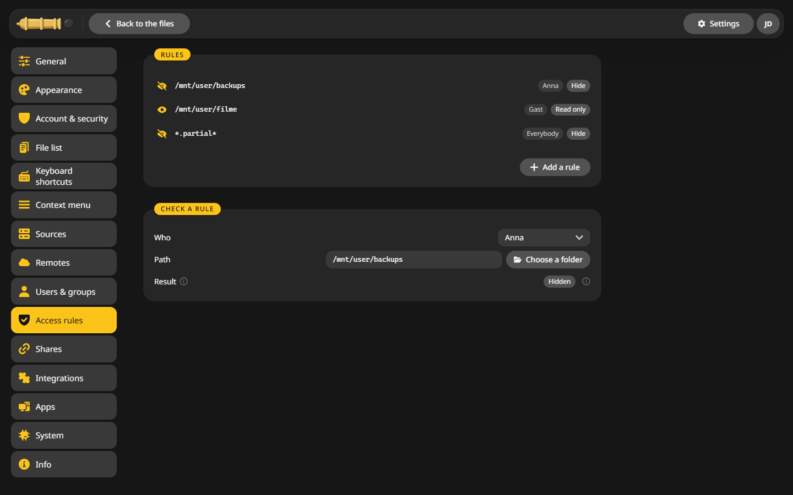
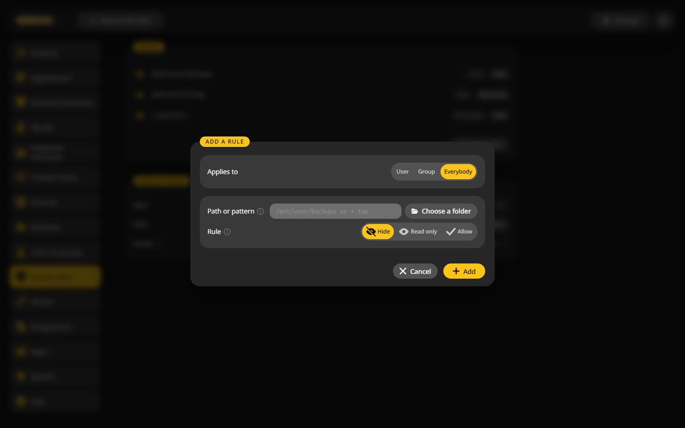

# Access rules

Rules hide a folder inside someone's area or make it read only, for one user, a group or everybody.

## Add a rule {#add}

1. Open **Settings > Access rules** and click **Add a rule**.
2. **Applies to**: a user, a group or everybody.
3. **Path or pattern**:
    - a path such as `/mnt/user/backups` covers the folder and everything in it,
    - a pattern with a star such as `*.partial*` fits names anywhere,
    - a pattern with a slash such as `appdata/*/cache` works like a path.
4. **Rule**: Hide, Read only or Allow.
5. Click **Add**.

## The order matters {#order}

The first rule that fits wins. **Allow** lifts a rule further down, for example to open one subfolder of a hidden folder:

| # | Applies to | Path | Rule |
|---|---|---|---|
| 1 | Anna | `/mnt/user/backups/anna` | Allow |
| 2 | Anna | `/mnt/user/backups` | Hide |

Move a rule up or down with its arrows.

## Check a rule {#check}

The **Check a rule** card answers what one person sees at one path. Pick the person and the folder, and **Result** shows Visible, Read only or Hidden, with the rule that decided it.

## Where the rules apply {#where}

Everywhere: the interface, [WebDAV](../integrations/webdav.md), share links, [API tokens](tokens.md) and the [MCP server](../integrations/mcp.md). Disk shares such as `/mnt/disk1` are for admins only.

Files hidden by a pattern go along when their folder is deleted or moved, and copying leaves them out.
