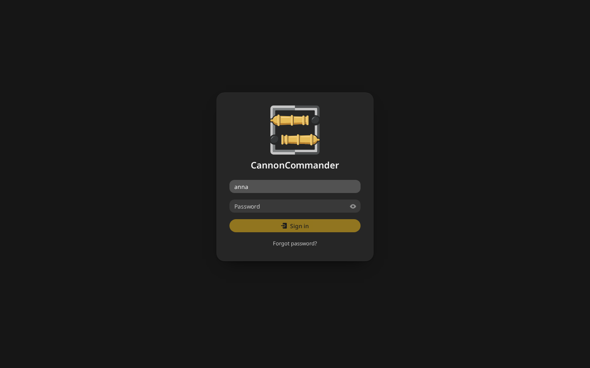
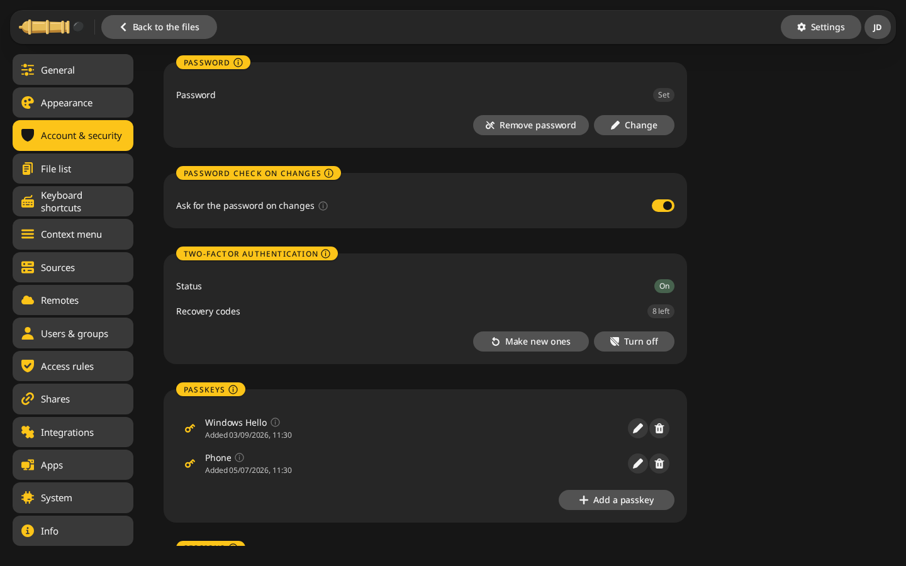
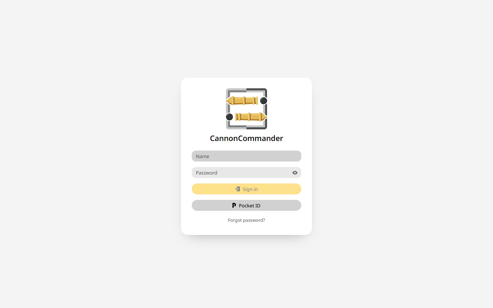

# Signing in

Until an account has a password, CannonCommander is open and everyone who reaches it is an admin. Once a password is set, every visitor signs in first.

## Turn on the sign-in {#on}

Set a password for your own account under **Settings > Account & security**, see [First start](../getting-started/first-start.md#password). From then on the sign-in page greets everyone:

With a single account the page asks only for the password. As soon as there are more, it asks for the name too.

## Account & security {#account}

Everything about your own sign-in lives on this page: the password, two-factor authentication, passkeys, sessions, API tokens and sign-in services.

## Change or remove the password {#change}

- **Change** asks for the current password and a new one. Any length works, and under 12 characters the page tells you it is short. Every other session ends.
- **Remove password** opens CannonCommander to everyone again. It only works while no other account signs in with a password. Two-factor authentication, passkeys, API tokens and sign-in services go with it.

## Password check on changes {#ask}

Some changes want a sign-in from the last 10 minutes, or 5 when you signed in through a sign-in service:

- a new API token, passkey or MCP key
- setting up two-factor authentication or making new recovery codes
- adding or changing a sign-in service, its test sign-in, and turning the service from `config.yaml` back on
- for admins, a new account or another account's password

If your sign-in is older, CannonCommander asks for your password, and typing it counts as signing in again. Switch off **Ask for the password on changes** and it sends you to sign in again instead. The (i) next to the switch lists the same changes.

Changing or removing your own password always asks for the current one.

## Sessions {#sessions}

The **Sessions** card lists every browser that is signed in, how it signed in, its address and when it was last seen. **Sign out all others** ends every session but this one. API tokens keep working, see [API tokens](tokens.md).

A session lasts 30 days and ends after 7 days without a visit.

## Wrong passwords {#limit}

- After five wrong passwords for one name, every further try waits a little longer, up to a minute. A stranger guessing your name cannot lock you out for good.
- After ten wrong tries from one address, that address waits 15 minutes.

Behind a reverse proxy, tell CannonCommander which proxy to trust so it sees the real address, see [Reverse proxy](../configuration/reverse-proxy.md).

## Forgot the password {#reset}

1. Click **Forgot password?** on the sign-in page.
2. Open the container log. On Unraid, click the container's icon in the Docker tab and pick **Logs**. The newest line that says `signin: someone asked to reset the password` ends with the code, such as `code=K7QM-3XRP-9DTA`.

3. Within 10 minutes, enter the code, your name and a new password twice, then click **Set password**. With a single account there is no name to enter.

Whoever knew the old password may have left a way in behind, so the reset clears more than the password:

- every session and every API token ends, for all accounts
- your passkeys, two-factor authentication and links to sign-in services are gone
- sign-in services pause until you turn them on again

Another admin can also set a new password for you under **Settings > Users & groups**.

## Sign-in services {#sso}

People can also sign in through Pocket ID, authentik, Authelia, Keycloak, Kanidm, Zitadel or any other OpenID Connect service. The sign-in page then shows its button:

How to set one up: [Sign-in services](../configuration/oidc.md).
