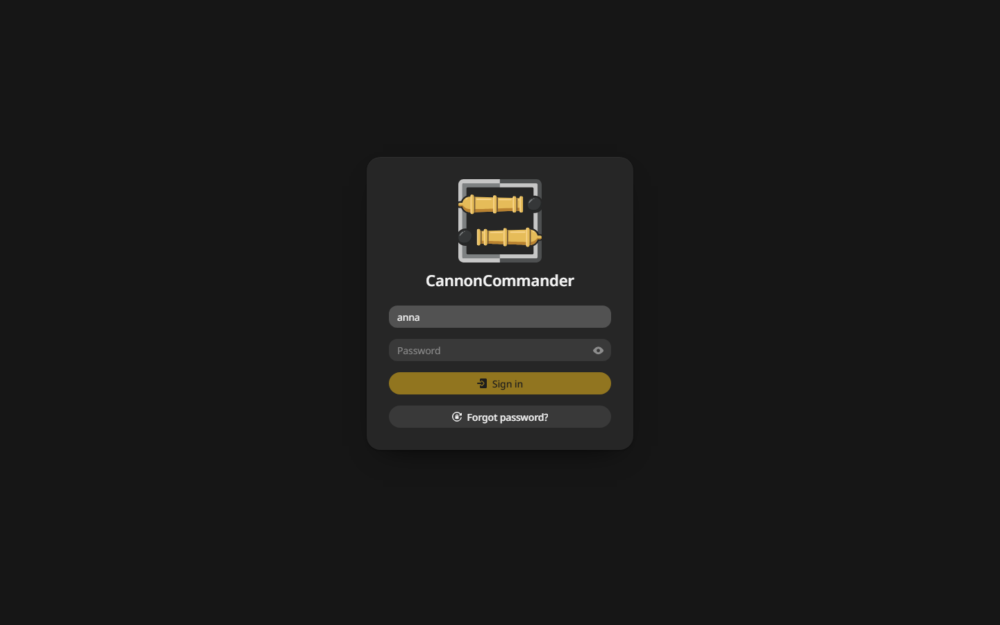
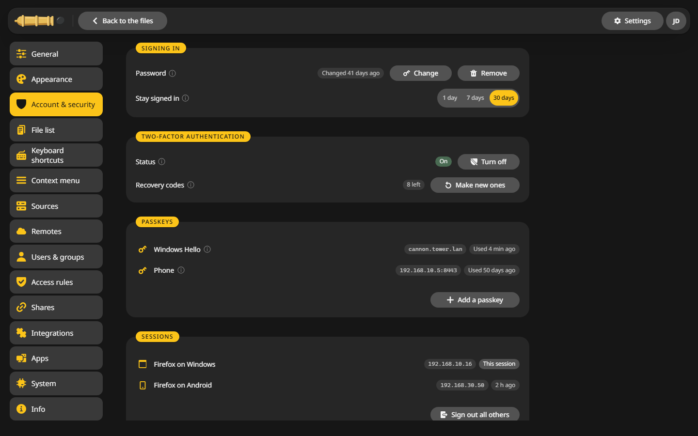
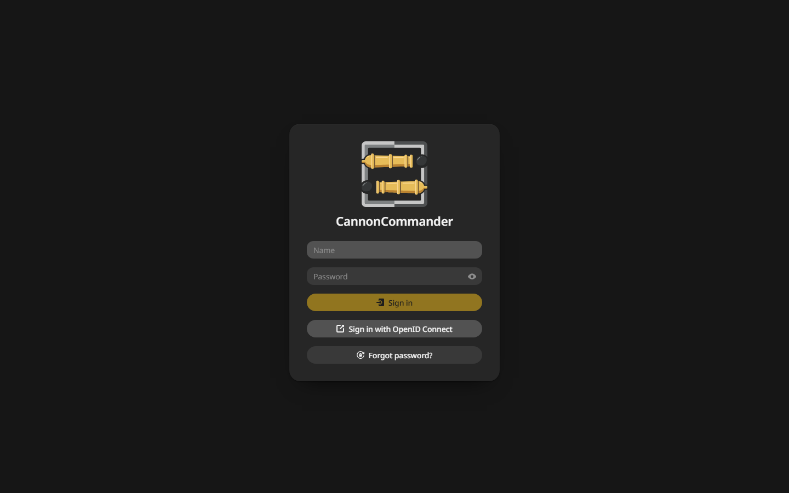

# Signing in

Without a password CannonCommander opens for everyone who reaches it. Once any account has a password or a passkey, every visitor signs in first.

## Turn on the sign-in {#on}

Set a password for your own account under **Settings > Account & security**, see [First start](../getting-started/first-start.md#password). From then on the sign-in page greets everyone:

## Stay signed in {#stay}

**Stay signed in** on the same page decides how long a sign-in lasts: 1, 7 or 30 days. The time counts from your last visit.

## Change or remove the password {#change}

- **Change** asks for the current password and a new one of at least 12 characters. It signs you out everywhere else.
- **Remove** opens CannonCommander again without a sign-in, as long as no other account has a password. Two-factor sign-in and passkeys go with it.

## Sessions {#sessions}

The **Sessions** card lists every browser that is signed in, with its address and when it was last seen. **Sign out all others** ends all of them except this one. API tokens keep working, see [API tokens](tokens.md).

## Wrong passwords {#limit}

After five wrong passwords for one name from one address, that address waits 15 minutes. Behind a reverse proxy, tell CannonCommander which proxy to trust so it sees the real address, see [Reverse proxy](../configuration/reverse-proxy.md).

## Single sign-on {#sso}

CannonCommander can also sign in through an OpenID Connect provider. The sign-in page then shows a button for it:

How to set it up: [Single sign-on with OIDC](../configuration/oidc.md).
