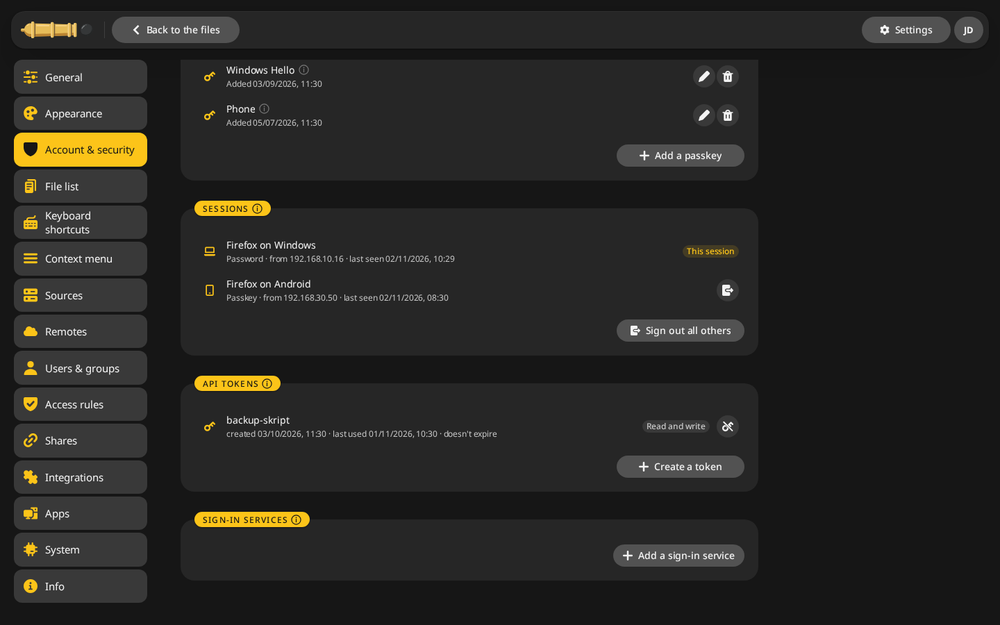
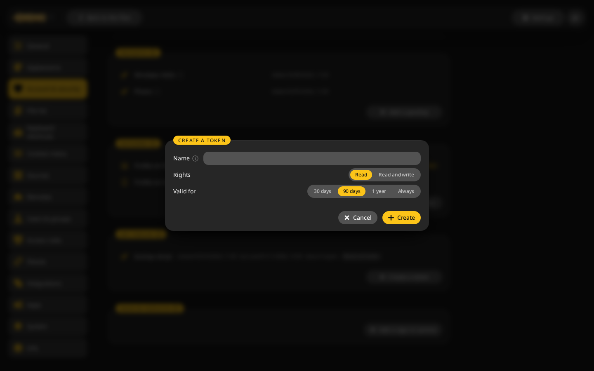

# API tokens

Scripts, WebDAV clients and other programs sign in with an API token instead of your password. A token can be limited to reading, and it never does more than you may.



## Create a token {#create}

Tokens work before CannonCommander has a password too. A token made then stands for the admin and ends once CannonCommander asks for a sign-in, after the first password or the first sign-in service, and its row says so.

1. Open **Settings > Account & security** and scroll to **API tokens**.
2. Click **Create a token**.
3. Give it a **Name**, such as `backup-script`.
4. Pick the **Rights**: Read, or Read and write.
5. Pick how long it is **Valid for**: 30 days, 90 days, 1 year or always.
6. Click **Create**. If your sign-in is older than a few minutes, CannonCommander asks for your password first.
7. Copy the token. It is shown only this once.



## Use a token {#use}

Send it in the `Authorization` header:

```sh
curl -H "Authorization: Bearer <token>" https://files.example.com/api/v1/me
```

The full API description is served at `/api/v1/openapi.yaml`.

For [WebDAV](../integrations/webdav.md), use the token as the password.

## What a token may do {#rights}

A token acts as you, with your role, your area and your [access rules](rules.md). A read-only token can look and download, nothing else. Tokens never get a [terminal](../integrations/terminal.md).

## Revoke a token {#revoke}

Click **Revoke** next to the token. Programs using it are turned away at once. An admin can see and revoke the tokens of every user in their window under **Settings > Users & groups**.

A password reset through the container log ends every token, see [Forgot the password](sign-in.md#reset).
