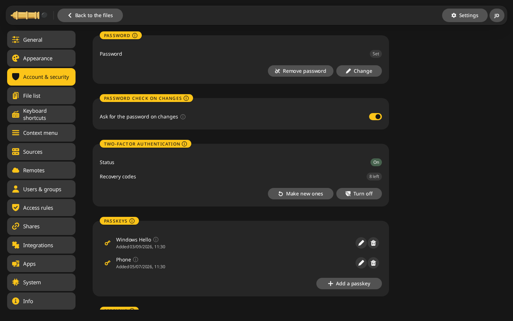

# Two-factor and passkeys

Both live under **Settings > Account & security**, and both wait until your account has a password.

## Turn on two-factor authentication {#totp}

1. Under **Two-factor authentication**, click **Set up**.
2. Scan the QR code with an authenticator app, such as Aegis, 2FAS or your password manager. Or type the key in by hand.
3. Enter the six digits the app shows and click **Turn on**.
4. Save the ten **recovery codes** somewhere safe and click **I've saved them**. Each one signs you in once if your phone is missing.

From now on CannonCommander asks for a code after the password.

- **Make new ones** replaces the recovery codes, and the old ones stop working.
- **Turn off** asks for a code from the app or a recovery code.

## Add a passkey {#passkeys}

A passkey signs you in with your fingerprint, your face or your device's PIN. Your password keeps working.

1. Under **Passkeys**, click **Add a passkey**.
2. Give it a name, such as Laptop, and click **Continue**.
3. Confirm in your browser's window.

Next time, the browser offers the passkey as soon as you click into the password field.

Browsers tie a passkey to a domain name with a trusted certificate, such as `https://files.example.com`. On a plain `http://` address in your network the card says so instead. A passkey you added under another address shows which one it works at.

## Accounts from a sign-in service {#service}

Someone who signs in through a [sign-in service](../configuration/oidc.md) has no password here. They set up two-factor authentication and passkeys at the service.

## If you are locked out {#locked}

- Lost the phone: sign in with a recovery code.
- No codes left: reset the password through the container log, see [Forgot the password](sign-in.md#reset). The reset also turns off two-factor authentication.
