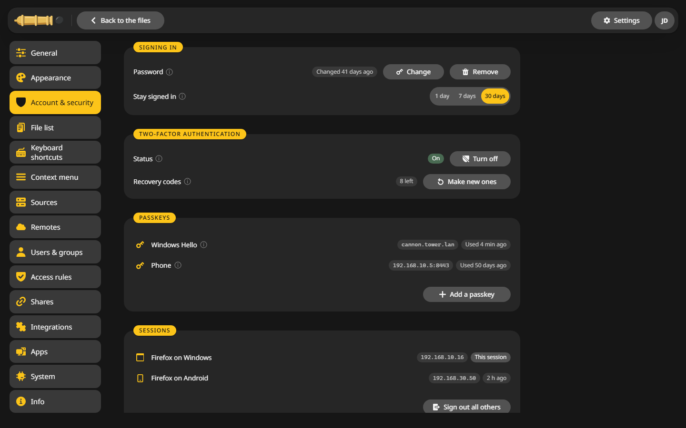

# Two-factor and passkeys

Both live under **Settings > Account & security**, and both show up once your account has a password.

## Turn on two-factor sign-in {#totp}

1. Under **Two-factor authentication**, click **Set up**.
2. Scan the QR code with an app for one-time codes, such as Aegis, 2FAS or your password manager. Or type the key in by hand.
3. Enter the six digits the app shows.
4. Save the eight **recovery codes** somewhere safe. Each one signs you in once if your phone is missing.

From now on CannonCommander asks for a code after the password.

**Make new ones** replaces the recovery codes, and the old ones stop working. **Turn off** asks for a code first.

!!! tip "For everyone"
    `enforcedOtp: true` under `auth.methods.password` in `config.yaml` asks every user to set up two-factor sign-in at their next sign-in.

## Add a passkey {#passkeys}

A passkey signs you in without the password, with your fingerprint, face or device PIN.

1. Under **Passkeys**, click **Add a passkey**.
2. Enter your password and give the passkey a name, such as Laptop.
3. Confirm in your browser's window.

A passkey works only at the address where you add it, such as `https://files.example.com`. Browsers offer passkeys only over HTTPS or on `localhost`, so on a plain `http://` address in your network the card says so instead.

## If you are locked out {#locked}

- Lost the phone: sign in with a recovery code.
- No codes left: **Forgot password?** on the sign-in page resets the password with a code from the container log, and turns off two-factor sign-in. See [Troubleshooting](../troubleshooting.md#common).
