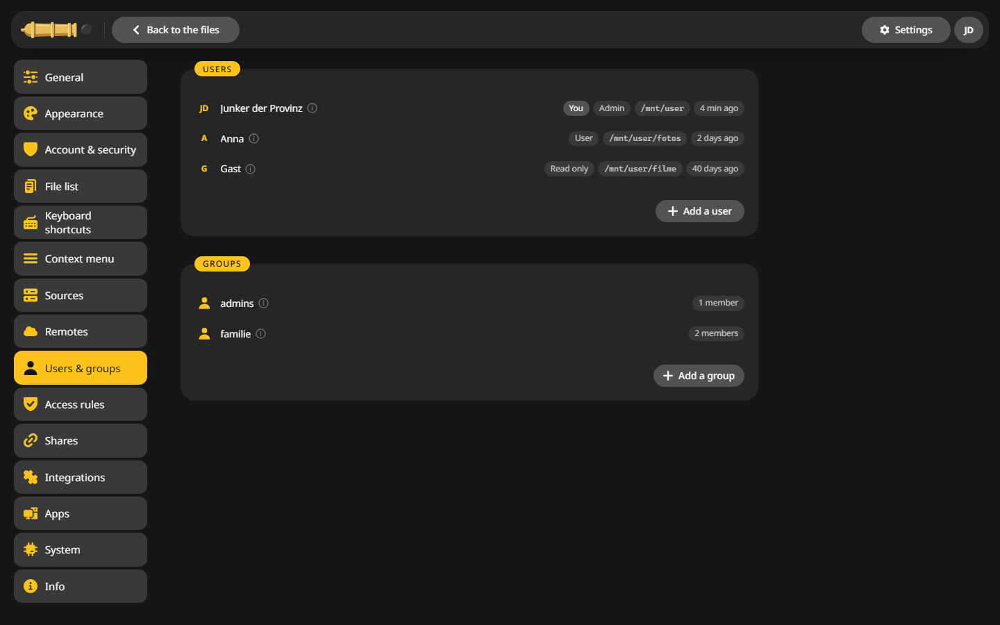
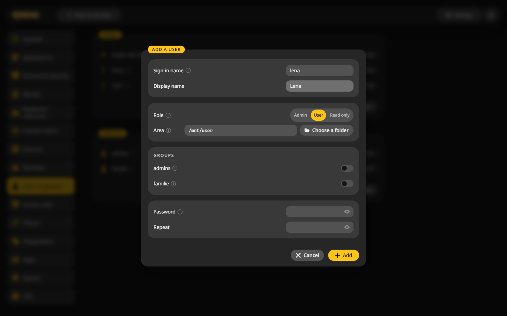

# Users and groups

Give each person an account of their own, with a role and a folder they stay inside.

## Add a user {#add}

1. Open **Settings > Users & groups** and click **Add a user**.
2. Fill in:
    - **Sign-in name**: lower case letters, such as `lena`.
    - **Display name**: how the name shows in the interface.
    - **Role**: Admin, User or Read only.
    - **Area**: the folder this person sees, with everything below it.
    - **Groups**: switch on the groups the person belongs to.
    - **Password**: at least 12 characters, typed twice.
3. Click **Add**.

## Roles {#roles}

| Role | May |
|---|---|
| Admin | Everything, the settings included. Sees disks and pools below `/mnt` |
| User | Work with the files in their area: copy, move, rename, delete, share |
| Read only | Look and download |

There always has to be at least one admin.

## Groups {#groups}

A group bundles people so an [access rule](rules.md) can apply to all of them at once. **Add a group**, give it a name, then add members from the user's window.

## Remove a user {#remove}

Open the user and choose **Remove user**. Their files stay where they are, and their share links stop working.

In the desktop app there are no users. It runs for you alone, see [Desktop app](../desktop-app.md).
