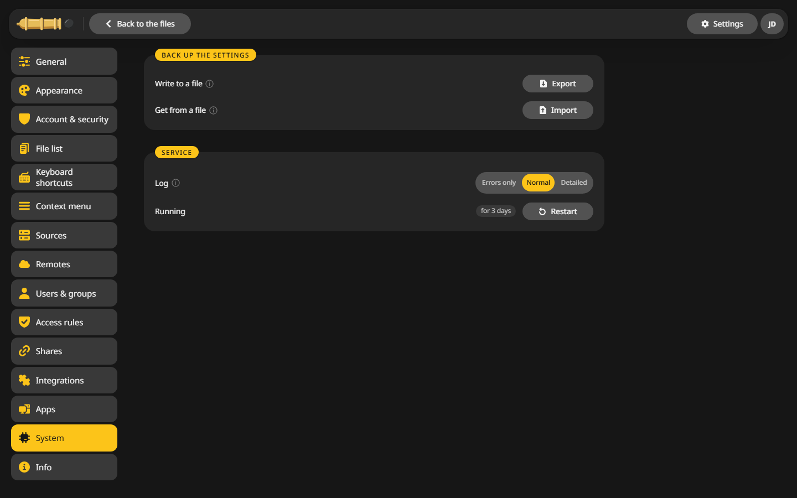

# The config file

Most settings live in the interface under **Settings**. A few, such as single sign-on or the proxy setup, live in `/config/config.yaml`, which the container writes with good defaults on its first start.

## Edit config.yaml {#edit}

1. Open the file in your appdata folder, on Unraid `/mnt/user/appdata/cannoncommander/config.yaml`, with any text editor.
2. Change what you need.
3. Restart the container.

CannonCommander itself does not open its own data folder, see [Security](../security.md). Edit the file over SMB or SSH.

## What it holds {#keys}

| Section | For example | See |
|---|---|---|
| `server.sources` | The folders that show up | [Folders](folders.md) |
| `http` | `externalUrl`, `baseURL`, trusted proxies | [Reverse proxy](reverse-proxy.md) |
| `auth.methods.password` | `enforcedOtp: true` for two-factor sign-in for everyone | [Two-factor and passkeys](../access/two-factor.md) |
| `auth.methods.oidc` | Single sign-on | [OIDC](oidc.md) |

## Back up and move the settings {#export}

An admin can save every setting to a file and load it on another server:

1. Open **Settings > System**.
2. **Export** writes the settings to a file.
3. On the new server, **Import** reads it back.

The same page sets the **Log** level and **Restart**s the service.

## Environment variables {#env}

| Variable | What it does |
|---|---|
| `PUID`, `PGID`, `UMASK` | Who new files belong to, see [Permissions](permissions.md) |
| `TZ` | Time zone, such as `Europe/Berlin` |
| `CC_UNRAID_SOCKET` | `true` allows spinning disks down and Unraid notifications, see [Unraid extras](unraid.md) |
| `CC_OIDC_CLIENT_ID`, `CC_OIDC_CLIENT_SECRET` | Keep the OIDC credentials out of the file |
