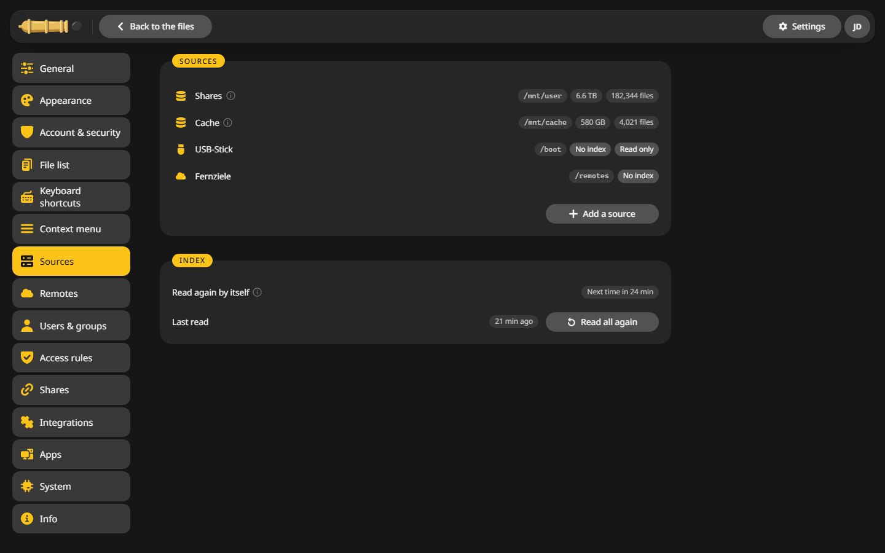

# Folders

## What the container maps {#mappings}

| Container path | What it holds |
|---|---|
| `/config` | `config.yaml`, the database with users, settings, jobs and the index, the thumbnail cache and rclone's configuration |
| `/mnt` | Your user shares, disks and pools, at the same paths as on the server |
| `/var/local/emhttp` | Read only. Unraid's live view of the disks, pools and shares |
| `/boot/config` | Read only. The settings of each share, read for placing files and for the Unraid permissions |

Everyone works in the user shares under `/mnt/user`. The disks and pools are for admins alone. Where a file lies, the other names of a hard link and moving a folder onto one disk work right away.

On Unraid the access mode of `/mnt` is **RW/Slave**, so disks and pools mounted later show up too.

## Sources {#sources}

A source is a folder CannonCommander shows at the top of the folder tree, with an index for fast search. **Settings > Sources** lists them:

### Add a source {#add}

1. Click **Add a source**.
2. Give it a **Name**, such as Disk 3, and pick the **Folder**.
3. Choose whether to **Read in for search**, and which names to leave out, such as `cache` or `*.tmp`.
4. Switch on **Read only** if nobody, admins included, should change anything there.
5. Restart CannonCommander when the page asks for it.

To browse a single disk or pool, add it here, such as `/mnt/disk3`.

### On other servers {#other}

CannonCommander starts with `/mnt/user`. On a server without that folder, add your own folders here, such as `/srv/data`, after mapping them into the container.

## The desktop app {#desktop}

The desktop app starts with your home folder. On Windows every drive is a source, on a Mac your home folder and `/Volumes`, on Linux your home folder and whichever of `/media`, `/run/media` and `/mnt` exist. **Settings > Sources** changes that list.
