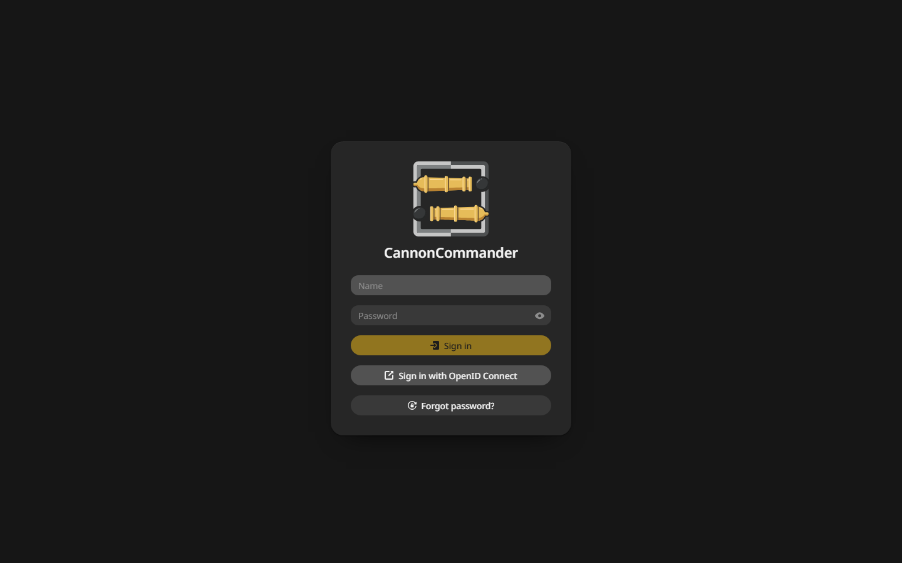

# Single sign-on with OIDC

CannonCommander signs in through any OpenID Connect provider you run.

## Set it up {#setup}

1. In your provider, create an application for CannonCommander with this redirect address:

    ```text
    https://files.example.com/api/auth/oidc/callback
    ```

2. Note its client ID, client secret and issuer address.
3. Add them to `/config/config.yaml`:

    ```yaml
    auth:
      methods:
        oidc:
          enabled: true
          clientId: "cannoncommander"
          clientSecret: "the secret from your provider"
          issuerUrl: "https://auth.example.com/application/o/cannoncommander/"
          adminGroup: "cannoncommander-admins"
    ```

4. Restart the container.

The sign-in page now shows a button for it:



## Who gets in {#who}

- A user who signs in for the first time is created on the spot.
- Members of `adminGroup` become admins.
- `userGroups` limits sign-in to the groups you list.

## Keep the secret out of the file {#env}

The client ID and secret can come from the variables `CC_OIDC_CLIENT_ID` and `CC_OIDC_CLIENT_SECRET` instead.

## Behind a reverse proxy {#proxy}

Set `externalUrl` so the redirect address matches, see [Reverse proxy](reverse-proxy.md).
