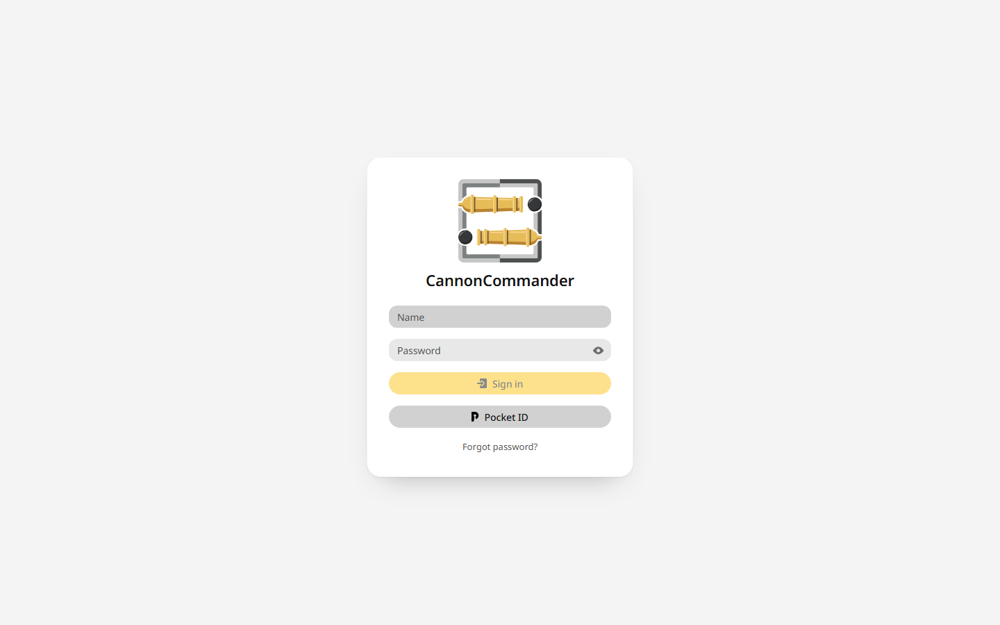

# Sign-in services

A sign-in service signs people in over OpenID Connect: Pocket ID, authentik, Authelia, Keycloak, Kanidm, Zitadel or any other. The sign-in page then shows its button below the password:



You set one up in the app or in `config.yaml`. Either way, CannonCommander needs its address in `http.externalUrl`, so the service can send people back, see [Reverse proxy](reverse-proxy.md#config). For a service in `config.yaml` that address must be https, or CannonCommander does not start.

## In the app {#app}

Sign-in services added in the app wait until your account has a password, so you can still get in when the service is down.

1. Open **Settings > Account & security** and click **Add a sign-in service** at the bottom.
2. Pick your service from the list, or **Other sign-in service** for any other.
3. Create an application for CannonCommander at the service and give it the **Redirect address** the form shows. The button next to it copies it.
4. Fill in the service's **Address**, the **Client ID** and the **Client secret**. Pasting both into **Client ID** at once fills both fields, as two lines, as `id:secret` or as the JSON many services hand out.
5. Pick the **Role for newcomers**. Whoever the service lets in for the first time gets it, and it stays User unless you change it.
6. Save, then click **Test sign-in**. The button shows up on the sign-in page once a test sign-in has worked.

**More settings** holds the name on the button, the scopes and the claims for the name and the groups. For the services in the list CannonCommander knows them already.

## In config.yaml {#config}

The short form is enough for the services in the list. CannonCommander recognises them by their address:

```yaml
http:
  externalUrl: "https://files.example.com"
auth:
  methods:
    oidc:
      enabled: true
      issuerUrl: "https://id.example.com"
      clientId: "cannoncommander"
      clientSecret: "the secret from your service"
```

Give the service this redirect address, then restart the container:

```text
https://files.example.com/api/auth/oidc/callback
```

The service shows up in **Sign-in services** marked **from config.yaml**, and you change it in the file.

!!! note "Closed without a password"
    With a service in `config.yaml`, CannonCommander stays closed even before anyone has a password. Only the service lets people in.

### All keys {#keys}

| Key | What it does |
|---|---|
| `enabled` | Switches the service on. |
| `issuerUrl`, `clientId`, `clientSecret` | The application at your service. |
| `name` | The name on the button, such as `Family login`. Empty takes the service's own name. |
| `provider` | The kind of service when it is not recognised: `pocket-id`, `authentik`, `authelia`, `keycloak`, `kanidm`, `zitadel` or `custom`. |
| `scopes` | What CannonCommander asks for. Empty takes the service's usual scopes. |
| `userIdentifier` | The claim that becomes the account name. Empty takes the service's, usually `preferred_username`. |
| `groupsClaim` | The claim with the groups. Empty takes the service's, usually `groups`. |
| `adminGroup`, `userGroups` | Who becomes an admin and who gets in, see below. |
| `caFile` | A PEM file with the certificate authority of a service that runs on your own certificate. |

A service on your own certificate needs `caFile`. CannonCommander does not start with `disableVerifyTLS`.

A service CannonCommander does not recognise, with a name of its own and your own certificate:

```yaml
oidc:
  enabled: true
  name: "Family login"
  provider: "custom"
  issuerUrl: "https://login.example.com"
  clientId: "cannoncommander"
  clientSecret: "the secret from your service"
  caFile: "/config/my-ca.pem"
```

### Who gets in {#who}

- Someone who signs in for the first time gets an account on the spot, with the role User.
- Members of `adminGroup` become admins. Whoever leaves the group is a user again at the next sign-in.
- `userGroups` lets in only the groups you list.

### Keep the secret out of the file {#env}

The client ID and secret can come from the variables `CC_OIDC_CLIENT_ID` and `CC_OIDC_CLIENT_SECRET` instead.

## After a password reset {#reset}

A [reset through the container log](../access/sign-in.md#reset) pauses every sign-in service. Click **Turn on again** on the service, or **Test sign-in** for one added in the app.
