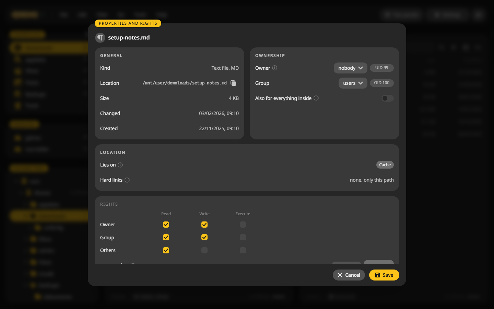
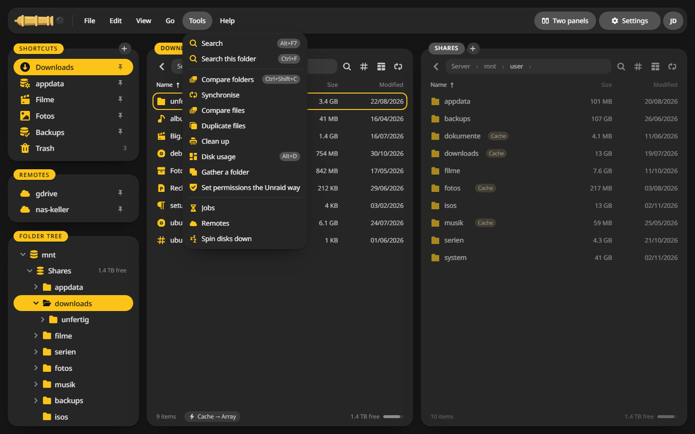

# Permissions

## Who new files belong to {#variables}

| Variable | Default | What it does |
|---|---|---|
| `PUID` | `99` | The user the server runs as and writes new files as. 99 is Unraid's `nobody`. `0` runs it as root |
| `PGID` | `100` | The group for new files, Unraid's `users` |
| `UMASK` | `000` | The permission mask for new files. 000 matches Unraid's shares, so you can still change what CannonCommander writes over SMB |
| `TZ` | | Your time zone, such as `Europe/Berlin` |

On other servers, set `PUID` and `PGID` to the user who owns your files. `id` on the server shows them.

## The capabilities it keeps {#capabilities}

The server runs as `nobody` and keeps four capabilities of root. The Unraid template sets them for you:

- `CHOWN` and `FOWNER` let **Set permissions the Unraid way** hand files to `nobody:users`.
- `DAC_READ_SEARCH` reads files that only root may read, such as the share settings in `/boot/config`.
- `DAC_OVERRIDE` writes where only root may write, such as Unraid's notification folder.

The file manager's own [users](../access/users.md) and [rules](../access/rules.md) still decide what each person sees and changes.

## Look at and change the rights of a file {#properties}

1. Put the cursor on the file or folder.
2. Press ++alt+enter++ or choose **File > Properties and rights**.
3. Change the owner, the group or the rights. **Also for everything inside** applies them to a whole folder.
4. Click **Save**.

The window also shows whether the file lies on the cache or the array, and its other names if it is a hard link.

## Set permissions the Unraid way {#unraid}

Files a container wrote as root can lock out your SMB users. **Tools > Set permissions the Unraid way**, or the same entry in the context menu, gives the marked files to `nobody:users` with the rights Unraid uses for its shares. It runs as a job.

