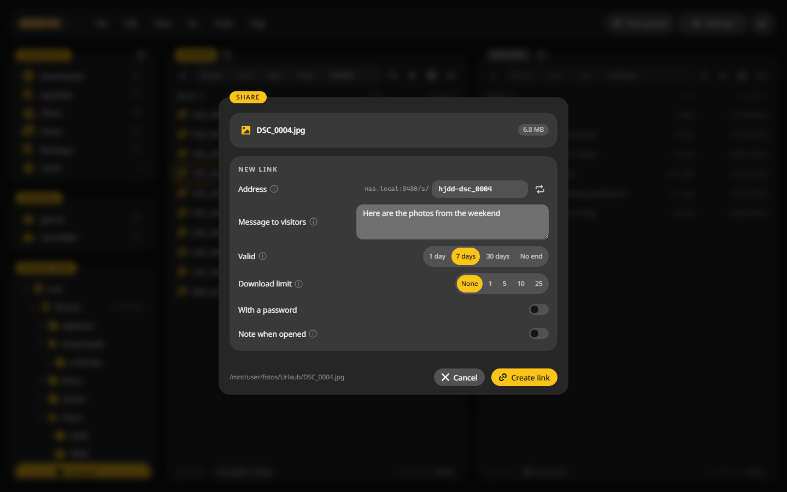

# Reverse proxy

To reach CannonCommander from outside your network, put it behind a reverse proxy with https, or use a VPN. Nginx Proxy Manager, SWAG, Traefik and Caddy all work.

## Three things to get right {#rules}

1. **Pass the `Host` header on unchanged.** WebDAV and passkeys check it against the address you use. A proxy that rewrites it breaks both.
2. **Turn off response buffering.** The live updates use server-sent events, which a buffering proxy holds back.
3. **Tell CannonCommander about the proxy.** Then sign-in limits see the real client address, and share links point to the right place.

## Tell CannonCommander about the proxy {#config}

Add this to `/config/config.yaml` and restart the container:

```yaml
http:
  externalUrl: "https://files.example.com"
  trustProxyHeaders: true
  trustedProxies:
    - 192.168.1.10
```

- `externalUrl`: the address people open.
- `trustedProxies`: the address of your proxy.

Share links then use that address:



## A sub-path {#subpath}

For an address such as `https://example.com/files/`, also set `baseURL` under `http`:

```yaml
http:
  baseURL: "/files/"
```

## Example for Caddy {#caddy}

```text
files.example.com {
    reverse_proxy 192.168.1.20:8480 {
        flush_interval -1
    }
}
```

`flush_interval -1` turns off buffering, and Caddy passes the `Host` header on by default.

## Example for Nginx {#nginx}

```nginx
location / {
    proxy_pass http://192.168.1.20:8480;
    proxy_set_header Host $host;
    proxy_set_header X-Forwarded-For $proxy_add_x_forwarded_for;
    proxy_set_header X-Forwarded-Proto $scheme;
    proxy_buffering off;
    client_max_body_size 0;
}
```

In Nginx Proxy Manager, paste the lines from `proxy_buffering` on into the **Advanced** tab of the proxy host.
