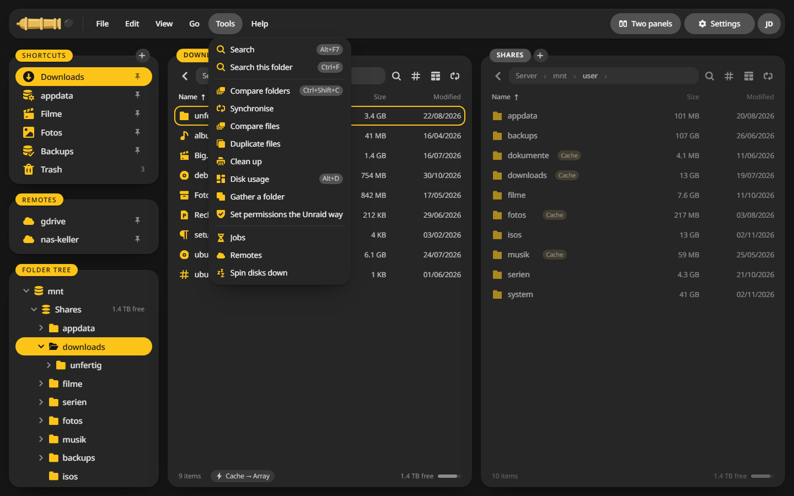

# Unraid extras

On Unraid, CannonCommander reads Unraid's own view of the array, so it can warn and help where a plain file manager cannot.

## What works right away {#always}

- **Cache badges**: files that still wait on the cache show a **Cache** badge, and **View > Only on the cache** lists just those.
- **Sleeping disks**: disks that are spun down stay asleep. Disks and pools are never indexed, and a copy that would wake one says so first.
- **Parity check**: copies can wait until a running check is done, see [Copy and move](../using/jobs.md#unraid).
- **Room on the disks**: a copy that would not fit the share's disks is stopped before it starts.
- **Disk share and user share**: mixing `/mnt/disk1` and `/mnt/user` in one copy would destroy the file, so CannonCommander stops it.
- **Gather a folder**: **Tools > Gather a folder** brings a folder spread over several disks onto one, so only that disk wakes up for playback. It can also empty a disk before you swap it.

## Spin down and notifications {#write}

Spinning disks down and sending Unraid notifications go through a socket and files that belong to root, so they are off by default. To switch them on:

1. Edit the container in Unraid.
2. Add a variable `CC_UNRAID_SOCKET` with the value `true`.
3. Add a path that maps `/var/run/emhttpd.socket` to the same path in the container.
4. For notifications, also map `/tmp/notifications` to the same path.
5. Apply.

**Tools > Spin disks down** then works, and **Tell Unraid too** under **Settings > General** sends a note when a job is done. Only admins see these actions.

!!! warning
    The emhttpd socket controls the whole array. Only switch this on if you trust everyone with an admin account.
