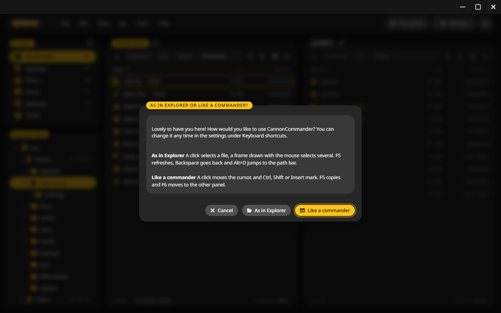

# Desktop app

CannonCommander also runs as a program on Windows, macOS and Linux, with the same interface in a window of its own, for the files on your own computer.

## Install it {#install}

=== "Windows"

    1. Download the installer for [x64](https://github.com/junkerderprovinz/cannoncommander/releases/latest/download/cannoncommander-windows-amd64-installer.exe) or [ARM](https://github.com/junkerderprovinz/cannoncommander/releases/latest/download/cannoncommander-windows-arm64-installer.exe).
    2. Run it. The app is not signed by Microsoft, so Windows may ask whether you trust it: click **More info**, then **Run anyway**.

=== "macOS"

    1. Download the [universal zip](https://github.com/junkerderprovinz/cannoncommander/releases/latest/download/cannoncommander-macos-universal.zip) and unzip it.
    2. Move CannonCommander into **Applications**.
    3. The app is not signed by Apple. At the first start, right click it and choose **Open**.

=== "Linux"

    - The installer for [x64](https://github.com/junkerderprovinz/cannoncommander/releases/latest/download/cannoncommander-linux-amd64-installer) or [ARM](https://github.com/junkerderprovinz/cannoncommander/releases/latest/download/cannoncommander-linux-arm64-installer). Make it executable and run it.
    - The Flatpak for [x64](https://github.com/junkerderprovinz/cannoncommander/releases/latest/download/cannoncommander-linux-amd64.flatpak) or [ARM](https://github.com/junkerderprovinz/cannoncommander/releases/latest/download/cannoncommander-linux-arm64.flatpak).
    - A zip on the [releases page](https://github.com/junkerderprovinz/cannoncommander/releases/latest) that runs from any folder.

## The first start {#first-start}

The app asks once how you like to work:

- **As in Explorer**: a click selects a file, a frame drawn with the mouse selects several. ++f5++ refreshes, ++backspace++ goes back and ++alt+d++ jumps to the path bar.
- **Like a commander**: a click moves the cursor, and ++ctrl++, ++shift++ or ++insert++ mark. ++f5++ copies and ++f6++ moves to the other panel.

You can change it any time under **Settings > Keyboard shortcuts**.

## What is different from the server {#differences}

- The panels open in your home folder. Which drives show up is explained under [Folders](configuration/folders.md#desktop).
- There is no sign-in. The app's server listens on 127.0.0.1 only and answers its own window and nothing else on the computer.
- So the settings leave out the account, users, access rules and share links.
- Remote storage stays with the server.
- Deleting uses your system's trash.
- Typing `cmd`, `terminal` or `powershell` into the path field opens your computer's terminal, see [Terminal](integrations/terminal.md#desktop).
- On Windows and Linux it can become the default file manager, so folders from other programs open in it.

## Updates {#updates}

Once a day the app looks for a new release, checks the download against the release's checksums and puts it in place for the next start. Switch that off under **Settings > Info**.

## Helper programs {#helpers}

The app brings ffmpeg for thumbnails and videos, 7-Zip for 7z archives and MuPDF for PDF pages. On Windows and Linux they come as a download of their own, which the installer fetches and every update renews. A Mac has them inside the app. If one goes missing, **Settings > Info** fetches it again.

To pack RAR archives the app uses WinRAR, or `rar` on Linux, when it is installed. The Windows build does not show PDF thumbnails yet.

## Where it keeps its data {#data}

The configuration, the database and the log live in a `CannonCommander` folder:

| System | Folder |
|---|---|
| Windows | `%APPDATA%\CannonCommander` |
| macOS | `~/Library/Application Support/CannonCommander` |
| Linux | `~/.config/CannonCommander` |
