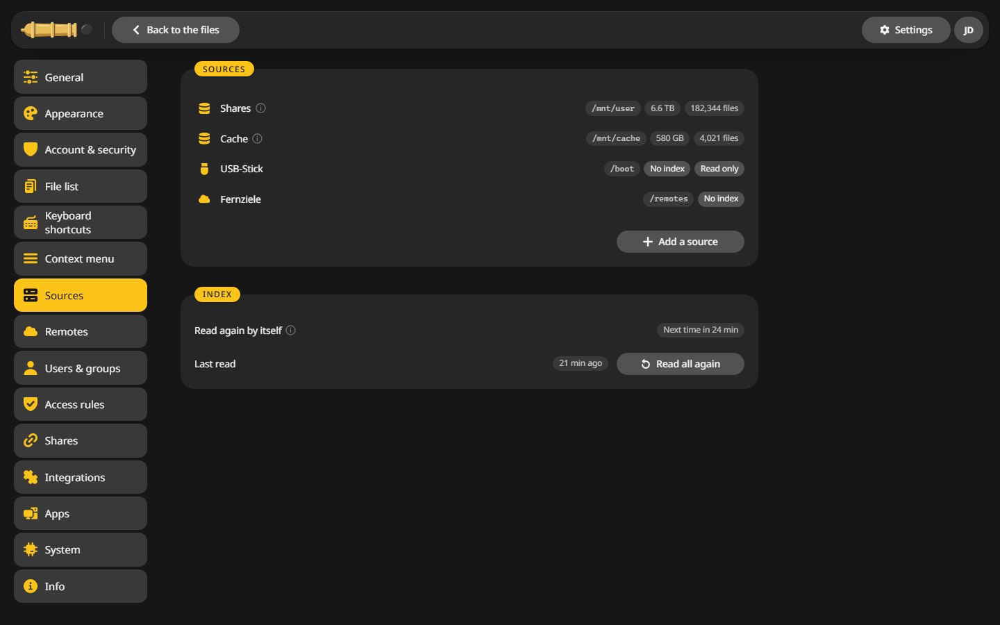

# Other Docker hosts

Any Linux server with Docker runs the same container as the Unraid template.

## With Docker Compose {#compose}

1. Make a folder for it and download [compose.yaml](https://raw.githubusercontent.com/junkerderprovinz/cannoncommander/main/compose.yaml) into it.
2. Set `PUID` and `PGID` to the user who owns your files. `id` on the server shows them.
3. Start it:

    ```sh
    docker compose up -d
    ```

4. Open `http://<your server>:8480`.

## With docker run {#run}

```sh
docker run -d --name cannoncommander -p 8480:80 \
  -v /path/to/appdata:/config \
  -v /mnt:/mnt \
  -e PUID=1000 -e PGID=1000 -e UMASK=022 \
  --device /dev/fuse --cap-add SYS_ADMIN \
  --cap-add DAC_READ_SEARCH --cap-add DAC_OVERRIDE \
  --security-opt apparmor:unconfined \
  junkerderprovinz/cannoncommander:latest
```

## Where your files show up {#folders}

CannonCommander shows the folders below `/mnt/user`, the way Unraid lays out its shares. On another server you have two choices:

- Keep your folders below `/mnt/user` on the host, or
- add your own folders under **Settings > Sources**, or change the source in `/config/config.yaml`.



More on this under [Folders](../configuration/folders.md).

!!! note "Without FUSE"
    Without `--device /dev/fuse` and `SYS_ADMIN` everything works except mounting remote storage. On Debian and Ubuntu, Docker's AppArmor profile blocks FUSE mounts, which is what `apparmor:unconfined` is for.

Then set a password: [First start](first-start.md).
