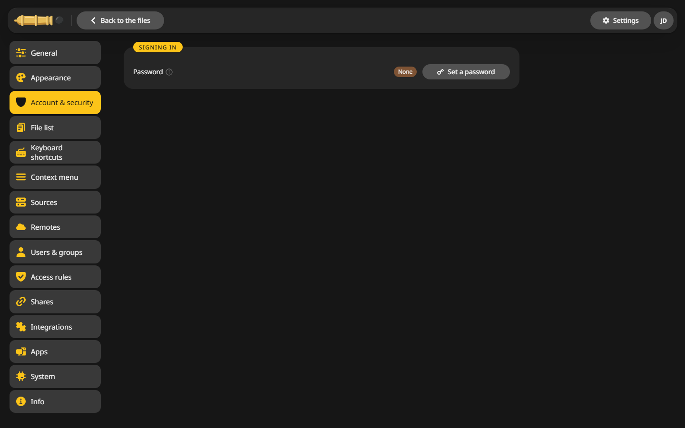
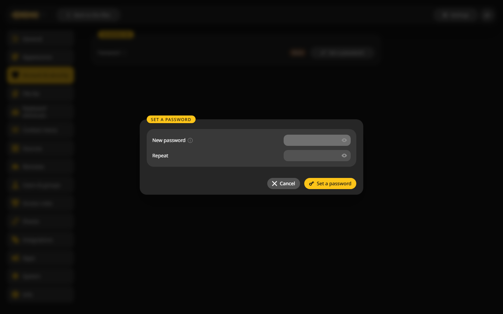

# First start

CannonCommander opens right away as the user `admin`, without a sign-in. That makes the first look easy, but anyone who reaches the port can use it. Setting a password takes a minute.

## Set a password {#password}

1. Click **Settings** at the top right.
2. Open **Account & security**. The password shows **None**.

    

3. Click **Set a password**, type it twice and confirm. It needs at least 12 characters.

    

From now on everyone signs in. The page you just used now also offers two-factor sign-in, passkeys and API tokens, see [Two-factor and passkeys](../access/two-factor.md).

## Add more people {#people}

Under **Settings > Users & groups** you add an account per person, each with a role and a folder of their own. See [Users and groups](../access/users.md).

## Going back to no sign-in {#remove}

**Remove password** on the same page opens CannonCommander again, as long as no other account has a password. Only do this on a network you trust.

## Next {#next}

- Learn the [panels and tabs](../using/panels.md).
- Copy your first files: [Copy and move](../using/jobs.md).
- Reach it from outside safely: [Reverse proxy](../configuration/reverse-proxy.md).
