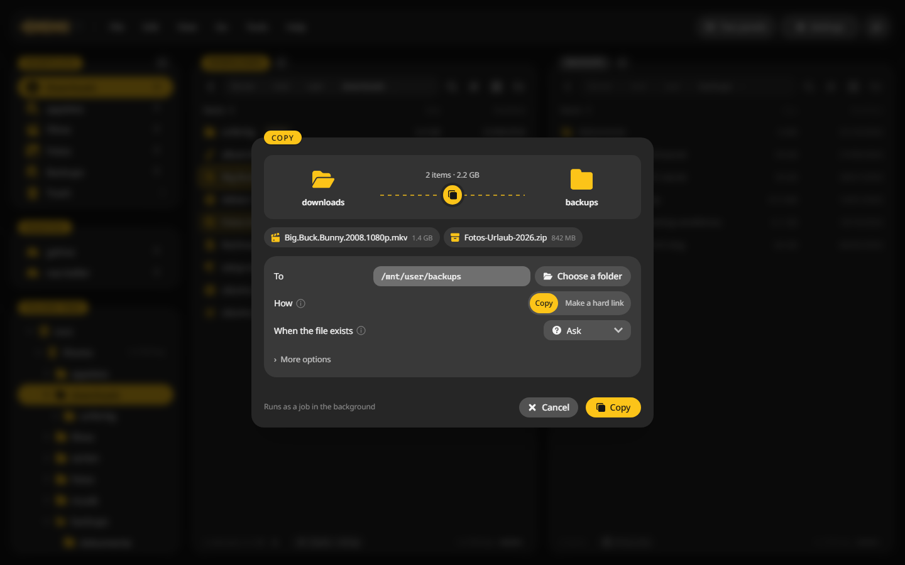
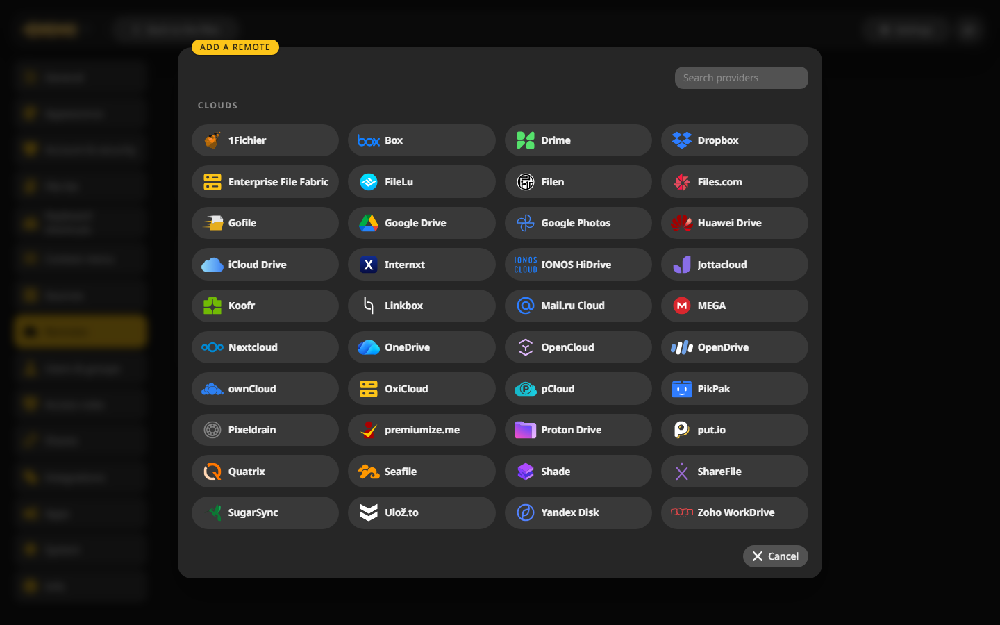
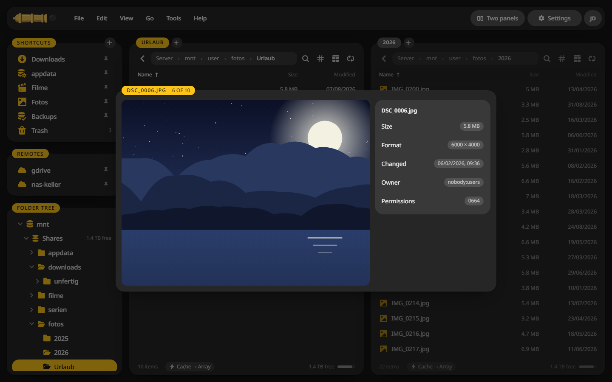

# CannonCommander

CannonCommander is a two-pane file manager. It runs on your server as a container and opens in the browser, and it runs on your own computer as an app for Windows, macOS and Linux. On Unraid it knows which files sit on the cache, which disks are asleep and how Unraid wants its permissions.

The folders and files in these pictures are made up.

## Two panels and the keyboard {#two-panels}

Each panel shows a folder, with tabs if you want more. Mark files on one side, press ++f5++ and they are copied to the other. ++f6++ moves, ++f7++ makes a folder, ++f8++ deletes. ++ctrl+k++ finds any command by name.

[Panels and tabs](using/panels.md) · [Keyboard shortcuts](using/keys.md)

## Copies run as jobs {#jobs}

A copy, move or delete becomes a job on the server. You keep working while it runs, follow its speed, pause it or cap it, and close the browser without stopping it. Deleted files land in a trash first.

[Copy and move](using/jobs.md) · [Trash and undo](using/trash.md)

## Every cloud, browsed like a folder {#remotes}

SFTP, SMB, WebDAV, S3 and the big cloud drives mount through rclone and show up in the folder tree next to your shares.

[Remote storage](remote-storage.md)

## A closer look on the space bar {#quick-look}

++space++ shows the file under the cursor large, with its details. The arrow keys walk through the folder. Pictures, videos, music, PDFs, text, code and Office files all open this way.

[Quick look and preview](using/quick-look.md)

## Where to start {#start}

- New here? [Install it](getting-started/index.md) on Unraid, another NAS, any Docker host or your computer.
- Already running? Learn the [panels](using/panels.md) and the [keys](using/keys.md), then pick what you need from the sidebar.
- Something odd? [Troubleshooting](troubleshooting.md) lists the usual causes.
