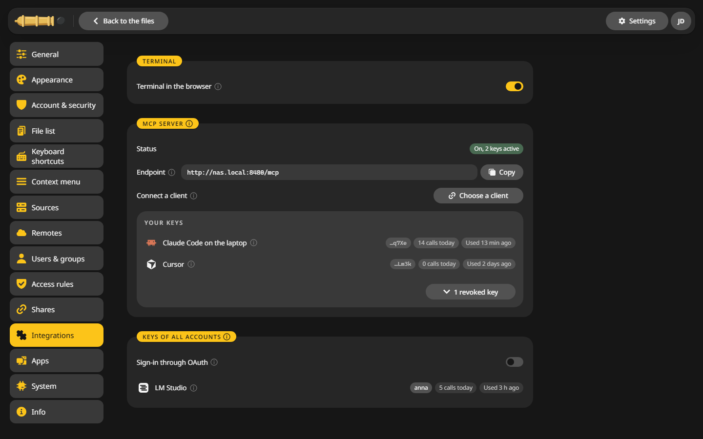
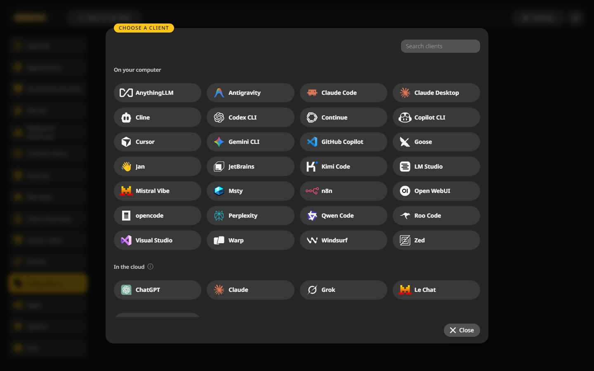
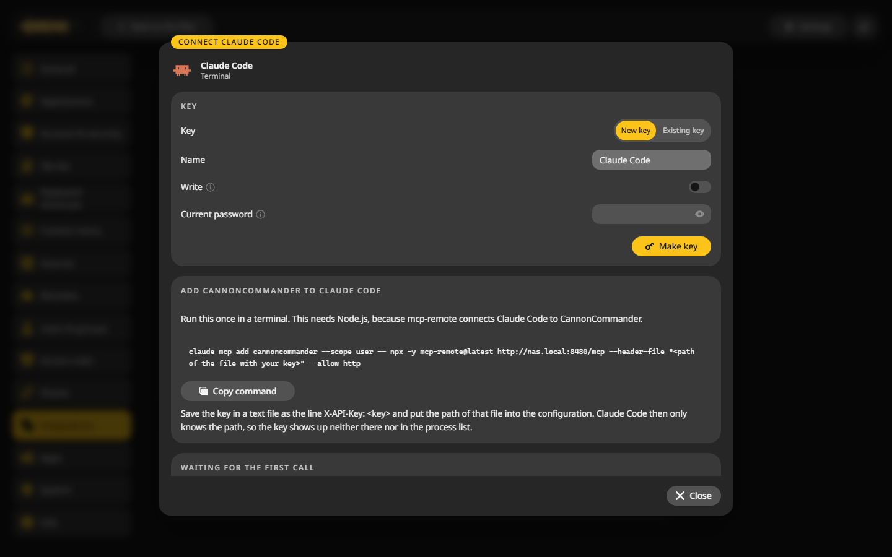

# MCP server

The built-in MCP server lets the AI assistants you already use browse, search and read your files, and with your say-so tidy them up. Each assistant gets a key of its own and exactly its owner's rights.

## Connect an assistant {#connect}

1. Open **Settings > Integrations** and find the **MCP server** card.

    

2. Click **Choose a client** and pick yours. **Other client** covers any that is not listed.

    

3. Follow the three steps in the window: make a key, copy the configuration into your client, and wait for the first call. The card turns green once the client has called.

    

The endpoint is `/mcp` below the address you open CannonCommander at, such as `http://nas.local:8480/mcp`. It speaks Streamable HTTP and takes the key in the `Authorization` or `X-API-Key` header.

## Reading and writing {#rights}

- A new key only reads: it lists folders, searches and reads text files.
- **Write** is a switch per key and asks for your password first. With it on, the assistant can create folders, copy, move, rename, move things to the trash and restore them.
- Every change is a job you can follow and undo. Nothing is ever deleted for good.
- Writing is held to 25 entries per call and 200 per hour.

What the assistant reads, such as folder names or the text of a file, goes to the AI provider behind it.

## Keep an eye on a key {#log}

Each key shows its calls today and when it was last used. Its log lists what it did, and the [activity log](../troubleshooting.md#activity) names the key next to each change. **Replace** gives a key a new secret, **Revoke** ends it.

An admin sees the keys of every account, can take writing away and revoke them. The server keeps only a fingerprint of each key.

## Assistants in the cloud {#oauth}

Web chats in the cloud cannot take a key. For them:

1. Make CannonCommander reachable from the internet over https, for example behind a [reverse proxy](../configuration/reverse-proxy.md). A login on the proxy may guard the interface, but `/mcp` has to get through without it.
2. As admin, switch on **Sign-in through OAuth** under **Keys of all accounts** in the same card, with the public address.
3. Add CannonCommander in the assistant. It sends you to a CannonCommander page where you sign in and allow it.

## In the desktop app {#desktop}

The endpoint is `http://127.0.0.1:<port>/mcp` on your own computer. The port can change when another program has taken it, so check the card if a client stops connecting.
