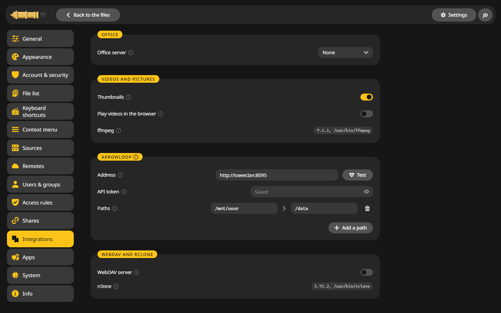

# Office files

CannonCommander previews Word, Excel and PowerPoint files on its own. With an office server of yours, they also open for editing in the browser, in the quick look and with ++f3++.

## Connect an office server {#connect}

1. Run an office server you trust, such as OnlyOffice, Collabora or Euro-Office, where the browser can reach it.
2. Open **Settings > Integrations** and pick it under **Office server**.
3. Enter its **Server address**, the one it answers at in the browser.
4. Enter the **JWT secret**. You find it in the office container's configuration as `JWT_SECRET`. Without it the server turns every file away.
5. The card says whether the connection works.

Then open a document with ++f3++ and choose **Open in** with the name of your server.

## Videos and pictures {#media}

The same page has the **Videos and pictures** card:

- **Thumbnails** for photos and videos, made by ffmpeg in the background.
- **Play videos in the browser** converts formats such as MKV while they play. It takes computing time, so it is off by default.

## ArrowLoop {#arrowloop}

[ArrowLoop](https://github.com/junkerderprovinz/arrowloop) plans recurring syncs. With its address and an API token in the **ArrowLoop** card, **Plan in ArrowLoop** in the [sync window](../using/compare.md#sync) hands it a folder pair. If ArrowLoop sees the shares under other paths, such as `/data` instead of `/mnt/user`, add the pair under **Paths**.
