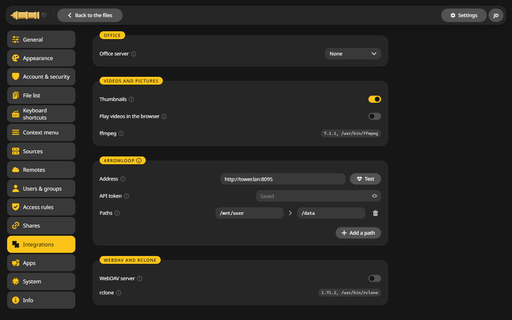

# Office files

CannonCommander previews Word, Excel and PowerPoint files on its own. With an office server of yours, they also open for editing in the browser, in the quick look and with ++f3++.

## Connect an office server {#connect}

When your office server runs as a container on the same server, CannonCommander finds it for you:

1. Open **Settings > Integrations**. The **Office** card lists each OnlyOffice, Euro-Office or Collabora container under **Found on this server**, with the address it answers at.
2. Click **Connect**. CannonCommander takes the address and, for OnlyOffice and Euro-Office, the JWT secret from the container, tests the connection and saves it.
3. The row now says **Connected**, and the fields above show the address.

This needs the Docker socket, `/var/run/docker.sock`, mounted into the container, as the Unraid template offers under **Docker socket**. CannonCommander only reads from it here.

Then open a document with ++f3++ and choose **Open in** with the name of your server.

### Without the Docker socket {#probe}

On the desktop app, in a Proxmox container or on umbrelOS, CannonCommander does not see other containers. The card shows **Look for an office server** instead:

1. Enter the machine your office server runs on, such as `tower.lan` or `192.168.1.20`. It starts with the host you opened CannonCommander at.
2. Click **Search**. CannonCommander asks that one machine on the ports office servers usually listen on: 80, 8080, 9900 and 9943 (Euro-Office on Unraid), 443, 9980 (Collabora) and 35201 (Euro-Office on umbrelOS). It never asks any other machine.
3. Click **Connect** next to what it found, then enter the **JWT secret** for OnlyOffice or Euro-Office. You find it in the office container's configuration as `JWT_SECRET`.

### By hand {#manual}

1. Pick your server under **Office server**.
2. Enter its **Server address**, the one it answers at in the browser.
3. Enter the **JWT secret**. Without it OnlyOffice and Euro-Office turn every file away.
4. Click **Test**. The button says whether the connection works.



### Which address it picks {#address}

A container can be reachable at several addresses. CannonCommander tries them in this order and keeps the first that answers:

- the WebUI address of the Unraid template, or a Traefik `Host()` rule,
- a published port on the host you opened CannonCommander at, such as `http://tower.lan:9900`,
- the container's own address on a LAN network such as `br0`,
- its address on a Docker network.

When CannonCommander is opened over https, an https address comes first, because the browser refuses an editor on plain http inside an https page. If the found address is not the one your browser uses, for example a reverse proxy, change **Server address** after connecting.

## Collabora {#collabora}

Collabora has no JWT secret. It decides by its `aliasgroup1` setting which servers may open documents in it, and without one it takes the first server that calls.

If Collabora already works for another app, such as Nextcloud, add CannonCommander's address to its settings, for example in the container's environment:

```
aliasgroup1=https://cloud.example.com:443
aliasgroup2=http://tower.lan:8480
```

When the container's setting names other servers only, the found row says so and names the address to add. Restart Collabora afterwards.

Collabora serves https with a certificate of its own by default, which CannonCommander and the browser do not trust. Behind a reverse proxy, start it with `extra_params=--o:ssl.enable=false --o:ssl.termination=true` and connect the proxy's https address.

## An OnlyOffice server without JWT_SECRET {#own-secret}

An OnlyOffice container started without `JWT_SECRET` makes up a secret of its own and keeps it inside the container. The found row then says so. Connect, then read the secret with

```
docker exec <container> /var/www/onlyoffice/documentserver/npm/json -f /etc/onlyoffice/documentserver/local.json 'services.CoAuthoring.secret.session.string'
```

and enter it under **JWT secret**. Setting `JWT_SECRET` on the container is simpler and survives an update.

## What CannonCommander reads {#privacy}

Listing the office servers reads the image name, the addresses and the ports of the running containers. It looks at the environment of office containers only, and the secret never leaves the server: the page only learns whether there is one. Only a click on **Connect** copies it into CannonCommander's settings, the same place a secret you type in goes.

## Videos and pictures {#media}

The same page has the **Videos and pictures** card:

- **Thumbnails** for photos and videos, made by ffmpeg in the background.
- **Play videos in the browser** converts formats such as MKV while they play. It takes computing time, so it is off by default.

## ArrowLoop {#arrowloop}

[ArrowLoop](https://github.com/junkerderprovinz/arrowloop) plans recurring syncs. With its address and an API token in the **ArrowLoop** card, **Plan in ArrowLoop** in the [sync window](../using/compare.md#sync) hands it a folder pair. If ArrowLoop sees the shares under other paths, such as `/data` instead of `/mnt/user`, add the pair under **Paths**.
