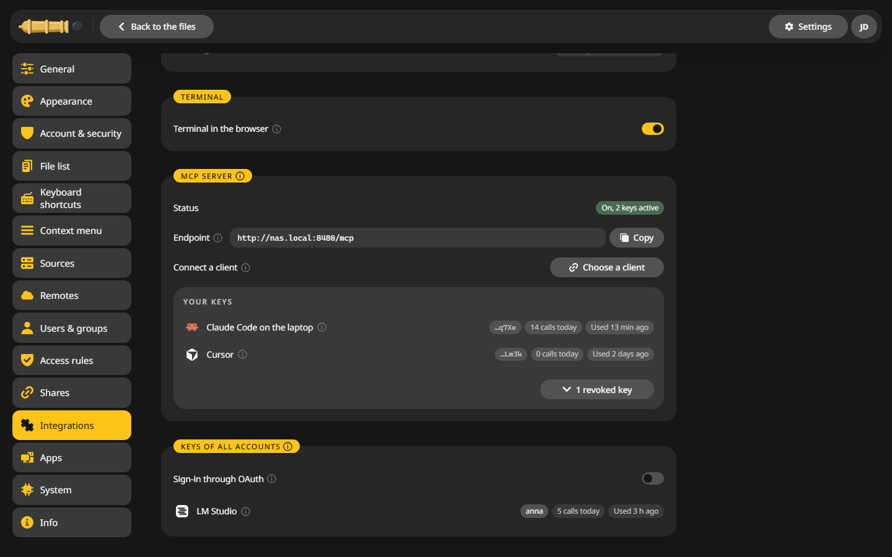

# Terminal

Admins can open a shell on the server in the folder they are looking at. It stays off until you switch it on.

## Switch it on {#on}

1. Open **Settings > Integrations**.
2. In the **Terminal** card, switch on **Terminal in the browser**.

!!! warning "Think before you switch it on"
    Whoever opens the terminal can do on the server whatever CannonCommander's user may, past every access rule. With sign-in turned off everybody who reaches the page counts as an admin, so all of them would get a shell.

## Open a terminal {#open}

Any of these opens one in the current folder:

- type `bash`, `cmd`, `terminal` or `powershell` into the path field (++ctrl+l++) and press ++enter++,
- **Tools > Open terminal here**,
- **Open terminal here** in the context menu of the list.

Until the switch is on, CannonCommander says so and offers a way to the settings.

## What runs there {#what}

- A Linux shell inside the container, `bash` where the image has it.
- It runs as `PUID:PGID`, without the extra capabilities the server keeps.
- Only signed-in admins get one, never an API token, and at most four at a time.
- It closes after 30 minutes without typing, when the session ends and when the switch goes off.
- Opening and closing go into the activity log. What is typed does not.

## In the desktop app {#desktop}

The same words open your own computer's terminal in a window of its own, with no switch to turn on:

| System | Word | Opens |
|---|---|---|
| Windows | `cmd` | Command Prompt |
| Windows | `powershell` | Windows PowerShell |
| Windows | `pwsh` | PowerShell 7 |
| Windows | `wt` | Windows Terminal |
| Windows | `terminal` | Windows Terminal where installed, otherwise the Command Prompt |
| macOS | any of them | Terminal |
| Linux | any of them | The terminal in `TERMINAL` or `x-terminal-emulator`, else the first common one found |
