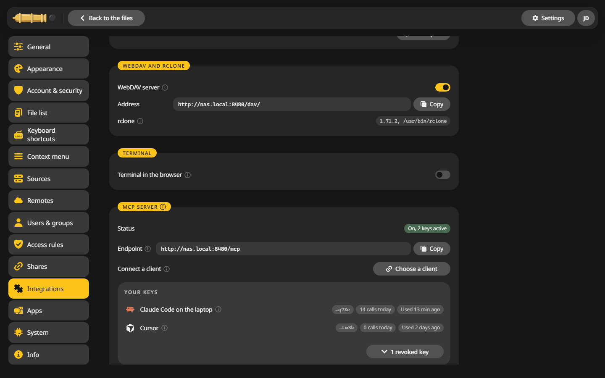

# WebDAV

The WebDAV server lets you mount your files as a drive, in a file manager on your computer or in a phone app. The same users and [access rules](../access/rules.md) apply.

## Switch it on {#on}

1. Open **Settings > Integrations**.
2. In the **WebDAV and rclone** card, switch on **WebDAV server**.
3. Copy the **Address**. It ends in `/dav/`.



## Connect a client {#clients}

Sign in with your user name and password. With [two-factor sign-in](../access/two-factor.md) on, use an [API token](../access/tokens.md) as the password.

=== "Windows"

    Windows Explorer maps a WebDAV drive only over https. Put CannonCommander behind a [reverse proxy](../configuration/reverse-proxy.md) with a certificate first, then:

    1. In Explorer, right click **This PC** and choose **Map network drive**.
    2. Enter `https://files.example.com/dav/` as the folder.
    3. Tick **Connect using different credentials** and sign in.

=== "macOS"

    1. In Finder, choose **Go > Connect to Server** or press ++cmd+k++.
    2. Enter `http://nas.local:8480/dav/` and click **Connect**.
    3. Sign in.

=== "Linux"

    In most file managers, type the address into the location bar with `dav://` in front:

    ```text
    dav://nas.local:8480/dav/
    ```

    Use `davs://` for an https address.

=== "rclone"

    ```sh
    rclone config create cc webdav url=http://nas.local:8480/dav/ vendor=other user=anna pass=$(rclone obscure 'your-password')
    rclone ls cc:
    ```

Plain http works for macOS, Linux, rclone and phone apps on your own network.

## Behind a reverse proxy {#proxy}

The proxy has to pass the `Host` header on unchanged, since WebDAV checks it. See [Reverse proxy](../configuration/reverse-proxy.md).
