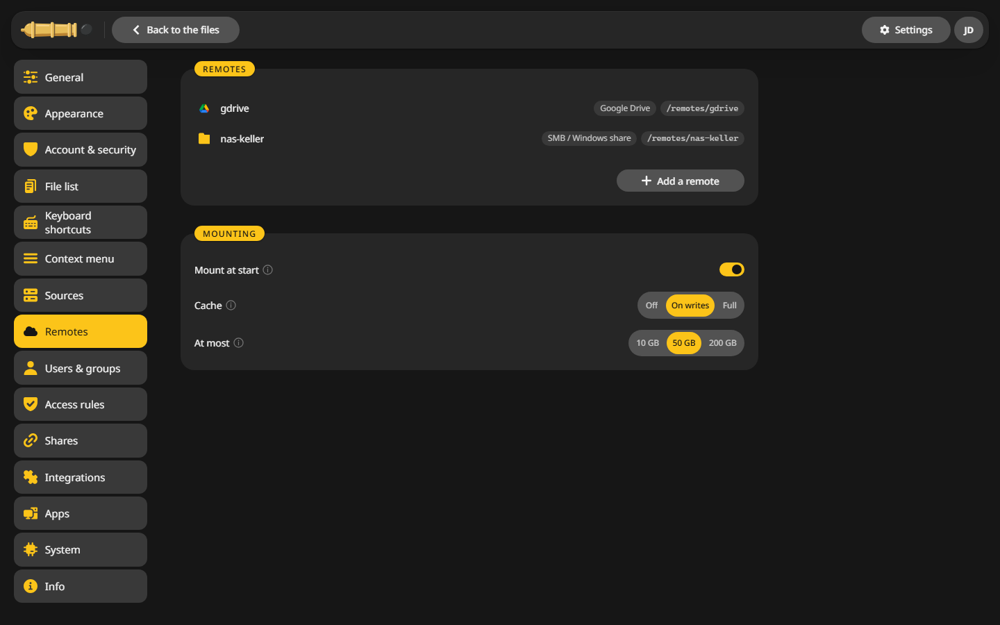
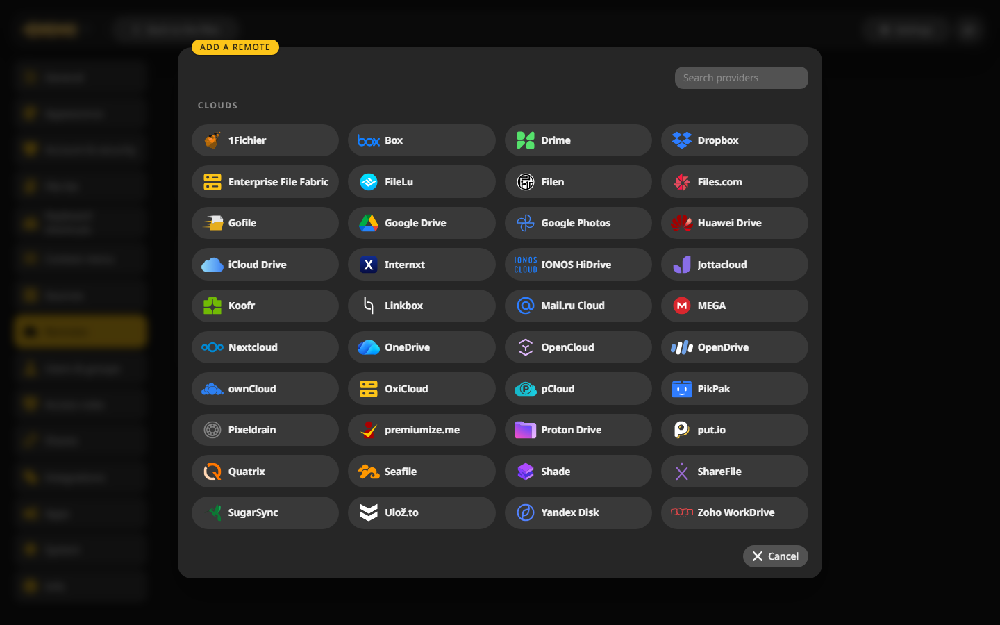
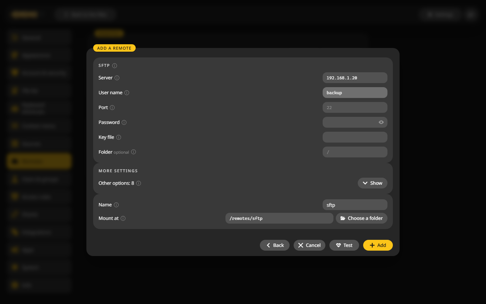
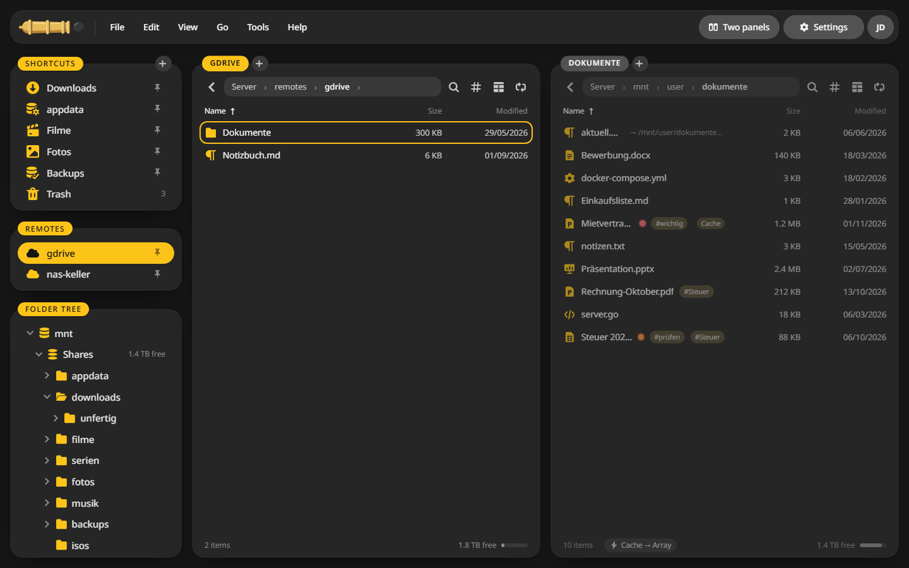

# Remote storage

SFTP, SMB, WebDAV, S3, the big cloud drives and everything else rclone speaks show up as folders next to your shares. CannonCommander starts rclone itself, so there is nothing to install.

## Add a remote {#add}

1. Open **Settings > Remotes** and click **Add a remote**.

    

2. Pick the provider. The search field at the top narrows the list.

    

3. Fill in the fields the provider needs. For SFTP that is the server, the user name and a password or key file.
4. Give it a **Name** and check **Mount at**. The folder has to be below `/remotes`.
5. Click **Test**, then **Add**.

The remote now sits under **Remotes** in the sidebar. Open it like any folder, and copy between it and your shares with ++f5++:

## Providers that sign in through a browser {#token}

Google Drive, OneDrive, Dropbox and a few others sign in through a web page. The server cannot open one, so you make a token on your own computer once:

1. Install [rclone](https://rclone.org/install/) on a computer with a browser.
2. In the remote form, copy the command shown under **Run on your computer**. It looks like `rclone authorize "drive"`.
3. Run it in a terminal. A browser opens, you sign in and allow access.
4. The terminal prints a token. Paste it into **Token** and click **Use it**.

CannonCommander only gets the token, never your password.

## Mounting and cache {#cache}

Under **Settings > Remotes > Mounting**:

- **Mount at start** mounts every remote when the container starts.
- **Cache** keeps files on the server for a moment, so programs can open them like local files. **Off** saves space, **On writes** suits most uses, **Full** is fastest and takes the most room.
- **At most** limits the cache to 10, 50 or 200 GB.

## Where things live {#where}

- rclone's configuration: `/config/rclone`.
- The mounts: below `/remotes` inside the container. Neither the server nor other containers see them.

## What the container needs {#needs}

Mounting needs `/dev/fuse` and the `SYS_ADMIN` capability. The Unraid template sets both. On Debian and Ubuntu, Docker's AppArmor profile also has to allow it, see [Other Docker hosts](getting-started/docker.md).

In the desktop app remotes are not available, since it has nothing to mount them with. Mount them on the server instead.
