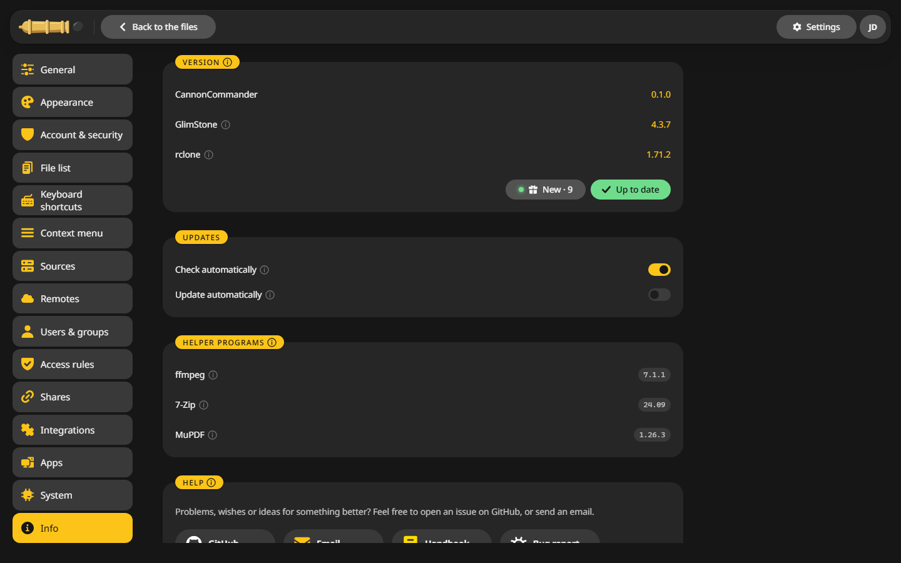
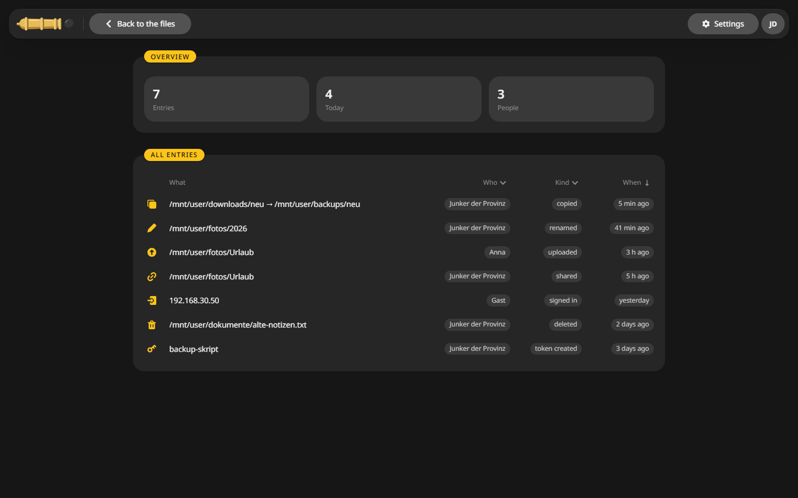

# Troubleshooting

Most problems come down to a mapping, a permission or a proxy setting. Here are the usual ones.

## First look {#first}

**Settings > Info** shows the version, whether an update is out, and whether the helper programs are there.

## Common problems {#common}

??? question "I see no files, or only some shares"
    CannonCommander shows the folders below `/mnt/user`. Check that `/mnt` is mapped into the container. On another server, add your folders under **Settings > Sources**, see [Folders](configuration/folders.md).

??? question "A disk or pool is missing"
    Disks and pools are for admins only. To browse one, add it under **Settings > Sources**. On Unraid the `/mnt` mapping needs the access mode **RW/Slave**, otherwise disks mounted later stay invisible.

??? question "Permission denied when copying or deleting"
    The server writes as `PUID:PGID`. Check that this user may write in the folder, see [Permissions](configuration/permissions.md). Files a container wrote as root can be handed back with **Tools > Set permissions the Unraid way**.

??? question "Files I wrote cannot be changed over SMB"
    Keep `UMASK` at `000` on Unraid, so new files match the share's rights.

??? question "A remote does not mount"
    The container needs `/dev/fuse` and `SYS_ADMIN`. On Debian and Ubuntu also `--security-opt apparmor:unconfined`. See [Remote storage](remote-storage.md#needs).

??? question "The list does not update, jobs seem stuck"
    The live updates use server-sent events. Turn off response buffering in your reverse proxy, see [Reverse proxy](configuration/reverse-proxy.md).

??? question "WebDAV or passkeys fail behind the proxy"
    The proxy has to pass the `Host` header on unchanged.

??? question "Windows will not map the WebDAV drive"
    Windows Explorer maps WebDAV only over https. See [WebDAV](integrations/webdav.md).

??? question "No passkey can be added here"
    Browsers offer passkeys only over https or on `localhost`. Open CannonCommander through its https address.

??? question "Share links point to the wrong address"
    Set `externalUrl` in `config.yaml`, see [Reverse proxy](configuration/reverse-proxy.md#config).

??? question "Videos do not play"
    Switch on **Play videos in the browser** under **Settings > Integrations**. It converts MKV and similar formats while they play.

??? question "I forgot my password"
    Click **Forgot password?** on the sign-in page. CannonCommander writes a code into the container log: on Unraid click the container's icon in the Docker tab and pick **Logs**. Enter the code and a new password within 10 minutes. The reset ends all other sessions, turns off two-factor sign-in and revokes every API token. Another admin can also set a new password for you under **Settings > Users & groups**.

## The activity log {#activity}

**Go > Activity** lists who did what and when: copies, renames, uploads, shares, sign-ins, deletes and new tokens.

## The log {#log}

**Settings > System > Log** switches between Errors only, Normal and Detailed. The container log in Unraid's Docker tab, or `docker logs cannoncommander`, shows it.

## Report a problem {#report}

1. Open **Settings > Info** and click **Bug report**. It downloads a file with the settings and the state of the jobs, without passwords, keys or credentials.
2. [Open an issue](https://github.com/junkerderprovinz/cannoncommander/issues) and attach the file.

Questions are welcome in the [support thread](https://forums.unraid.net/topic/201231-support-junkerderprovinz-cannoncommand/).
