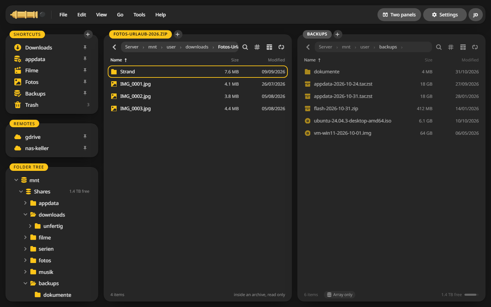

# Archives and checksums

## Pack files {#pack}

1. Mark the files and folders.
2. Press ++alt+p++ or choose **File > Pack**.
3. Give the archive a name and pick a **Format**:
    - **zip** opens on every system without an extra program.
    - **tar.zst** is the fastest and keeps rights and owners.
    - **7z** packs the smallest.
    - **rar** needs the rar program on the server.
4. Pick a **Compression**. Photos, videos and music hardly get smaller, so **None** saves time for them.
5. Add a **Password** if you like. zip, 7z and rar encrypt with AES-256.
6. Click **Pack**. It runs as a job and the archive lands in the other panel's folder.

## Look inside an archive {#browse}

Double click an archive, or press ++enter++ on it. It opens like a folder, read only. Copy single files out of it with ++f5++.

## Unpack {#unpack}

1. Mark one or more archives.
2. Press ++alt+u++ or choose **File > Unpack**.
3. **Into a folder of its own** keeps each archive's files apart.
4. Choose what happens when a file exists already, and click **Unpack**.

ZIP, 7z, RAR, TAR and its compressed kinds all unpack.

## Test an archive {#test}

**File > Test archive** reads every file in the archive without unpacking it. Damaged archives stay marked red in the list.

## Checksums {#checksums}

1. Mark the files and choose **File > Make checksums**.
2. Pick the **Method**. SHA-256 is what most downloads list, BLAKE3 is the fastest.
3. Copy a single checksum, or save them all as a `.sha256` file next to the files.

**File > Check checksums** compares files against such a list, from a file or pasted in.

## Split and combine {#split}

**File > Split file** cuts a large file into parts of a size you choose. **File > Combine** puts the parts back together.
