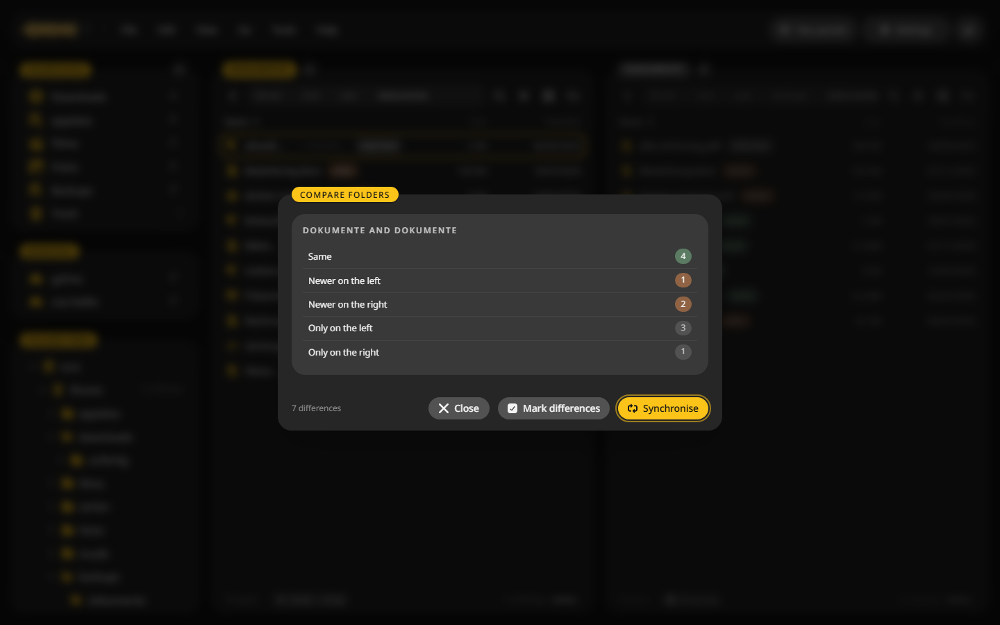
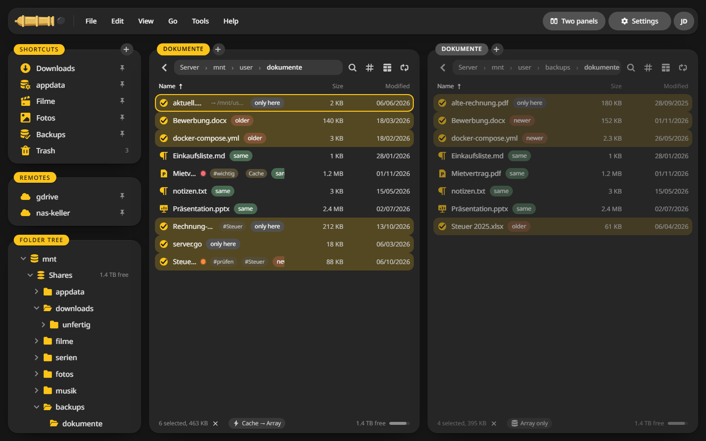
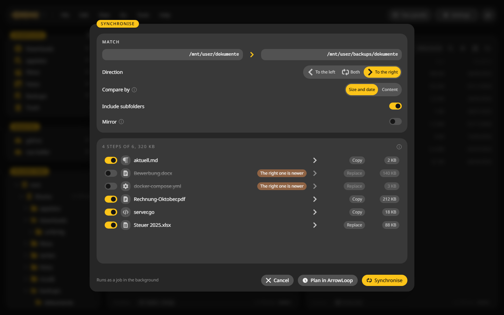
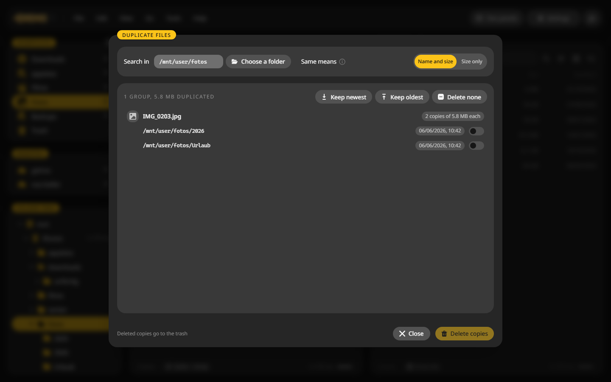
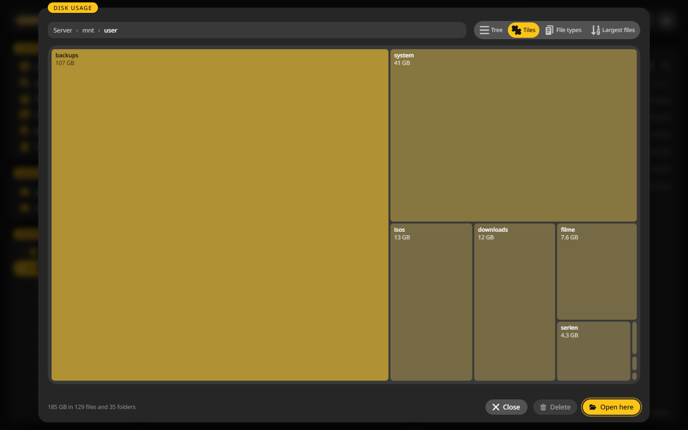

# Compare and sync

Tools for keeping two folders the same, finding doubles and seeing where the space went.

## Compare two folders {#compare}

1. Open one folder in each panel.
2. Press ++ctrl+shift+c++ or choose **Tools > Compare folders**.
3. The window counts what is the same, what is newer on either side and what exists only on one side.

4. **Mark differences** marks every file that differs, in both panels, with a badge that says why.

With the differences marked, ++f5++ copies them across.

**View > Browse in sync** keeps both panels in step: open a subfolder on one side and the other side follows.

## Synchronise {#sync}

1. In the compare window, click **Synchronise**, or choose **Tools > Synchronise**.
2. Pick the **Direction**: to the left, both, or to the right.
3. Pick **Compare by**: size and date is quick, content reads every file and finds what size and date do not show.
4. Switch on **Include subfolders** if you want them.
5. **Mirror** also deletes on the target what the source does not have. Deleted items go to the trash.
6. Look at the steps in the preview. Each one can be switched off.
7. Click **Synchronise**. It runs as a job.

**Plan in ArrowLoop** hands the folder pair to [ArrowLoop](https://github.com/junkerderprovinz/arrowloop) as a recurring sync job. Set its address and token under **Settings > Integrations > ArrowLoop** first.

## Compare two files {#diff}

Mark one file in each panel and choose **Tools > Compare files**. Text files show side by side with the changes coloured.

## Duplicate files {#duplicates}

1. Open the folder and choose **Tools > Duplicate files**.
2. Pick what **Same means**: name and size, or size only, which also finds renamed copies.
3. Choose **Keep newest**, **Keep oldest** or tick the copies yourself.
4. **Delete copies** moves them to the trash. One copy always stays.

## Disk usage {#disk-usage}

++alt+d++ shows what takes the space below the current folder, as a tree, as tiles, by file type or as a list of the largest files. **Open here** shows the folder in the panel, **Delete** removes what you picked.

## Clean up {#cleanup}

**Tools > Clean up** finds empty folders and messy names below a folder and tidies them in one go. What it deletes goes to the trash.
