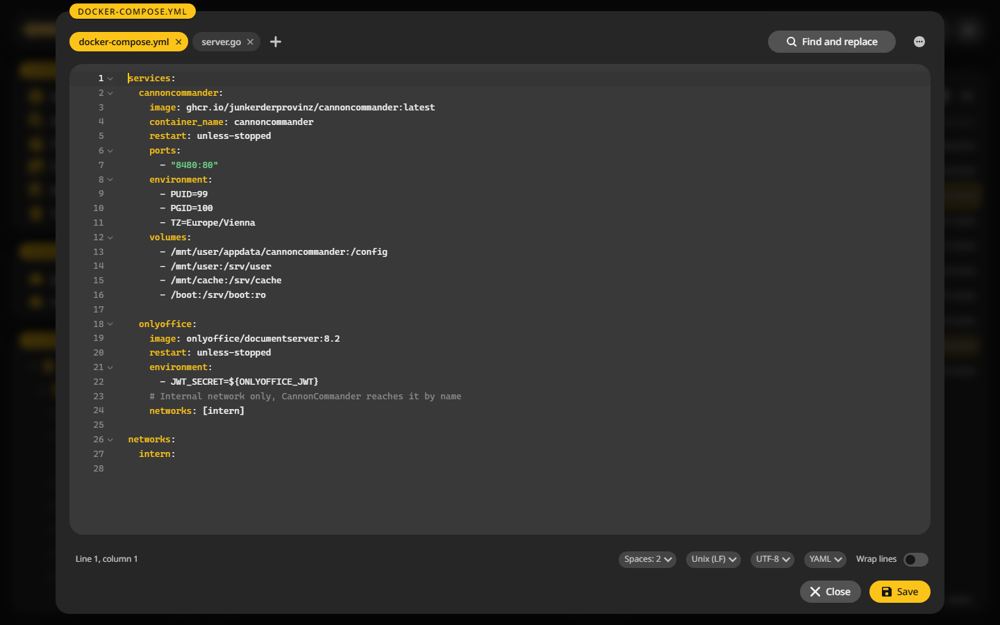

# Editor

A text and code editor in the browser, for the compose file or a config you would otherwise open over SSH.

## Edit a file {#edit}

1. Put the cursor on a file, or mark several.
2. Press ++f4++. Each file opens in a tab.
3. Change it and press ++ctrl+s++.

++shift+f4++ makes a new file and opens it.

## Handy keys {#keys}

| Key | Does |
|---|---|
| ++ctrl+s++ | Save |
| ++ctrl+f++ and ++ctrl+h++ | Find, find and replace |
| ++f3++ and ++shift+f3++ | Next and previous match |
| ++ctrl+g++ | Go to a line |
| ++ctrl+d++ | Duplicate the line |
| ++alt+arrow-up++ and ++alt+arrow-down++ | Move the line |
| ++ctrl+slash++ | Comment the line in or out |
| ++ctrl+tab++ and ++ctrl+w++ | Next tab, close the tab |

Find and replace can match case, whole words or a regular expression.

## The status bar {#status}

At the bottom: line and column, the indent, the line endings, the encoding and the language. Click one to change it. **Wrap lines** breaks long lines at the window edge.

## Vim keys {#vim}

**Settings > Keyboard shortcuts > Vim keys in the editor** switches the editor to vim's modes and keys.

## When someone else changed the file {#conflict}

If the file changed on the server while you edited it, CannonCommander does not overwrite it. Your version stays in the editor, so you can copy what you need and reload.
