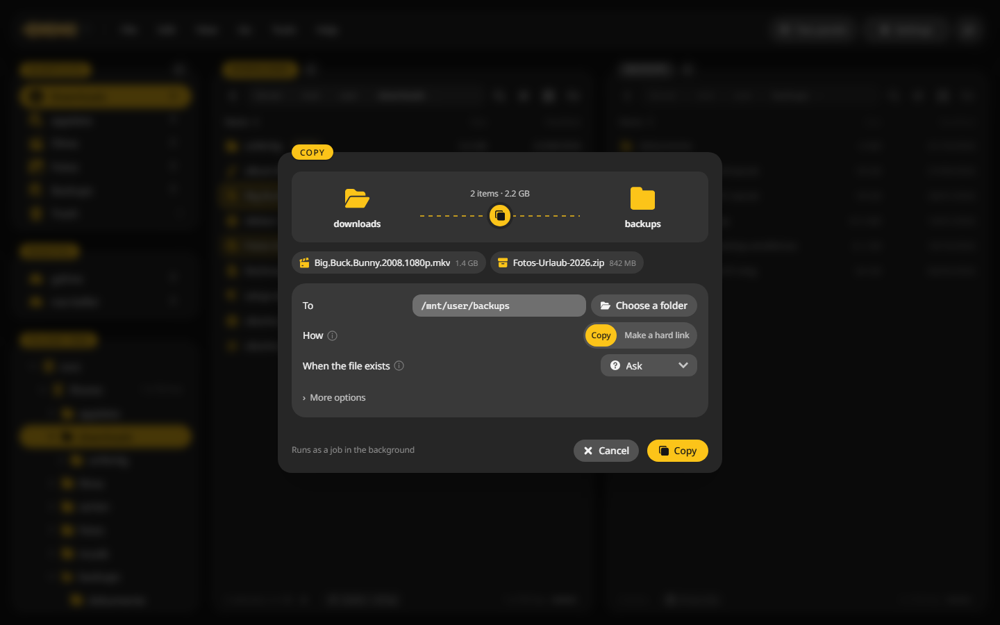
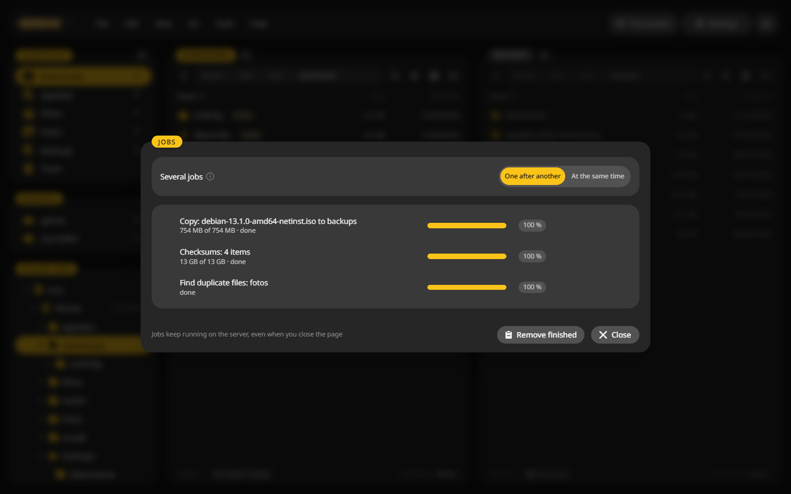
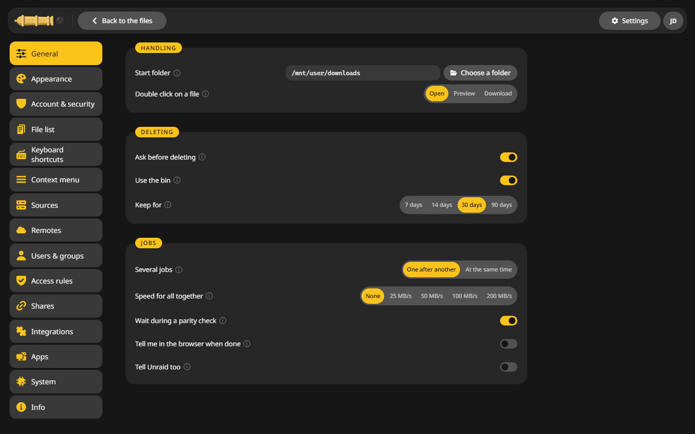

# Copy and move

Copies, moves and deletes run as jobs on the server. You keep working, and the job keeps going when you close the page.

## Copy files to the other panel {#copy}

1. Open the target folder in one panel and the files in the other.
2. Mark the files. See [Marking files](panels.md#marking).
3. Press ++f5++ to copy or ++f6++ to move.
4. Check the window and click **Copy**.

The window offers:

- **To**: the target. It starts with the other panel's folder.
- **How**: a normal copy or a **hard link**. A hard link is a second name for the same file and takes no space. It works when source and target are on the same disk or pool.
- **When the file exists**: Ask, Skip, Replace, If newer or Keep both. With Ask you decide per file.
- **More options**: keep permissions and timestamps, and check the copy against a checksum afterwards.

Dragging files from one panel to the other works too, and so do ++ctrl+c++, ++ctrl+x++ and **Edit > Paste**.

## Follow the jobs {#jobs}

**Tools > Jobs** or ++alt+4++ shows what runs.

For each job you can:

- pause and resume it,
- limit its speed,
- cancel it, or retry it after an error,
- change the order with the arrows or ++alt+arrow-up++ and ++alt+arrow-down++.

**Several jobs** decides whether they run **one after another**, which is kind to the disks, or **at the same time**. A speed limit for all jobs together sits under **Settings > General**, next to a note in the browser or in Unraid when a job is done.

Jobs pick up again after the container restarts.

## Unraid's own checks {#unraid}

Before a copy starts, CannonCommander checks what Unraid would do:

- **Parity check running**: it asks whether to copy now or wait until the check is done. **Wait during a parity check** under Settings, General makes waiting the rule.
- **Not enough room**: when no disk of the share has space above its minimum free space, it says so before the copy would stop halfway.
- **Disk share and user share**: copying between `/mnt/disk1/x` and `/mnt/user/x` would cut the file to 0 bytes. CannonCommander stops that and offers a safe way.

## Undo {#undo}

++ctrl+z++ takes back the last rename, copy, move, new folder or delete. **Edit > Recent actions** lists the last ones to pick from.
