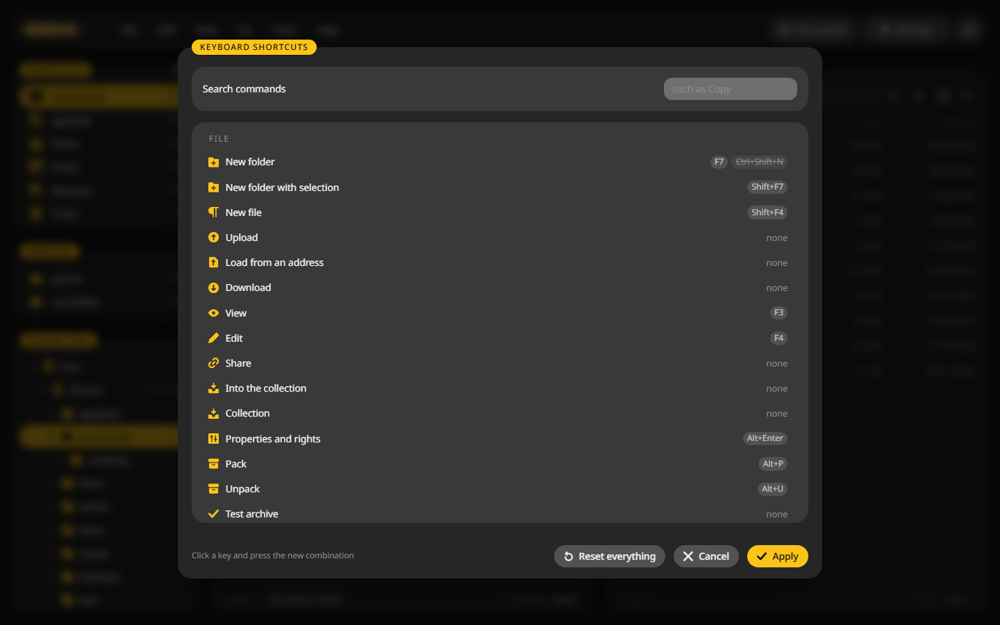
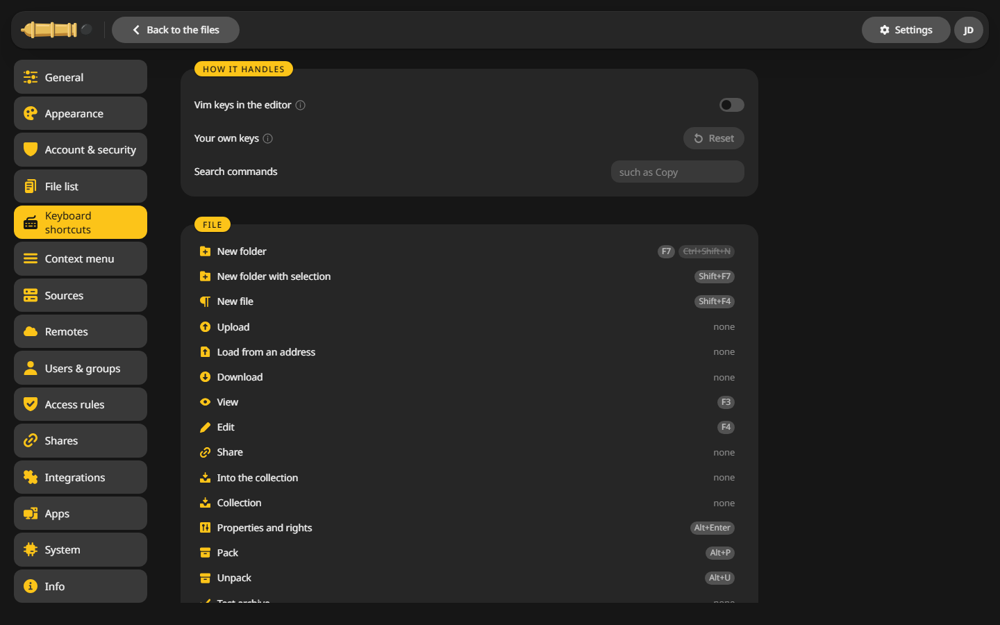

# Keyboard shortcuts

CannonCommander follows the keys of the classic commanders. ++f1++ lists all of them, and every one can be changed.

## The function keys {#fkeys}

| Key | Does |
|---|---|
| ++f1++ | Keyboard shortcuts |
| ++f2++ | Rename |
| ++f3++ | View |
| ++f4++ | Edit, ++shift+f4++ makes a new file |
| ++f5++ | Copy to the other panel |
| ++f6++ | Move to the other panel |
| ++f7++ | New folder, ++shift+f7++ with the marked files inside |
| ++f8++ | Delete, also ++del++ |
| ++f9++ | Search, also ++alt+f7++ |
| ++f10++ | Menu bar |

**View > Function key bar** shows these keys as buttons at the bottom.

## More keys worth knowing {#more}

| Key | Does |
|---|---|
| ++ctrl+k++ | Find a command |
| ++space++ | Quick look |
| ++slash++ or ++ctrl+f++ | Filter this folder |
| ++ctrl+m++ | Rename many |
| ++ctrl+shift+c++ | Compare folders |
| ++alt+p++ and ++alt+u++ | Pack and unpack |
| ++alt+d++ | Disk usage |
| ++alt+enter++ | Properties and rights |
| ++ctrl+z++ | Undo |
| ++ctrl+q++ | Preview in the other panel |
| ++ctrl+h++ | Hidden files |
| ++alt+1++ to ++alt+4++ | Jump to the sidebar, the left panel, the right panel, the jobs |

## The shortcut window {#window}

++f1++ lists every command with its keys, grouped by menu. The field at the top finds one by name.

## Change a key {#change}

1. Open **Settings > Keyboard shortcuts**.
2. Click the key next to a command and press the new one.
3. **Reset** brings back the defaults.

The same page switches the editor to vim keys. In the desktop app it also chooses between keys as in Explorer and keys like a commander.
