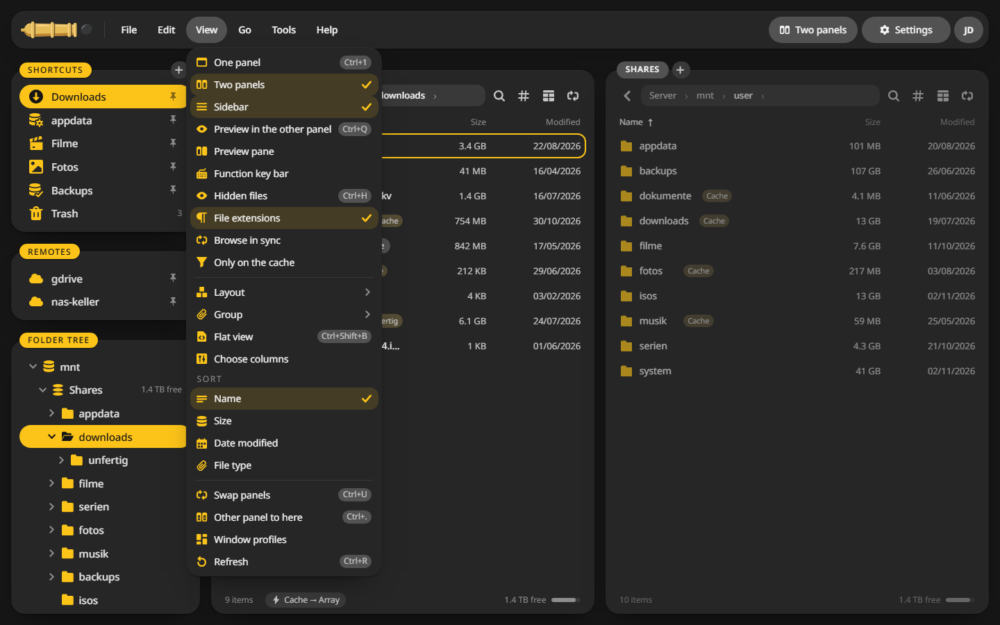
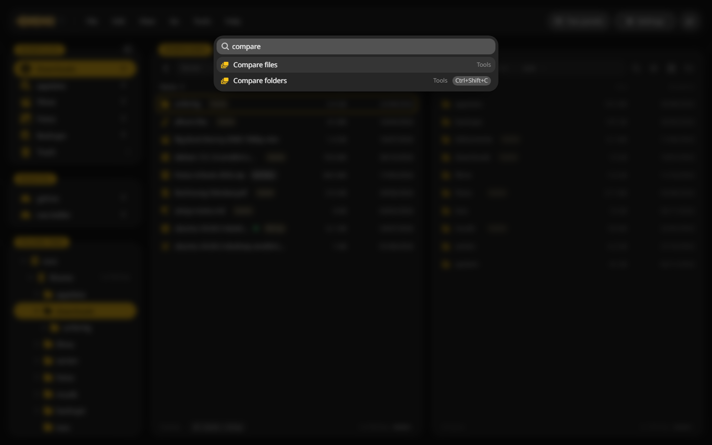

# Panels and tabs

## The parts of the window {#parts}

- **Sidebar** on the left: shortcuts, remotes and the folder tree. ++ctrl+b++ hides it.
- **Two panels**, each with a folder. The active panel has the yellow cursor row.
- **Menu bar** at the top: File, Edit, View, Go, Tools and Help. ++f10++ opens it from the keyboard.
- **Status line** under each panel: how many items, what is marked, free space, and on Unraid where new files land.

## Moving around {#moving}

| Do this | Key |
|---|---|
| Switch between the panels | ++tab++ |
| Open a folder or file | ++enter++ or a double click |
| Up one level | ++alt+arrow-up++ |
| Back and forward | ++alt+arrow-left++ and ++alt+arrow-right++ |
| Type a path | ++ctrl+l++ |
| Folder history | ++alt+arrow-down++ |
| One panel or two | ++ctrl+1++ and ++ctrl+2++ |
| Swap the panels | ++ctrl+u++ |
| Open the other panel's folder here | ++ctrl+period++ |

Typing into the path field also opens a [terminal](../integrations/terminal.md): `bash`, `cmd` or `terminal`, then ++enter++.

## Tabs {#tabs}

Each panel can hold several tabs.

1. ++ctrl+t++ opens a new tab with the current folder.
2. ++ctrl+tab++ and ++ctrl+shift+tab++ switch between them.
3. ++ctrl+w++ closes the current one.

The **+** next to the tab names does the same as ++ctrl+t++. A right click on a tab can duplicate it, lock it to its folder or close all the others.

## The menu bar {#menus}

Every command sits in a menu, with its key beside it.

## Find a command {#palette}

Forgot where something is? ++ctrl+k++ opens the command search. Type a few letters and press ++enter++.

## Marking files {#marking}

| Do this | How |
|---|---|
| Mark the row and move down | ++insert++ |
| Add single files | ++ctrl++ and a click |
| Mark a range | ++shift++ and a click |
| Mark by pattern, such as `*.jpg` | ++plus++ |
| Invert the selection | ++asterisk++ |
| Clear it | ++minus++ |
| Mark everything | ++ctrl+a++ |

A right click on a file opens its context menu with the commands that fit it.

## Unraid in view {#unraid}

On Unraid the list shows a **Cache** badge on files that still sit on the cache, and the status line names where new files land, such as **Cache → Array**. Disks that are spun down stay asleep: CannonCommander warns before a copy would wake them.

## Window profiles {#profiles}

**View > Window profiles** saves both panels with their tabs and the columns of the list under a name. Pick it later to get the same setup back.
