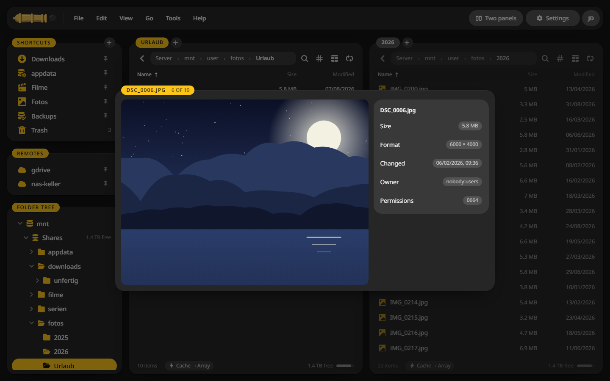
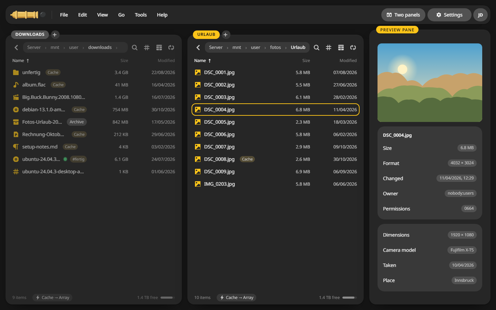
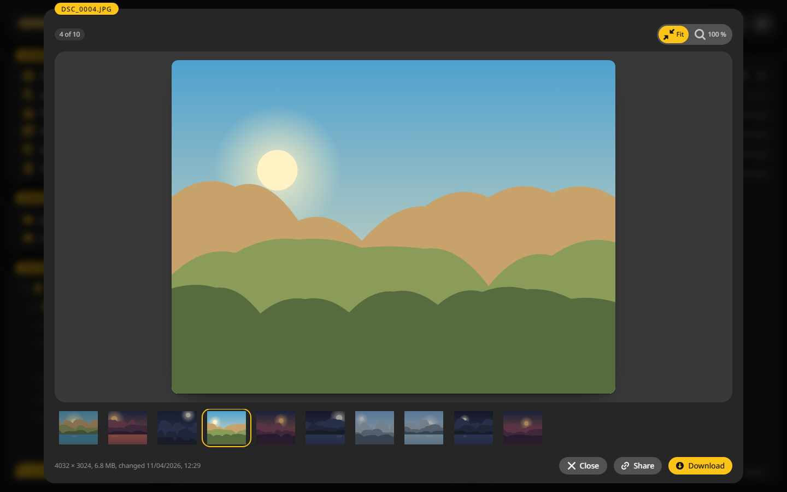

# Quick look and preview

Four ways to see a file without opening it in another program.

## Quick look on the space bar {#quick-look}

1. Put the cursor on a file.
2. Press ++space++.
3. ++arrow-left++ and ++arrow-right++ walk through the folder. ++esc++ or ++space++ closes it.

## The preview pane {#pane}

**View > Preview pane** puts a preview of the file under the cursor next to the panels. For a photo it shows the camera, the date and the place.

## Preview in the other panel {#other-panel}

++ctrl+q++ turns the other panel into a preview. Move the cursor and the preview follows. ++ctrl+q++ again brings the folder back.

## The viewer {#viewer}

++f3++ opens the file in the viewer: pictures, video, audio, PDF, Markdown, text and code, Office files, e-books, 3D models and archives.

- Videos the browser cannot play, such as MKV, are converted while they play when **Play videos in the browser** is on under **Settings > Integrations**.
- Office files show in a built-in preview. With an [office server](../integrations/office.md) they open for editing.
- Markdown switches between **Rendered** and **Source**.
- In a folder of pictures the arrow keys step through them.
