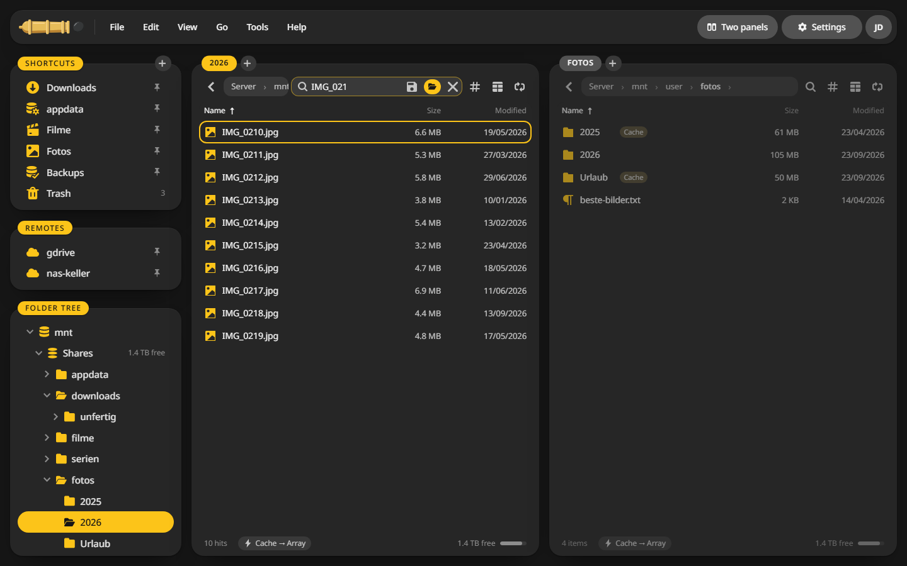
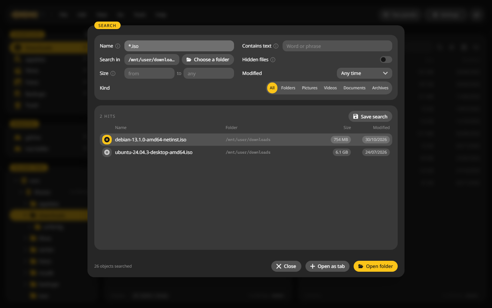
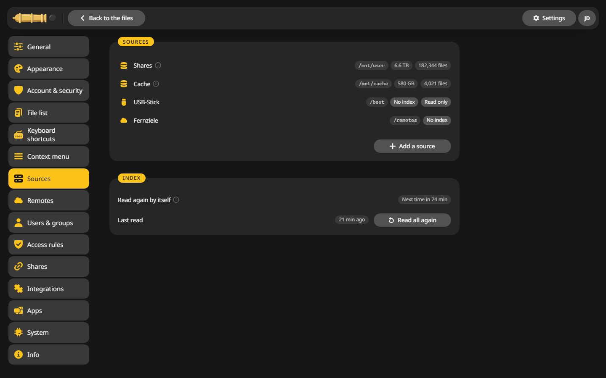

# Search

Two kinds of search: a quick filter for the folder you are in, and a full search across the server.

## Filter the current folder {#filter}

1. Press ++slash++ or ++ctrl+f++.
2. Type part of a name. The list shrinks as you type.
3. ++esc++ shows the whole folder again.

## Search the server {#search}

1. Press ++alt+f7++, ++f9++ or ++ctrl+e++.
2. Fill in what you know:
    - **Name**: patterns such as `*.iso *.img`, or part of a name. `*` stands for any number of characters, `?` for one.
    - **Contains text**: a word inside text and source files.
    - **Search in**: the folder to start from.
    - **Size**, **Modified** and **Kind** narrow it down.
3. Press ++enter++. The hits show up in the window.
4. **Open as tab** lists the hits in a panel, where you can copy, move or delete them like any folder.

## Search by field {#fields}

The search field in the panel understands more than names. Click into it and its menu shows examples:

| Type | Finds |
|---|---|
| `*.mkv` | Every MKV file |
| `IMG_????.jpg` | IMG_ and four characters |
| `#Steuer` | Files with the tag Steuer |
| `width:>=3840 codec:hevc` | 4K videos in HEVC |
| `modified:<7d` | Files changed in the last week |

Width, height, codec, artist, camera, size, modified, duration and every column name work as a field.

## Saved searches {#saved}

**Save this search** puts the search into the menu of the search field. Clicking it later always shows the current hits.

## The index {#index}

Search and folder sizes are fast because CannonCommander keeps an index of each source. It reads busy folders more often and quiet ones less often, between every 5 minutes and every 12 hours, so files other containers change show up too.

**Settings > Sources** shows each source with its files and when it was last read. **Read all again** starts a fresh read.

Disks and pools are never indexed, so a sleeping disk stays asleep.
