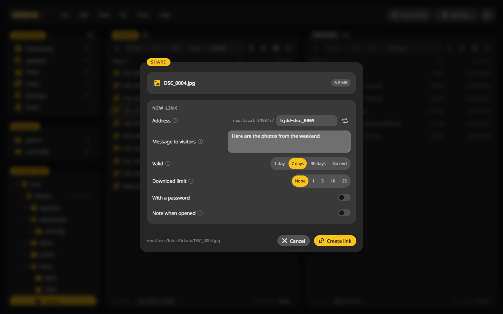
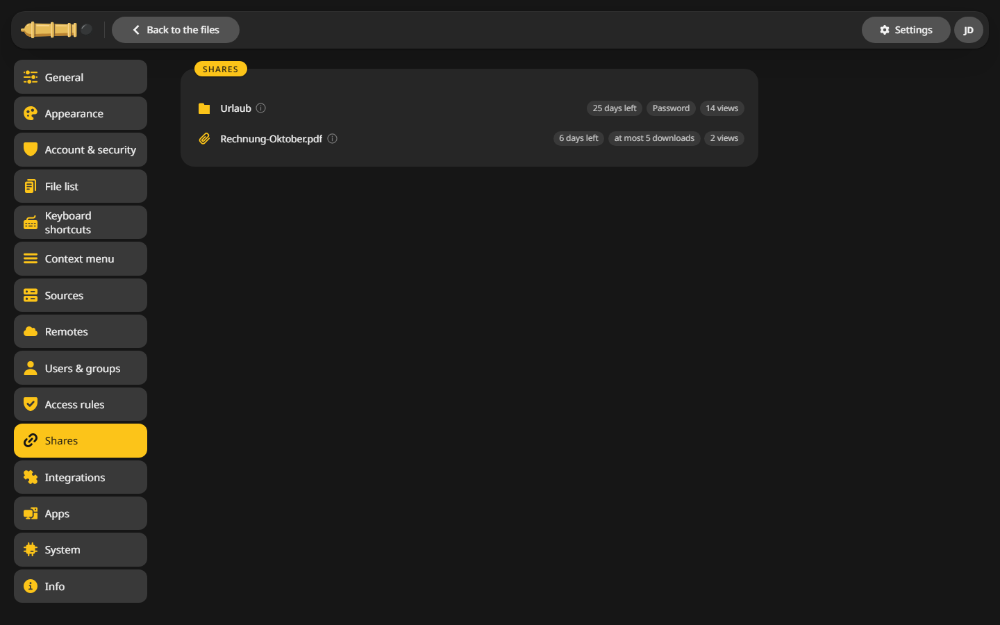

# Share links

Send someone a link to a file or a folder. They open it in their browser without an account.

## Share a file or folder {#share}

1. Put the cursor on the file or folder.
2. Choose **File > Share**, or **Share** in the context menu.
3. Set what you need:
    - **Address**: write the end yourself, such as `holiday-2026`, or roll a new one with the dice.
    - **Message to visitors**: a greeting shown above the files.
    - **Valid**: 1 day, 7 days, 30 days or no end.
    - **Download limit**: after this many downloads the link stops working.
    - **With a password**: asked before the files show.
    - **Note when opened**: you get a note here and in Unraid when someone opens it.
    - **Allow uploads** (folders only): visitors can put files in, but not see or delete what is there.
4. Click **Create link** and copy it, or show its QR code.

## Share files from several folders {#collection}

1. Mark files, in as many folders or search results as you like, and pick **Into the collection** in the context menu.
2. Choose **File > Collection** to see what is in it.
3. **Share together** makes one link. The visitor sees one folder with all the files side by side. The files stay where they are.

## Manage your links {#manage}

**Go > Shares** or **Settings > Shares** lists every link with its views, expiry and limits. Copy, extend or revoke a link there.

Share links point to the address CannonCommander is reached at. Behind a reverse proxy, set `externalUrl`, see [Reverse proxy](../configuration/reverse-proxy.md).

The desktop app has no share links, since they would point at your own computer.
