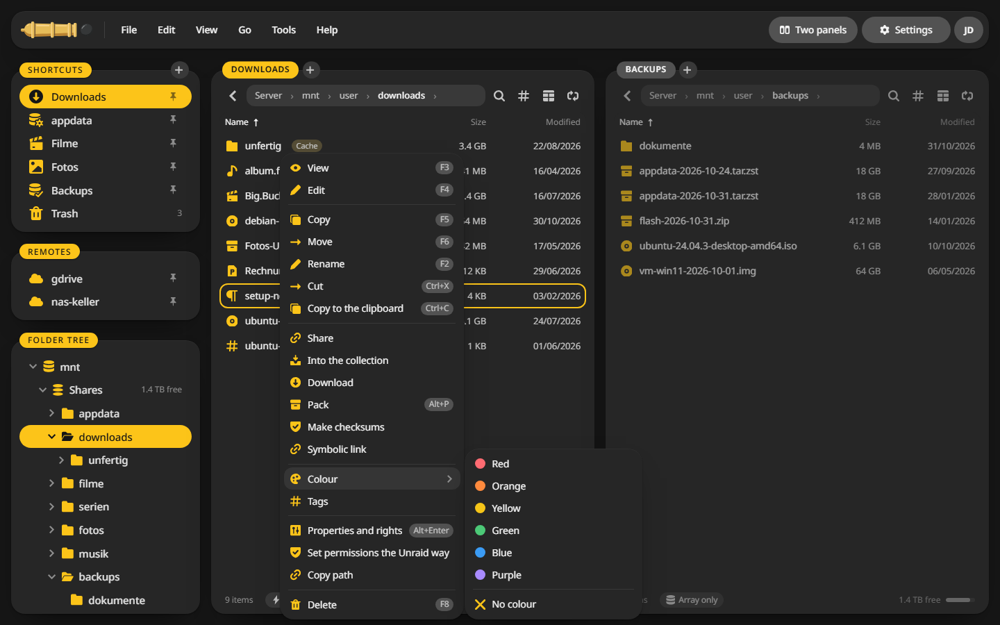
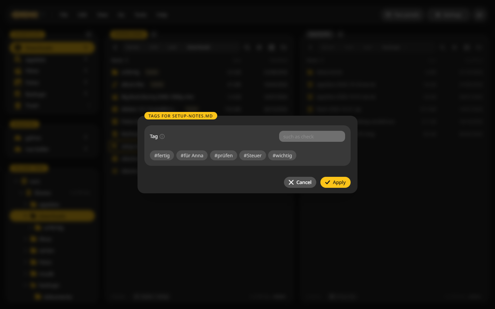

# Tags and colours

Mark files with a colour or tags, see them at a glance in the list and find them again with the search.

## Give a file a colour {#colour}

1. Right click the file, or mark several first.
2. Point at **Colour** and pick one.

The colour shows as a dot next to the name. **No colour** takes it away.

## Add tags {#tags}

1. Right click the file and choose **Tags**.
2. Click a grey tag to set it, or type a new one and press ++enter++.
3. The x on a tag takes it away. Click **Apply**.

Tags show as `#name` badges in the list.

## Find tagged files {#find}

The **#** button in a panel's toolbar lists every colour and tag with how many files carry it. Pick one and the panel shows all of them across the shares.

You can also type `#` and the tag into the search field of a panel, such as `#Steuer`. See [Search](search.md#fields).

## Your own colours and tags {#edit}

In the same list, the pencil next to **Colours** renames the six colours and adds new shades, and the pencil next to **Tags** manages the list of tags.
