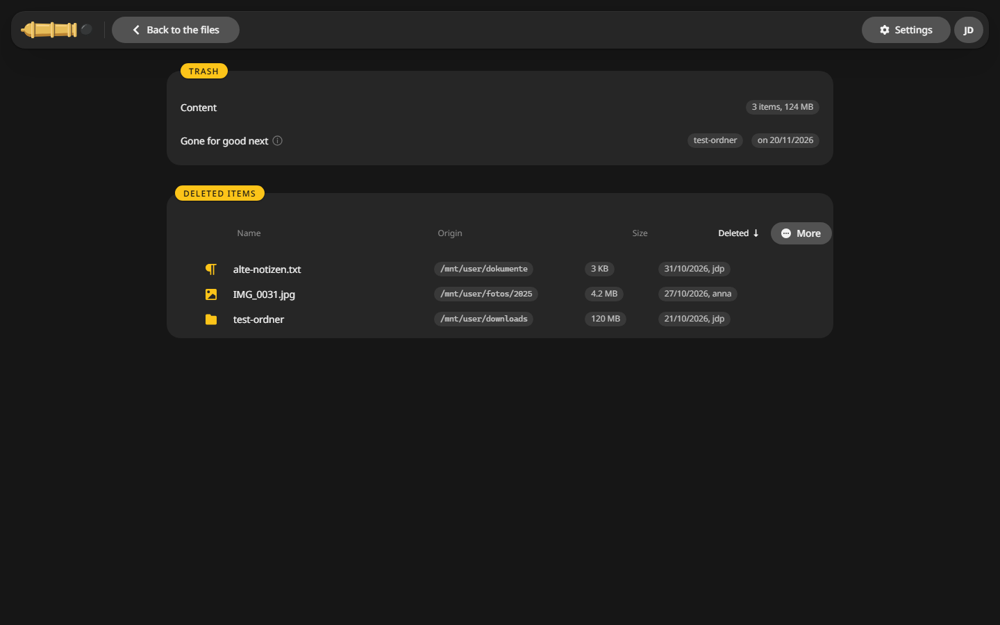
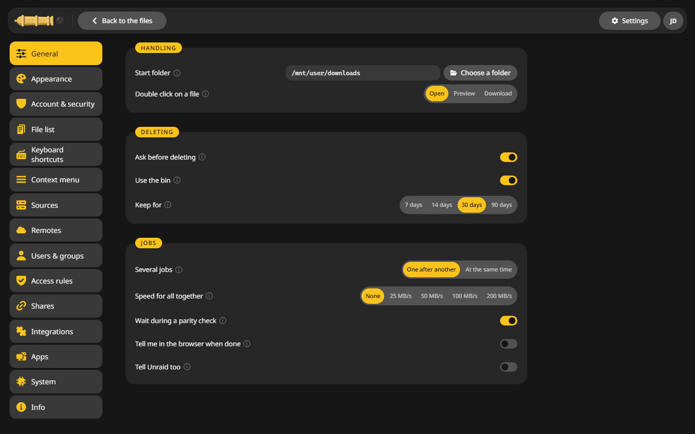

# Trash and undo

Deleted files go to a trash on the same share first, so a wrong ++f8++ costs nothing.

## Delete {#delete}

1. Mark the files.
2. Press ++f8++ or ++del++.
3. Leave **Into the trash** on and confirm.

With the switch off the files are gone at once. **File > Delete for good** does the same without asking about the trash.

## Get a file back {#restore}

1. Choose **Go > Trash**, or click **Trash** in the sidebar.
2. Find the file. The list shows where it came from, who deleted it and when.
3. Click **Restore**. It goes back to its old place.

Mark several and use **Restore selection**, or **Empty the trash** to free the space.

## How long things stay {#keep}

Everything in the trash is removed for good after 30 days. Change that under **Settings > General > Deleting**, to 7, 14 or 90 days. **Ask before deleting** and **Use the bin** live there too.

In the desktop app CannonCommander uses the system's trash instead, the Recycle Bin on Windows.

## Undo {#undo}

++ctrl+z++ takes back the last rename, new folder, copy, move or delete. **Edit > Recent actions** lists the last ones, so you can pick an older one.
