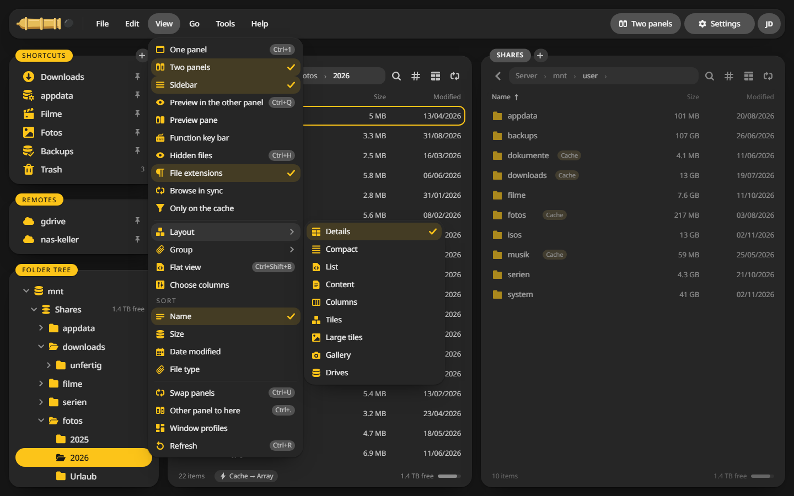
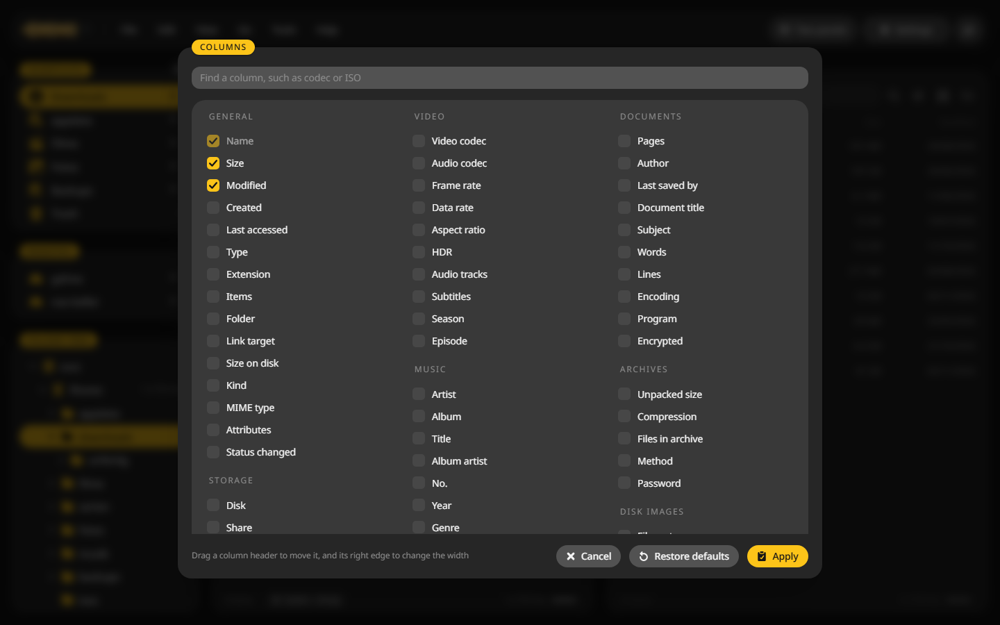

# Views and columns

Each folder can have its own view, and CannonCommander remembers it.

## Pick a view {#layout}

1. Open the folder.
2. Choose **View > Layout** and one of the nine views, or press ++ctrl+shift+v++ to step through them.

| View | Good for |
|---|---|
| Details | Everything at a glance, with the columns you choose |
| Compact and List | Many files in little room |
| Content | Files with a line of what is inside |
| Columns | Deep folder trees, one column per level |
| Tiles and Large tiles | Photos and videos with thumbnails |
| Gallery | One big picture and a strip of the rest |
| Drives | Disks and pools with their fill level |

A folder of photos in large tiles, in one wide panel (++ctrl+1++):

## Choose columns {#columns}

The details view has 89 columns to choose from: the usual name, size and dates, and also Unraid's disk and share, permissions, video codec and length, artist and album, camera and lens, page count, checksums and more.

1. Choose **View > Choose columns**.
2. Tick the columns you want and click **Apply**.
3. Drag a column header in the list to move it, and its right edge to change its width.

## Group, sort and flat view {#group}

- **View > Group** puts the files in groups by kind, date or size.
- **View > Sort** sorts by name, size, date or type. A click on a column header does the same.
- **View > Flat view** (++ctrl+shift+b++) shows the files of all subfolders in one list.
- **View > Only on the cache** shows only what still waits on Unraid's cache.

## Thumbnails {#thumbnails}

Photos and videos get thumbnails from ffmpeg, made in the background. Switch them off under **Settings > Integrations > Videos and pictures** if the server is short on power.
